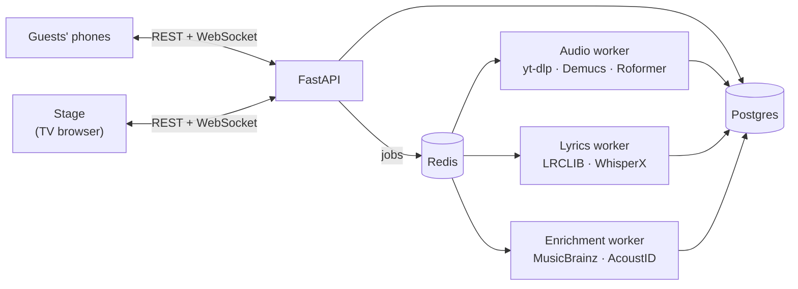

<div align="center">


# Open Karaoke Studio

**Sing any song on YouTube. Run the whole night from everyone's phones.**

[](https://react.dev)
[](https://www.typescriptlang.org)
[](https://fastapi.tiangolo.com)
[](https://pytorch.org)
[](https://docs.celeryq.dev)
[](./LICENSE)

<br />

https://github.com/user-attachments/assets/9fcea62c-0ba1-44da-bb42-eff63d9c4e61

</div>

---

Most songs never got a karaoke version. Open Karaoke Studio makes one from the YouTube video:
it separates the lead vocal, backing vocals and music with machine learning, finds the lyrics,
and times them to the singing word by word. Then it runs the party: one screen is the stage,
and guests join from their phones by scanning a QR code. There's nothing for them to install.

It's self-hosted, and built for a living room of 5–10 people, not a stadium.

## A night with it

- **Add a song from your phone.** Search, tap, and it's ready to sing in a few minutes.
- **Everyone gets a turn.** The rotation keeps track of who's up, so nobody sings five in a row.
- **Pick songs from the couch.** The stage has a song wheel you can turn with a remote or a mouse.
- **Words light up as you sing them,** after a 3-2-1 count-in.
- **Your phone is your mixer.** Turn the original singer and the backup singers up or down while
  you sing, or move the lyrics earlier or later.
- **Hear the singer in your headphones** while the room hears only the music.
- **Fix a wrong line on the spot.** Edit it on the stage and it stays fixed for next time.
- **Themes:** Cyberpunk, Retro, Vintage and Catppuccin.

There's also an Android TV app ([`tv-app/`](tv-app/)) that runs the stage full screen on an
NVIDIA Shield, driven by its remote.

## How it works



- **Three separate tracks.** Demucs splits the voice from the music, then a Roformer model splits
  the lead vocal from the backing vocals. Each fader on a guest's phone controls one of these.
  The browser mixes them live with the Web Audio API, with each song's loudness evened out.
- **Lyrics timed to the singing.** Synced lyrics come from LRCLIB and other sources. WhisperX
  then lines up each word against the isolated vocal track. If no lyrics can be found, it
  writes them out from the recording.
- **One session, many screens.** Every device in a session shares one WebSocket channel, and
  everything about the session is stored by session, so the stage and every phone stay in step.
  A refresh doesn't end the night.
- **Nothing slow happens in a request.** Downloading, separation and lyric timing run as Celery
  jobs on their own workers, and their progress streams to the app.

The [architecture overview](docs/architecture.md) covers each part in depth, with diagrams.

## Run it

You need Docker. A GPU is optional, but it makes processing much faster.

```bash
git clone https://github.com/spencerfrost/open-karaoke-studio.git
cd open-karaoke-studio
cp .env.example .env    # set the secrets, the first admin, and CORS_ORIGINS
docker compose up -d
```

Open `http://<server-ip>:5192` and sign in under **Hosting tonight? Sign in**.

The [self-hosting guide](docs/self-hosting.md) covers what to put in `.env`, using an NVIDIA GPU,
ports, backups and updating.

## Develop

FastAPI and Celery on Python 3.13, and React 19 with TypeScript, Vite and Tailwind CSS v4.
[Contributing](docs/contributing.md) covers local setup, tests and checks.

## Documentation

The [docs](docs/) are a VitePress site:

- **[Features](docs/features.md)**: everything a guest, host and admin can do
- **[Architecture](docs/architecture.md)** and one doc per area: ingestion, song library, lyrics,
  sessions, the player and stage, and the platform
- **[API](docs/api-reference.md)** and **[WebSocket protocol](docs/websocket-protocol.md)** references
- **[Tech debt](docs/tech-debt.md)** and **[Roadmap](docs/roadmap.md)**

## License

MIT. See [LICENSE](./LICENSE).
