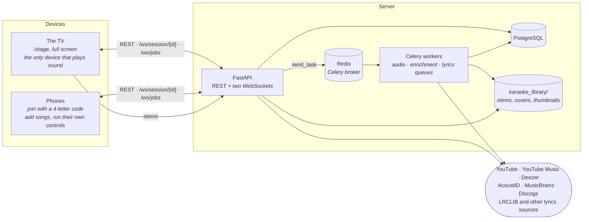

# Architecture

Open Karaoke Studio is a self-hosted karaoke app for a small gathering (5–10 people): one TV that
plays the music, a phone for each singer, and a server that turns YouTube videos into karaoke
tracks. This page is the map. How each part works is in its domain doc.

## The big picture

Three things shape everything else:

1. **The TV makes all the sound.** The browser on the TV downloads a song's stems (instrumental,
   lead vocals, backing vocals) and mixes them with the Web Audio API. Every other screen is a
   remote control.
2. **The API process and the Celery workers share no memory.** Workers write progress to the
   `jobs` table, and browsers learn about it by asking the API, which reads that table.
3. **Everything that happens during a night belongs to one session**, and nothing about one
   session can reach another.

## Domain docs

Each of these covers one slice end to end, backend and frontend, with diagrams, known debt and
dead code.

| Doc | Covers |
|---|---|
| [Ingestion & Processing Pipeline](domains/ingestion-pipeline.md) | YouTube search and download, source separation, the Celery queues, job progress |
| [Song & Library Metadata](domains/song-library.md) | Titles, artists and credits, albums and covers, AcoustID and MusicBrainz, browsing and search, the admin data-quality pages |
| [Lyrics System](domains/lyrics-system.md) | Plain, synced and word-synced lyrics, alignment, reports and feedback, the lyrics display |
| [Sessions, Queue & Realtime](domains/sessions-realtime.md) | Session lifecycle, joining, the roster and rotation, both WebSockets |
| [Player, Stage & Performance](domains/player-stage.md) | The stage screens, the audio engine, the phone controls, the song wheel, the guided tour |
| [Platform Foundations](domains/platform-foundations.md) | Routes and access gates, accounts and the JWT, the demo, settings, the API clients |

Reference pages sit beside them: the [API reference](api-reference.md), the
[WebSocket protocol](websocket-protocol.md), [Tech debt](tech-debt.md) and
[Demo accounts](demo-accounts.md).

## Tech stack

| Layer | Tools |
|---|---|
| Frontend | React 19, TypeScript, Vite, Tailwind CSS v4, shadcn/ui, TanStack Query (server state), Zustand (client state), React Router |
| Backend | FastAPI on Uvicorn, SQLAlchemy 2.0, Alembic, Pydantic, slowapi (rate limits) |
| Background work | Celery with a Redis broker |
| Database | PostgreSQL (`DATABASE_URL` is required; the backend tests use a throwaway SQLite file) |
| Audio | yt-dlp, Demucs and Roformer models (audio-separator) for separation, ffmpeg `loudnorm` for loudness, librosa for vocal range |
| Lyrics | WhisperX / faster-whisper for alignment and transcription |
| Deployment | Docker Compose: `postgres`, `redis`, `api`, `celery`, and `frontend` (nginx serving the build and proxying `/api`) |

## Rules that cut across every slice

**Session isolation.** All session state (player state, performance controls, presence, the
queue) is keyed by `session_id`. There are no global dictionaries of session state. WebSocket
broadcasts go to the room `session_{session_id}`, and queue, roster and playback rows carry a
`session_id` foreign key. On the REST side, `ensure_session_access` admits only a member device
of that session, the account that hosts it, or an admin.

**Two WebSockets.** `/ws/session/{session_id}` carries one session's player state, performance
controls, presence and "something changed" notices. `/ws/jobs` is shared by every session and
carries the in-flight processing jobs, each tagged with an opaque `owner_tag` instead of the join
code. Both make the first message `authenticate`. Changes themselves go through REST; the socket
tells everyone to look. Details:
[Sessions, Queue & Realtime § The two WebSockets](domains/sessions-realtime.md#the-two-websockets).

**Who may do what.** Three kinds of caller: a guest phone (a session device, from joining with
the code), an account (a host runs nights, an admin also maintains the library), and the demo
pool. The frontend's gates decide what's shown; the backend's dependency ladder decides what's
allowed. Details:
[Platform Foundations § Who gets in](domains/platform-foundations.md#who-gets-in-two-layers-of-gate)
and [Authentication](api/authentication.md).

**Layers.** Backend: `api/` (routes) → `services/` (logic) → `repositories/` (queries) →
`db/models/`. Celery tasks live in `jobs/` and call the same services. Frontend code is grouped
by feature under `features/`, with shared stores in `stores/` and API hooks in `hooks/api/`.

## Where the tables live

| Tables | Doc |
|---|---|
| `songs`, `artists`, `artist_aliases`, `song_artists`, `albums` | [Song & Library Metadata](domains/song-library.md#the-data-model) |
| Lyrics columns on `songs`, `lyrics_reports`, `lyrics_feedback` | [Lyrics System](domains/lyrics-system.md) |
| `jobs`, `batch_runs` | [Ingestion Pipeline](domains/ingestion-pipeline.md), [Admin API](api/admin.md) |
| `karaoke_sessions`, `session_devices`, `session_performers`, `karaoke_queue`, `session_playback_states` | [Sessions, Queue & Realtime](domains/sessions-realtime.md#the-data-model) |
| `performance_history` | [Player, Stage & Performance](domains/player-stage.md#performance-history) |
| `users`, `host_settings` | [Platform Foundations](domains/platform-foundations.md#accounts-and-the-jwt) |

## Design decisions

- **Separation in Celery, not in the request.** Downloading and separating a song takes minutes
  on a GPU. Celery keeps that work out of the API process, survives API restarts, and lets jobs be
  cancelled and retried. The cost is a Redis broker and workers that don't hot-reload. Only one
  separation runs at a time so two never share the GPU: in development the `audio` queue has its
  own single-slot worker, and in Docker one single-slot worker takes all three queues.
- **Mixing in the browser.** The backend stores stems; the TV mixes them. Faders, the song-change
  fade and loudness normalization all happen in Web Audio with no round trip, so a fader moved on
  a phone is heard as soon as the TV gets the message.
- **REST for changes, sockets for notices.** Every queue, roster and session change is a REST call
  that is authorized and tested like any other, and the socket only rings the doorbell. The
  player's own state (play, pause, position, the mix) is the exception and travels over the
  session socket.
- **Polling job progress.** Workers can't reach the API's sockets, so the browser asks for the
  job list every 3 seconds while anything is processing. A Redis pub/sub channel would remove the
  poll; at this scale it hasn't been worth it.

## Scale limits

Built for one server and 5–10 people at a time.

- WebSocket rooms and performance state live in the API process's memory. Run two API workers and
  a broadcast only reaches the sockets held by the worker that handled the request. A restart
  resets the performance controls (the playback position is persisted).
- One GPU separation at a time. A second song waits in the `audio` queue, and in Docker,
  enrichment and lyrics jobs wait behind it too.
- External services (YouTube Music, MusicBrainz, AcoustID, Discogs) are called at their own rate
  limits, so library-wide maintenance jobs take a while.
