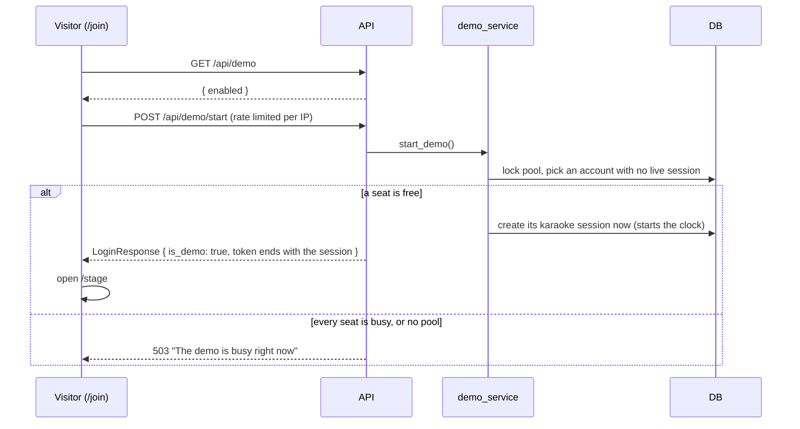

# Demo Accounts

The demo account pool lets a visitor genuinely host a karaoke session from a single button —
search YouTube, download a song, get AI-separated vocals/instrumentals, run a session — without
exposing your homelab to unbounded compute or letting two visitors collide into the same session.

The demo is **on when at least one `is_demo` account exists** and off when there are none.

## How visitors get in

The entry page (`/join`) offers two buttons on a computer:

- **Try it live** calls [`POST /api/demo/start`](/api/demo#start-a-demo-session), signs in to the
  account it returns, and opens the stage with its QR code. It only shows when
  [`GET /api/demo`](/api/demo#get-demo-status) reports `enabled`.
- **Watch the demo** opens a recording at `VITE_DEMO_RECORDING_URL`. It's hidden when that
  variable is unset.

A phone sees **Watch the demo** and a line saying the live demo runs the TV screen, so it needs a
computer. The live demo still uses a phone as the remote: the visitor scans the stage's QR code,
or uses **No phone? Open a phone view** under the join code.



## How it works

- **No published credential.** Behind the button sits a small pool of ordinary host accounts
  flagged `is_demo`. `POST /api/demo/start` picks a *free* one and returns its token in the normal
  login response, with `is_demo: true`. Visitors never see the pool or a password.
- **A session starts immediately.** Sessions are per-account, not per-login, so a shared account
  would mean shared sessions. To prevent that, a demo start eagerly creates the chosen account's
  karaoke session and starts its clock right away. Two simultaneous visitors get two different
  accounts and two isolated sessions.
- **One session per start.** A demo account only ever uses the session `POST /api/demo/start`
  opened for it. Its token expires with that session, at the time left on it. The stage joins that
  session through `POST /api/sessions/my`, but a demo account can't start or replace one: see
  [Guardrails](#guardrails). The only way to a fresh session, and a fresh download allowance, is
  another **Try it live**.
- **The pool can fill up.** If every pool account already has a live session, the start returns a
  `503` ("The demo is busy right now — try again in a few minutes"). Accounts free up
  automatically when their session expires.
- **Starts are rate limited per IP.** `5/hour;12/day`, with slowapi. Every call counts, including
  ones that come back `503`, which leaves room for a few retries. The pool size and the daily
  download budget stay the real ceiling on what the demo can cost.
- **Downloads are quota-limited.** Only new-song downloads cost compute (queuing an existing
  library song is unlimited). Demo sessions are capped per session and the whole pool shares a
  budget per 24 hours. The quotas count the session's download jobs, finished ones included
  (completed download jobs keep their `jobs` row). Failed and cancelled downloads don't count, and
  neither do jobs created before the session that holds the code now, since codes are recycled.

Everything else is the real application — there is no demo watermark or crippled mode. That is the
point.

## Defaults

| Setting | Value | Where |
|---|---|---|
| Pool size | 3 accounts (`demo-pool-1..3`) | you seed these |
| Session length | 15 minutes (`0.25h`) | seeded `HostSettings` |
| Downloads per session | 3 | `DEMO_SESSION_DOWNLOAD_LIMIT` |
| Downloads per 24 hours (whole pool) | 20 | `DEMO_DAILY_DOWNLOAD_LIMIT` |
| Demo token lifetime | What's left of its session | `demo_token_minutes()` |
| Demo starts per IP | 5 per hour, 12 per day | `DEMO_START_RATE_LIMIT` |
| Songs per singer | 5 | seeded `HostSettings` |
| Queue mode | instant | seeded `HostSettings` |

The daily budget is sized so ~10 visitors doing 1–2 songs each fit comfortably. The quota
constants live in `backend/app/services/demo_service.py`; the start rate limit is in
`backend/app/api/demo.py`.

## Configuration

There are no demo environment variables on the API. Seeding pool accounts turns the demo on.

Three deployment settings matter:

- **`VITE_DEMO_RECORDING_URL`** — link for **Watch the demo**. It's a build-time variable: in
  Docker it's passed to the frontend image as a compose build arg, so set it in the root `.env`
  and rebuild the frontend. In development it goes in `frontend/.env`.
- **`VITE_DOCS_URL`** — the public docs site, which the guided tour's "how this works" links point
  to. Build-time, set the same way as the recording link. The links are hidden when it's unset.
- **`FORWARDED_ALLOW_IPS`** — the per-IP start limit needs the visitor's real address, not
  nginx's. See [Client IPs behind the proxy](/guide#client-ips-behind-the-proxy).

```bash
# Root .env (Docker)
VITE_DEMO_RECORDING_URL=https://example.com/demo-video
VITE_DOCS_URL=https://example.com/docs/
```

The pool accounts each have their own private password, set when you seed them. Logging in with it doesn't start a session, and a demo account can't create one, so
**Try it live** is the only way to run a demo session.

## Seeding the pool

Pool accounts are created with the `manage_users` script. The `--demo` flag implies `--host` and
seeds a matching `HostSettings` row (15-minute sessions, instant queue, 5 songs per singer).

```bash
cd backend
source venv/bin/activate

# Create three pool accounts with strong, private passwords
python scripts/manage_users.py create --username demo-pool-1 --password "$(openssl rand -hex 12)" --demo
python scripts/manage_users.py create --username demo-pool-2 --password "$(openssl rand -hex 12)" --demo
python scripts/manage_users.py create --username demo-pool-3 --password "$(openssl rand -hex 12)" --demo

# Confirm — the Host and Demo columns should both read "Yes"
python scripts/manage_users.py list
```

The pool size is however many `is_demo` accounts you seed; three is a sensible default.

::: tip Migration
The `is_demo` / job-attribution columns ship in an Alembic migration. Make sure you've run
`alembic upgrade head` before seeding.
:::

## What a visitor experiences

1. They press **Try it live** and land on the stage of a live, 15-minute session on a free pool
   account.
2. They can browse the library, queue existing songs freely, and download up to 3 new songs into
   their session.
3. On the 4th download they get: *"Demo limit: 3 new songs per session. You can still queue
   anything already in the library."*
4. When the pool's shared daily budget is spent, new downloads return: *"The demo's daily download
   budget is used up — existing library songs still work."*
5. If everyone's busy, the entry page says every seat is taken and a seat frees up when someone's
   15 minutes run out. If their network has started too many demos, it asks them to try again in
   an hour.
6. When the session ends, the stage signs them out and sends them back to `/join`, with *"Your demo
   has ended. Press Try it live to start another."* The stage watches the session's expiry, so
   this happens on time even if nothing else tells it. They never see the create-session screen.
7. A request after their session has ended, a download or a new session, returns: *"Your demo
   session has ended — press Try it live to start a new one."*

## Guardrails

Because demo accounts are real logins, a few actions are blocked so a visitor can't degrade the
pool:

- **Can't change host settings.** Otherwise a visitor could widen their session to 24 hours and
  squat a pool slot all day.
- **Can't modify the account.** No changing the pool account's password or display name.
- **Can't start or replace a session.** `POST /api/sessions` is a `403` for a demo account, and so
  is `POST /api/sessions/my` when the account has no live session or sends
  `on_existing: "replace"`. Otherwise a visitor could keep their seat past 15 minutes, or reset
  their download allowance.
- **Tokens end with the session.** A demo token expires at the session's own expiry, so a saved
  token can't outstay the seat or come back to it after it has gone to someone else.
- **Starts are rate limited per IP**, so one visitor can't hold every seat by pressing the button
  repeatedly.
- **Quota is enforced before anything is created.** The add-song flow creates a library record and
  *then* requests the download; the quota is checked at both steps, so an over-quota visitor never
  leaves an orphaned, track-less song behind.

## Operations & troubleshooting

- **A slot seems stuck.** Sessions expire lazily — a pool account frees up as soon as its
  `expires_at` passes; there is no cleanup job to wait on. If a slot won't free, check the
  account's active `karaoke_sessions` row.
- **Give it more headroom.** Seed more `--demo` accounts (more concurrent visitors) or adjust the
  constants in `backend/app/services/demo_service.py` (per-session / daily download caps).
- **Change session length.** Update the seeded account's `HostSettings.session_duration_hours`
  (it's a float — `0.25` = 15 minutes). The token lifetime follows it.
- **Every visitor shares one rate limit.** The API is seeing nginx's address rather than the
  visitor's. Check `FORWARDED_ALLOW_IPS` against the proxy in front of the API.
- **Turn the demo off.** Delete the pool accounts (`python scripts/manage_users.py delete
  --username demo-pool-1`, and so on). With no `is_demo` account left, `GET /api/demo` reports
  `enabled: false`, **Try it live** disappears, and `POST /api/demo/start` returns `503`.
- **Attribution.** Every job records the `session_id` and `user_id` that started it, which is what
  the quota counts against and is generally useful for debugging who downloaded what. Neither is
  sent to clients.

## Not included

- No CAPTCHA — the per-IP start limit and the quotas already bound worst-case compute. Revisit only
  if abused.
- No demo-mode banner or watermark — it's the real application by design.
