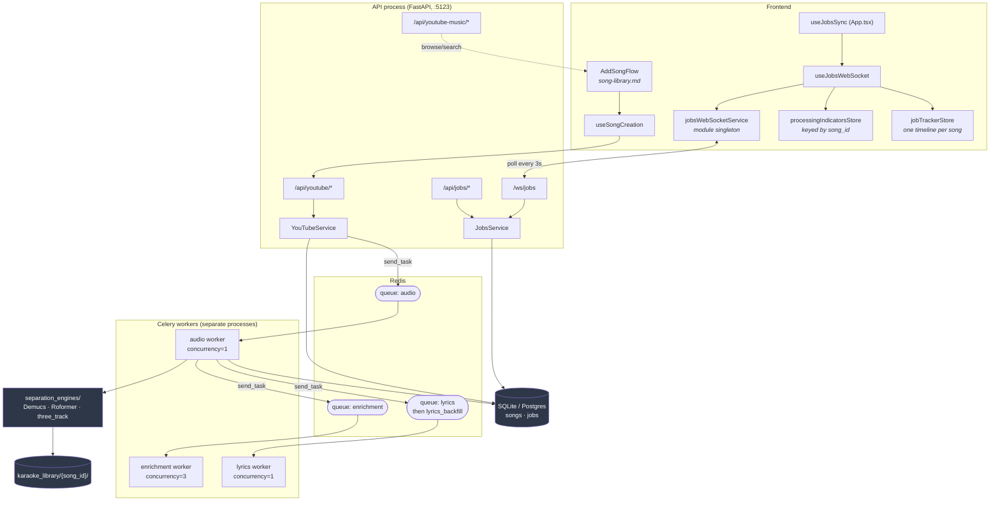
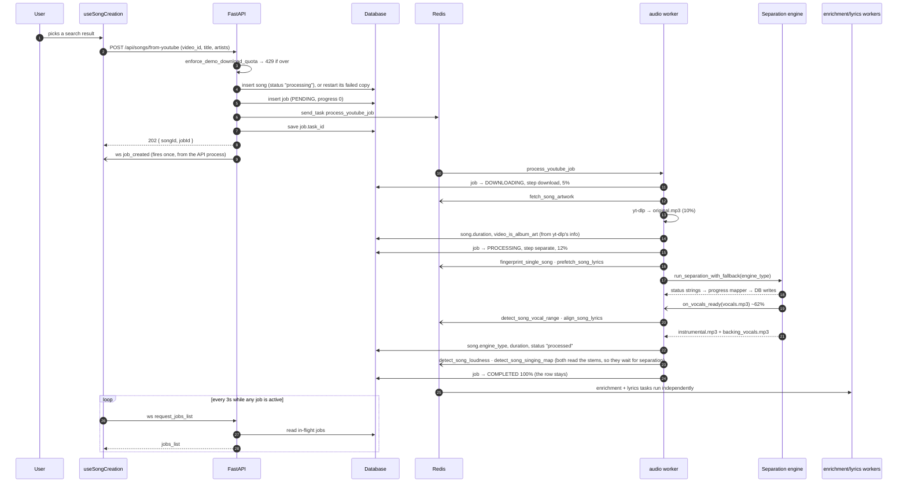
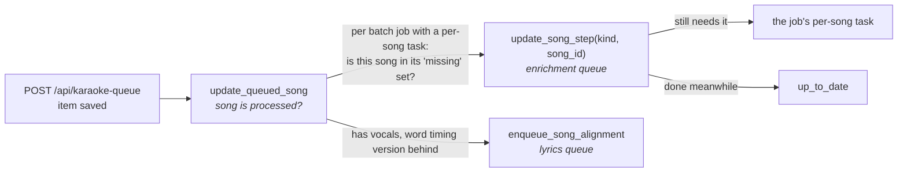
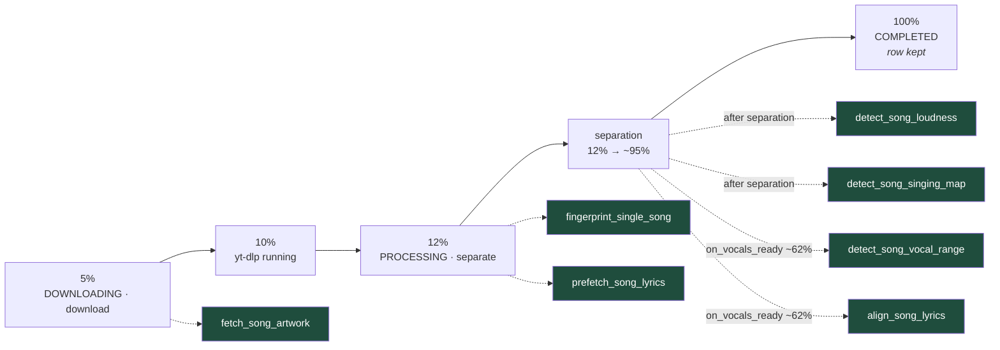
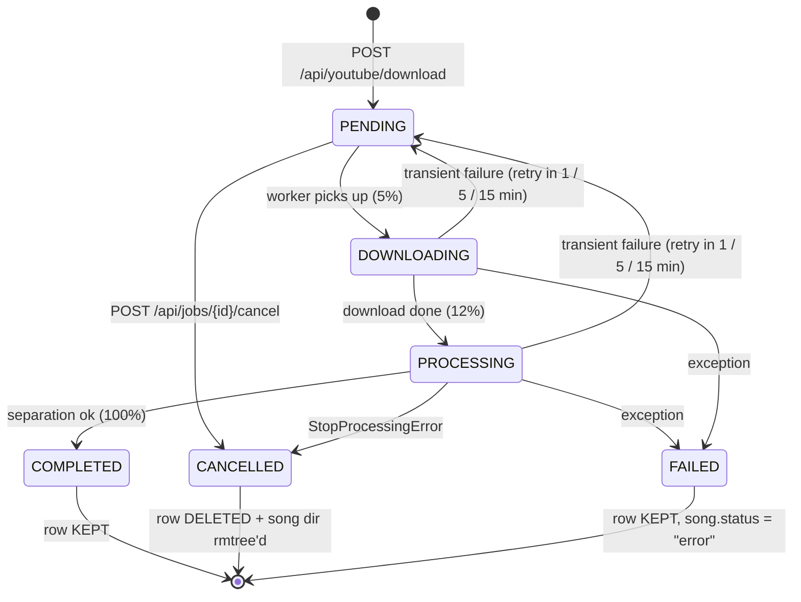
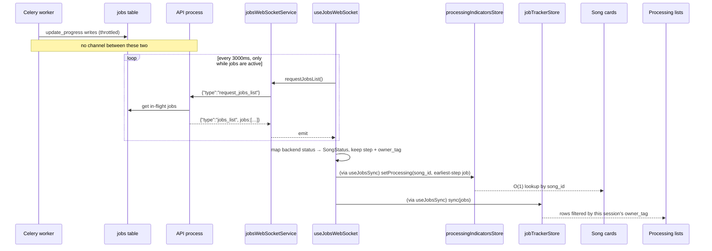

# Ingestion & Processing Pipeline

How a YouTube URL becomes a set of karaoke tracks on disk: search → download → source
separation → enrichment → the progress bar you see in the UI.

## The slice at a glance



The single most important structural fact: **the API process and the Celery workers do not
share memory, and there is no pub/sub between them.** Everything the UI knows about a running
job it learns by polling the API process, which reads the `jobs` table. See
[How progress actually reaches the UI](#how-progress-actually-reaches-the-ui).

## Entry points

| Route | Auth | What it does |
|---|---|---|
| `GET /api/youtube/search` | host **or** session member, 30/min per IP | yt-dlp flat search, returns video candidates with their `library` state |
| `GET /api/youtube/preview/{video_id}` | none (it's an `<audio>` src), 30/min per IP | 302 redirect to a direct audio stream URL — no download |
| `POST /api/songs/from-youtube` | host **or** session member | What the add-song page calls. Checks the demo quota, restarts the song's failed copy if that's the only one, otherwise creates the song row; queues `process_youtube_job`, broadcasts `job_created`, returns `202` with `songId` and `jobId`. `409` when a working copy exists |
| `POST /api/youtube/download` | host **or** session member | Queues `process_youtube_job` for a song row that already exists (`POST /api/songs` first), returns `202` with `jobId` |
| `GET /api/youtube-music/search`, `/suggestions`, `/artist/{id}`, `/artist/{id}/songs`, `/album/{id}/tracks` | host **or** session member, rate limited per IP | `ytmusicapi` browse, in FastAPI's threadpool. Each song carries `library`: ready, processing, or failed (the only copy; adding restarts it), matched by `video_id` or artist + title in two queries per list. `502` when YouTube Music fails |
| `POST /api/songs/{id}/replace-youtube` | admin | Re-ingest an existing song from a different video (same `download_and_process_async` path) |
| `POST /api/songs/{id}/retry` | host or session member | Restart a **failed** song from its own `video_id` (409 for any other status) |
| `POST /api/songs/{id}/replace-upload` | admin | Upload an MP3 for an existing song, queues `process_audio_job` |
| `POST /api/songs/{id}/reprocess` | admin | Re-separate the song's existing `original.mp3` with another engine, queues `process_audio_job` |
| `GET /api/jobs`, `/api/jobs/status`, `/api/jobs/{id}` | admin | Read job state |
| `POST /api/jobs/{id}/cancel` | admin | Revokes the Celery task (`SIGTERM`) and marks the job cancelled |

Files: [api/youtube.py](https://github.com/spencerfrost/open-karaoke-studio/blob/master/backend/app/api/youtube.py),
[api/youtube_music.py](https://github.com/spencerfrost/open-karaoke-studio/blob/master/backend/app/api/youtube_music.py),
[api/jobs.py](https://github.com/spencerfrost/open-karaoke-studio/blob/master/backend/app/api/jobs.py).

::: warning There is no plain "upload a new song" endpoint
`process_audio_job` exists and works, but its only live callers are
`POST /api/songs/{id}/replace-upload` and `POST /api/songs/{id}/reprocess`, which both require a
song that already exists. The frontend
has no upload UI wired to it — see [Dead code](#dead-code-and-known-debt).
:::

## One song's journey



Song row creation (step 4) is covered in [song-library.md](song-library.md); it's shown here
because the row and its job are made in the same request.

## Backend walkthrough

### Queueing (`YouTubeService.download_and_process_async`)

[services/youtube_service.py](https://github.com/spencerfrost/open-karaoke-studio/blob/master/backend/app/services/youtube_service.py) does five things, in
this order, and the order matters:

1. Normalises the input — accepts either a bare video ID or a full URL.
2. Ensures a `songs` row exists, creating a minimal one (`source: "youtube"`) if not.
3. Creates the `jobs` row **before** dispatching to Celery, then re-reads it to confirm the
   write landed. This is deliberate: the worker's first act is `JobRepository.get_by_id`, and a
   task that outruns its own job row is the classic race here (`process_audio_job` still carries
   a three-attempt exponential retry for exactly that reason).
4. `celery.send_task("process_youtube_job", …)`.
5. Writes `task_id` back onto the job so `POST /api/jobs/{id}/cancel` can revoke it.

The API layer then broadcasts `job_created` on `/ws/jobs` — the one and only real server-push
event in this pipeline, because it happens inside the API process.

### Workers and queues

Three workers, started by [celery_workers.sh](https://github.com/spencerfrost/open-karaoke-studio/blob/master/backend/celery_workers.sh) in dev (via `run_celery.sh`) and in the prod
`celery` container alike, consuming queues routed by task name in
[jobs/celery_app.py](https://github.com/spencerfrost/open-karaoke-studio/blob/master/backend/app/jobs/celery_app.py):

| Worker | Concurrency | Queues | Tasks |
|---|---|---|---|
| `audio` | 1 | `audio` | `process_youtube_job`, `process_audio_job` |
| `lyrics` | 1 | `lyrics`, then `lyrics_backfill` | `align_song_lyrics`: a new song's or a person's on `lyrics`, a library run's on `lyrics_backfill` |
| `enrichment` | 3 | `enrichment` | artwork, loudness, singing map, vocal range, album-art video, fingerprint, artist credits, `update_song_step`, all `batch_*`, and — by falling through to the default queue — `prefetch_song_lyrics` |

The split follows one rule: what a song needs before it can be sung (separation, then lyrics)
has a worker to itself, and everything that can finish after the song is playable waits on
`enrichment`. A new song's alignment starts as soon as `vocals.mp3` exists, while separation is
still writing the backing vocals, and never queues behind a slow vocal range check.

Two settings make the lyrics worker's queue order a real priority:

- `queue_order_strategy: "sorted"` (a broker transport option) makes a worker check its queues
  in name order on every fetch, so `lyrics` is always tried before `lyrics_backfill`. Celery's
  default rotates between them.
- `--disable-prefetch` makes a worker fetch only when it has a free slot. Otherwise it would
  hold the next backfill task in reserve, ahead of anything that arrives later.

`audio` and `lyrics` are pinned to `concurrency=1` so at most one separation and one alignment
share the GPU. All workers run `--without-gossip --without-mingle` (single box, and gossip
heartbeats were producing false "missed heartbeat" warnings when a heavy task starved the GIL).
Celery also forces the `spawn` multiprocessing start method, which CUDA requires.

### Catching up when a song is queued

A song processed months ago was processed by older code. Instead of re-running the whole
library after every change, a song catches up when someone queues it to sing.



`update_queued_song` ([song_updates.py](https://github.com/spencerfrost/open-karaoke-studio/blob/master/backend/app/jobs/song_updates.py)) runs after the queue item is
saved. It never fails the request, and it skips a song that isn't `processed`, whose pipeline
is still doing all of this.

**Which steps.** Each batch job in [batch_jobs.py](https://github.com/spencerfrost/open-karaoke-studio/blob/master/backend/app/services/batch_jobs.py) can name a
`song_task`, the Celery task that does the job for one song. A song in the job's `missing` set
(the same filter the library-wide run selects with) gets `update_song_step`, which checks
again when it starts, so a song queued twice in a row is done once.

| Batch job | Per-song task | The song needs it when |
|---|---|---|
| `loudness` | `detect_song_loudness` | its `loudness_version` is behind |
| `singing_map` | `detect_song_singing_map` | its `singing_map_version` is behind |
| `vocal_range` | `detect_song_vocal_range` | its `vocal_range_version` is behind |
| `song_albums` | `fetch_song_artwork` | never looked up, and it has no album cover |
| `album_art_videos` | `detect_song_album_art_video` | `video_is_album_art` is null |
| `fingerprint` | `fingerprint_single_song` | its status is `not_checked` |

Word timing goes through `enqueue_song_alignment` on the `lyrics` queue, which pulls the song
forward if it was waiting in a library run. A song that has lyrics keeps its words and is only
re-timed (`include_remote=False`); a song with none gets the full search.

**Step versions.** [processing_versions.py](https://github.com/spencerfrost/open-karaoke-studio/blob/master/backend/app/services/processing_versions.py) holds one
number per step that can change: `LOUDNESS_VERSION`, `SINGING_MAP_VERSION`,
`VOCAL_RANGE_VERSION` and `WORD_TIMING_VERSION`. A step saves its number on the song
(`songs.<step>_version`) whenever it reaches an answer, and "no range found" or "no lyrics
found" is an answer. A step that couldn't run (no audio, an error, a full GPU) saves nothing.
A song is **behind** when its saved number is empty or lower. Adding 1 to a constant is all it
takes to have every song redo that step: when it's next queued, or in the batch job's
`missing` run.

The stage reloads lyrics when an alignment job finishes, so a re-time of the song that's next
up can land after it has started. The words are the same; their timing shifts mid-song.

### When a worker stops

Native code in the GPU tasks (PyTorch's CUDA library) can segfault, which kills the worker
process outright: no Python exception, no task failure, nothing in the Celery log. The kernel log
(`journalctl -k`) and `coredumpctl` show it. Two things recover from it:

- **The worker restarts.** `celery_workers.sh` runs each worker in its own restart loop, five
  seconds after it exits; Ctrl-C (or the container stopping) stops the loops and the workers
  together. Each loop waits for its worker to exit, so the script runs until the workers are gone.
- **Its jobs fail.** The task a dead worker was running had already left the broker, so nothing
  would ever finish its job row. When a worker starts, a `worker_ready` handler in
  [jobs/celery_app.py](https://github.com/spencerfrost/open-karaoke-studio/blob/master/backend/app/jobs/celery_app.py)
  calls `fail_interrupted_jobs` in
  [utils/cleanup_jobs.py](https://github.com/spencerfrost/open-karaoke-studio/blob/master/backend/app/utils/cleanup_jobs.py)
  for the queues it consumes. It fails started jobs (`downloading`, `processing`) whose step runs
  on those queues: `download` and `separate` on `audio`, `align` on `lyrics` and `lyrics_backfill`. A failed download or
  separation marks the song `error` too; a failed alignment leaves the song playable with the
  lyrics it already had. Pending jobs are left alone, since their messages are still in the broker.
- **Its batch runs carry on.** The same handler calls `resume_interrupted_runs` in
  [jobs/_batch_runs.py](https://github.com/spencerfrost/open-karaoke-studio/blob/master/backend/app/jobs/_batch_runs.py)
  when the worker consumes `enrichment`, where every `batch_*` task runs. Each run that is
  `interrupted`, or still `running` (its task died with the old worker), has its task queued
  again. A run saves the ids it works through (`batch_runs.item_ids`) when it starts, and a
  resumed task skips the first `done + failed` of them. Runs that don't go song by song save no
  ids and start over: lyrics alignment's queueing step, and the artist credits rebuild (one
  transaction, its MusicBrainz lookups cached on disk). A lyrics alignment run already waiting on
  its songs' jobs has nothing to resume and is skipped. This assumes one enrichment worker: a
  second one started alongside would queue the first one's running runs again.

A stop on purpose goes through Celery's warm shutdown, which waits for every running task:
the thread pool can't stop a task part-way. A batch task is one task for the whole library,
so between songs it checks Celery's shutdown flags (`worker_stopping`). Once they are set, it
stops and marks its run `interrupted`, and the wait is one song. The loudness `ffmpeg` starts
in its own session, so a Ctrl-C in the terminal lets the current song finish instead of killing it. A second Ctrl-C makes `celery_workers.sh` kill the workers
outright (`SIGKILL`); that is the same as a crash, and the next start recovers it the same way.
In prod, `docker stop` sends `SIGKILL` after its grace period, with the same result.

A run's row is the only sign its worker died, so reading the admin job lists marks a `running`
run that hasn't reported for 15 minutes `interrupted`. If its worker turns out to be alive, its
next progress write marks it `running` again.

**Pause** uses the same stop between songs, on purpose, to free the GPU (say, for a game).
Pausing a running run marks it `pausing`; before its next song the task sees that (`run.each`
reads the row), marks it `paused`, and gives back the GPU memory it used
(`release_gpu_memory_now` in
[gpu_idle_cleanup.py](https://github.com/spencerfrost/open-karaoke-studio/blob/master/backend/app/services/gpu_idle_cleanup.py)
instead of the 30-minute idle timeout; the CUDA context stays with the worker). A paused run
isn't resumed when a worker starts, and a `pausing` run whose worker restarted is marked
`paused`. **Resume** queues the task again and it carries on from its saved ids. A lyrics
alignment run waiting on its songs pauses by taking the queued ones off the queue, and the
`release_gpu_memory` task on the `lyrics` queue frees the lyrics worker's memory after the song
it's aligning; Resume queues those songs again.

::: tip Operational gotcha
Celery does not hot-reload — restart it after editing anything under `backend/app/jobs/` or the
services it imports.
:::

### Inside `process_youtube_job`

[jobs/audio_tasks.py](https://github.com/spencerfrost/open-karaoke-studio/blob/master/backend/app/jobs/audio_tasks.py). The task is one long function with a
local `update_progress(progress, message, status, step)` closure, and its shape is best understood as
**a short critical path with enrichment tasks flung off it as soon as their inputs exist**:



Solid = the critical path inside the task. Dashed = `send_task` fire-and-forget; the pipeline
never waits for any of them and never learns whether they succeeded.

The `on_vocals_ready` hook is the interesting one. Three-track separation writes `vocals.mp3`
about two thirds of the way through its own run, well before it finishes de-noising the backing
vocals and converting the instrumental. The engine calls back at that moment so lyrics alignment
— the slowest downstream task — starts ~40% of a separation earlier than it otherwise would. Only
the `three_track*` engines pass this callback through
([jobs/separation.py](https://github.com/spencerfrost/open-karaoke-studio/blob/master/backend/app/jobs/separation.py) only forwards `on_vocals_ready` when
`engine_type.startswith("three_track")`); on `demucs` or `roformer`, vocal range and lyrics
alignment are simply never dispatched by this task at all.

### Progress accounting (why the numbers look arbitrary)

Two mechanisms overlap in `create_audio_progress_mapper`
([services/audio.py](https://github.com/spencerfrost/open-karaoke-studio/blob/master/backend/app/services/audio.py)):

- **Demucs-style messages** (`"Separating: Model 1/2 (Overall 45.3%)"`) are scaled into the
  caller's band. `process_youtube_job` passes `base_start=12, base_end=50`, so a pure-Demucs run
  crawls from 12% to 50% and then jumps to 100%.
- **three_track stage markers** (`"Progress: 76% - Loading model: …"`) are used **verbatim,
  ignoring the band**. The default engine therefore progresses 12 → ~95 fairly smoothly.

So the `12..50` band is real but only binds the fallback engines. Writes are also throttled:
the job row is only persisted when progress moves ≥5 points, hits a hardcoded milestone value,
or the status changes.

### Separation engines

Seven engines are registered in
[services/separation_engines/](https://github.com/spencerfrost/open-karaoke-studio/blob/master/backend/app/services/separation_engines/), selected by the
`engine_type` string with `separate_with_demucs` as the fallback for any unrecognised value:

| `engine_type` | Output | Notes |
|---|---|---|
| `three_track` | vocals + backing_vocals + instrumental | **Default.** Demucs `htdemucs_ft` → Roformer karaoke on the vocal stem → de-noise |
| `three_track_duality_v2` | 3 tracks | Same shape, InstVoc Duality V2 for the vocal split |
| `three_track_mel1143` | 3 tracks | Same shape, Mel-Roformer-Viperx-1143 |
| `demucs` | 2 stems | Baseline |
| `roformer` | 2 stems | Single-pass ViperX |
| `hybrid` | 2 stems | Demucs → audio-separator refinement |
| `clean_backing` | multi-pass | Experimental |

`run_separation_with_fallback` wraps the call: if a `three_track*` engine fails, it retries once
with `demucs` and returns the engine that actually produced the output, which is what gets stored
on `song.engine_type`. The exception is CUDA out-of-memory: engines re-raise
`torch.cuda.OutOfMemoryError` instead of returning `False`, so it skips the demucs fallback (which
would hit the same full GPU) and reaches the task.

**Transient failures retry.** In both `process_youtube_job` and `process_audio_job`, a failure that
`is_transient_processing_error` ([jobs/exceptions.py](https://github.com/spencerfrost/open-karaoke-studio/blob/master/backend/app/jobs/exceptions.py))
recognises — GPU out of memory (`is_cuda_out_of_memory`, shared with lyrics alignment), or a network-level download error (DNS, timeouts, resets, HTTP
5xx) — parks the job as `PENDING` with a "trying again in N min" message and calls `self.retry`
after 1, 5, then 15 minutes. The song stays `processing` throughout. A retry reuses the
already-downloaded `original.mp3`; first attempts always download. Only once retries run out does
the song become `error`, with the real cause in `error_message`. The whole call is bracketed by
`begin_gpu_activity` / `end_gpu_activity` ([services/gpu_idle_cleanup.py](https://github.com/spencerfrost/open-karaoke-studio/blob/master/backend/app/services/gpu_idle_cleanup.py)),
a refcount + generation-counter guard that releases VRAM (`gc.collect`, `empty_cache`,
`ipc_collect`) after `GPU_IDLE_CLEANUP_SECONDS` (default 30 min) of no GPU work.

**How full the card gets.** Separation and each lyrics run are wrapped in `track_gpu_memory`
([services/gpu_memory.py](https://github.com/spencerfrost/open-karaoke-studio/blob/master/backend/app/services/gpu_memory.py)), which reads the whole card's used
memory through NVML every half second (no CUDA context needed) and logs one line when the task
ends:

```
[GPU] separation for song …: card peaked at 7400 of 12288 MiB (2900 MiB at start, 4888 MiB free at the tightest) over 25.8s; torch peak in this process 3100 MiB
```

The card numbers include every other process on it (the other worker, dev's workers, the
desktop), which is what decides whether the next allocation fits. The torch number is this
process's own peak, and misses faster-whisper's models. Under 1 GiB free at the tightest moment
logs as a warning.

In practice new songs never pick an engine: `POST /api/songs/from-youtube` sends none, so
`download_and_process_async` uses its `"three_track"` default. The other six are reachable only
through the admin reprocess and replace panels and the benchmark scripts.

**Steps.** Alongside `status`, each job has a `step` column (`JobStep`: `download`, `separate`,
`align`). The job row is created on the step it will start with (`download` for a YouTube job,
`separate` for a reprocess or an upload), so a pending job already says what it's waiting for.
The worker moves it on at 5% and 12%. The lyrics alignment job (`engine_type =
"lyrics_alignment"`) is always on `align`.

### Terminal states



Completed and failed download/separation jobs keep their row; a cancelled job **deletes its own
row** right after writing its terminal status. The completed rows are what the demo download
quotas count (see [Demo Accounts](../demo-accounts.md)). The lyrics alignment job is different:
it deletes its row whenever it finishes, success or not. `/ws/jobs` lists only in-flight jobs
(`pending`, `downloading`, `processing`), so to the frontend a finished job still looks like a job
*disappearing* from the feed, and that's how it infers success rather than from a status value.
Cancellation also `rmtree`s the song directory and sets `song.status = "error"` — a cancelled
song is left as a broken library row, not removed.

## Where files land

```
karaoke_library/{song_id}/
├── original.mp3          # yt-dlp, FFmpegExtractAudio @ 320kbps
├── original.info.json    # writeinfojson — raw yt-dlp metadata
├── vocals.mp3            # lead vocals
├── backing_vocals.mp3    # three_track engines only
├── instrumental.mp3      # the karaoke track
└── thumbnail.jpg         # fetched by fetch_song_artwork when no album cover is found
```

Path construction goes through
[services/file_management.py](https://github.com/spencerfrost/open-karaoke-studio/blob/master/backend/app/services/file_management.py) (module-level
`get_*_path_stem` helpers) and [services/file_service.py](https://github.com/spencerfrost/open-karaoke-studio/blob/master/backend/app/services/file_service.py)
(`FileService`, instance methods over `BASE_LIBRARY_DIR`). The two overlap almost entirely and
disagree on default extension (`FileService.get_vocals_path` defaults to `.wav`; everything
actually written is `.mp3`), and `file_management.get_thumbnail_path` carries a "consider using
`FileService.get_thumbnail_path()`" note pointing at a method that doesn't exist. Prefer
`FileService` in new code.

Search and download configure yt-dlp with `player_client: ["android", "web"]`,
`player_skip: ["js"]`, and optional cookie support (`_cookie_opts` writes a temp cookie file and
deletes it in a `finally`). Those are age-gate / bot-check workarounds and the first thing to check
when downloads start failing en masse. The preview route leaves yt-dlp's default clients alone.

::: warning Downloads may be lower quality than they look
With those two clients forced, current yt-dlp no longer gets YouTube's audio-only formats.
`bestaudio/best` then falls back to format 18, a 360p mp4 with ~96 kbps AAC, and that is what gets
re-encoded to a 320 kbps `original.mp3`. yt-dlp's default clients still get the audio-only
formats. The download runs in Celery, so changing this needs a worker restart.
:::

## How progress actually reaches the UI

This is the part most likely to surprise you, and it's worth stating bluntly:
**there is no live progress push.** The relevant code is a documented no-op:

> `jobs/_events.py::broadcast_job_event` — *"Intentionally a no-op. This runs in the Celery
> worker process, which has no WebSocket connections of its own … and there is no cross-process
> broadcast mechanism (no Redis pub/sub) between them."*

What happens instead:



The pieces:

- **[services/jobsWebSocketService.ts](https://github.com/spencerfrost/open-karaoke-studio/blob/master/frontend/src/services/jobsWebSocketService.ts)** — a
  module-level singleton over `/ws/jobs` (via the Vite proxy in dev). It opens the socket once the
  browser holds an account token or a session device, sends `authenticate` with them first, and
  reopens when they change. A refused `authenticate` closes with 1008 and isn't retried; any other
  drop reconnects with exponential backoff capped at 30s. It's an event emitter over the socket,
  not a store.
- **[hooks/api/useJobsWebSocket.ts](https://github.com/spencerfrost/open-karaoke-studio/blob/master/frontend/src/hooks/api/useJobsWebSocket.ts)** — holds the
  job list in React state, maps backend statuses to `SongStatus`
  (`pending`→`queued`, `downloading`/`processing`→`processing`, `completed`→`processed`,
  `failed`/`cancelled`→`error`), runs the 3s poll while anything is active, and invalidates the
  `["songs"]` React Query caches on completion. Because the feed only carries in-flight jobs,
  completion is detected in `handleJobsList` by diffing the previous list against the new one.
  Finished jobs linger in the UI for 3 seconds before being dropped.
- **[hooks/useJobsSync.ts](https://github.com/spencerfrost/open-karaoke-studio/blob/master/frontend/src/hooks/useJobsSync.ts)** — called exactly once, in
  `App.tsx`. Jobs arrive keyed by `job_id`; it feeds the two stores below. A song can have two jobs
  at once, because lyrics alignment runs as its own job and starts while separation is still going.
- **[stores/processingIndicatorsStore.ts](https://github.com/spencerfrost/open-karaoke-studio/blob/master/frontend/src/stores/processingIndicatorsStore.ts)** —
  a Zustand `Map<song_id, SongProcessingStatus>`, so a song card can ask "am I processing?" in
  O(1). It gets the song's earliest-step job, the one that decides whether the song can play yet.
  The card's label comes from `step` ("Taking out the vocals 42%").
- **[stores/jobTrackerStore.ts](https://github.com/spencerfrost/open-karaoke-studio/blob/master/frontend/src/stores/jobTrackerStore.ts)** —
  every song in the feed, everyone's, folded into one timeline per song by
  [jobTimeline.ts](https://github.com/spencerfrost/open-karaoke-studio/blob/master/frontend/src/features/songs/processing/jobTimeline.ts).
  Each entry keeps the `owner_tag` it first saw from the song's main job (the alignment job has
  none of its own). `useJobTracker` turns it into rows for one session: songs still in the
  pipeline in queue order, plus this session's finished songs first. A finished song stays until
  it's queued, dismissed, or 15 minutes pass (`FINISHED_TTL_MS`). The
  stage's processing list and the inline tracker on add-song results
  (`SongProcessingTracker`) both read it.

**What a job says about itself.** Each job carries `step` (`download`, `separate` or `align`,
and while pending, the step it's waiting for) and `owner_tag`, an opaque HMAC of its session ID.
It never carries the session ID itself, which is the join code, or the user. The wire format is in
[Jobs API § Job Fields](../api/jobs.md#job-fields).

Consequences worth internalising: progress is up to 3 seconds stale; nothing updates while no
job is active (the poll is gated on `hasActiveJobs`); and a job that fails between two polls
still surfaces, because its row is kept with the error.

## Dead code and known debt

- **[services/uploadService.ts](https://github.com/spencerfrost/open-karaoke-studio/blob/master/frontend/src/services/uploadService.ts) is entirely
  unreferenced.** Nothing imports `useUploadAndProcessAudio`, `useProcessYouTubeVideo`,
  `useCancelProcessing`, or `useDismissJob`. Two of the endpoints it calls **do not exist** on the
  backend: `POST /api/process-youtube` and `POST /api/jobs/{id}/dismiss`. Treat the whole file as
  stale; don't use it as a reference for how uploads work.
- **`jobs/jobs.py` is a compatibility shim.** It re-exports everything from the split task
  modules and keeps duplicate copies of `select_and_run_separation_engine` /
  `run_separation_with_fallback` that shadow the real ones in `jobs/separation.py`. The live code
  path uses `jobs/separation.py`; the copies exist for older imports and tests. Editing one and
  not the other is an easy trap.
- **Enrichment failures are invisible.** Every `send_task` is fire-and-forget with no result
  check; the pipeline reports `COMPLETED` whether or not artwork, fingerprinting, or lyrics
  alignment ever ran.
- **Cancelled ≠ removed.** Cancellation deletes the audio directory but leaves the song row with
  `status = "error"`, so the library keeps a dud entry. Failed rows are at least out of the way:
  the songbook endpoints (`GET /api/songs`, `/search`, `/artists`, `/shows`, `/by-artist`,
  `/by-show`) filter them out via `in_songbook()`, adding the song again restarts the row, and
  admins see them in Library Audit.

## Cross-references

- **`/ws/jobs` authentication and the two-endpoint WebSocket design** —
  [sessions-realtime.md](sessions-realtime.md#the-two-websockets) and
  [WebSocket Protocol](../websocket-protocol.md).
- **Song row creation, metadata enrichment, AcoustID/MusicBrainz/album lookup, and the search UI that
  feeds this pipeline** — [song-library.md](song-library.md).
- **`align_song_lyrics`, `prefetch_song_lyrics`, and everything downstream of `vocals.mp3`** —
  [lyrics-system.md](lyrics-system.md).
- **The stage's processing list and Sing this** — [player-stage.md](player-stage.md#song-select-the-wheel).
- **Demo download quotas** (`enforce_demo_download_quota`, the `429` on
  `POST /api/songs/from-youtube` and `POST /api/youtube/download`) —
  [Demo Accounts](../demo-accounts.md).
