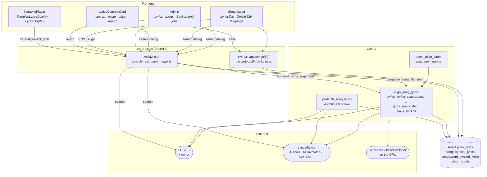
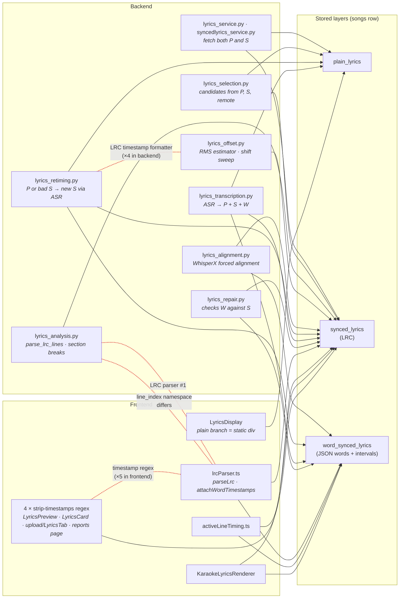
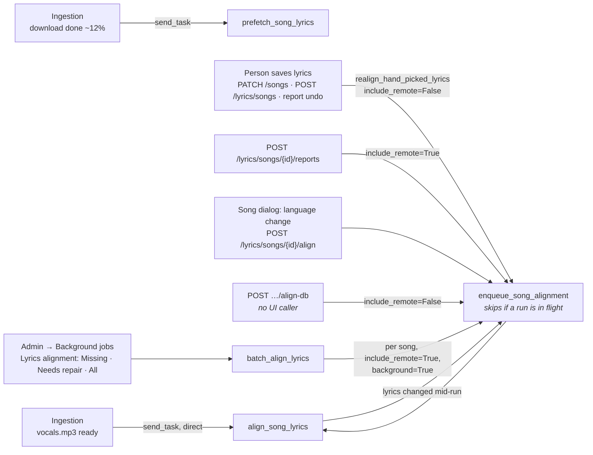
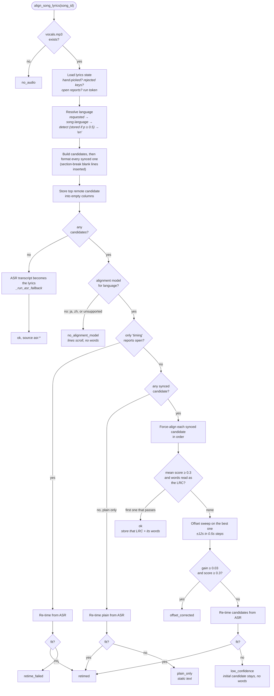
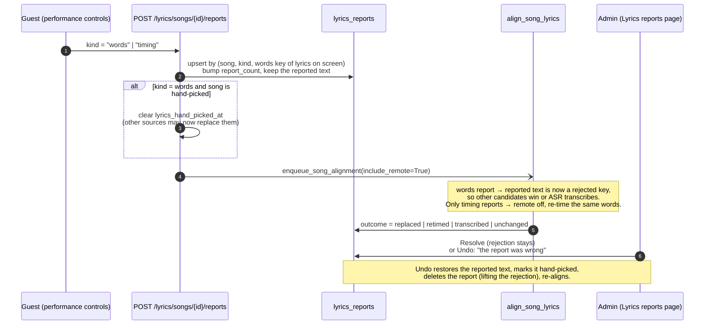
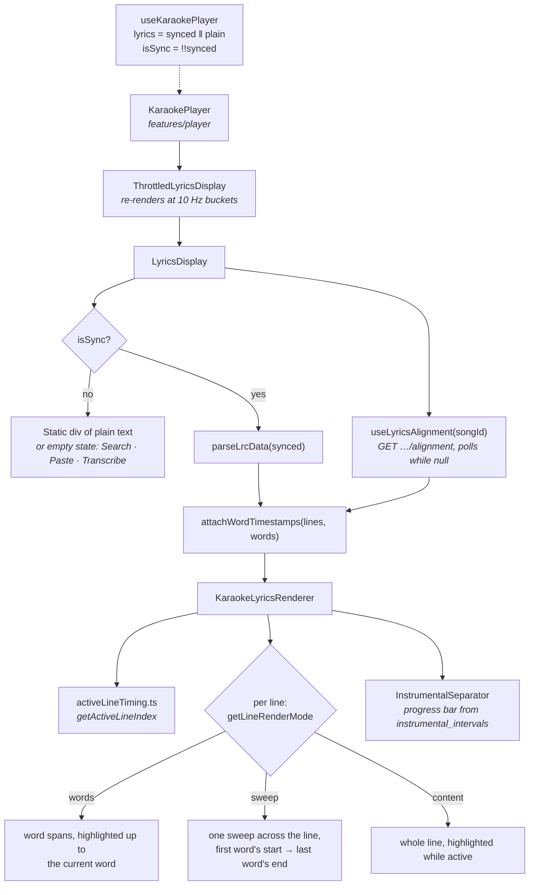

# Lyrics System

How a song gets its words, how those words get timed to the singing, and how the player turns
the result into a highlighted line or a highlighted word.

## The slice at a glance



Lyrics reach the player through two separate reads. The song object (from the songs API or the
queue payload) carries `plainLyrics` and `syncedLyrics`. The word timings are a separate query,
`GET /api/lyrics/songs/{id}/alignment`, cached under its own React Query key.

## Three layers, one row

Everything lives on the `songs` row
([song.py](https://github.com/spencerfrost/open-karaoke-studio/blob/master/backend/app/db/models/song.py)), as three independent nullable `Text` columns
plus some bookkeeping. Nothing in the schema ties the layers together. No column says which one is
authoritative, and no versioning table exists. Only the code paths described below keep them
consistent.

| Column | Holds | Written by |
|---|---|---|
| `plain_lyrics` | Untimed text, one line per line | Provider fetch, paste, edit, ASR transcript |
| `synced_lyrics` | LRC text: `[mm:ss.xx]line` | Provider fetch, edit, offset save, alignment (it rewrites this) |
| `word_synced_lyrics` | JSON blob in a `Text` column (shape [below](#the-word-synced-payload)) | Only `align_song_lyrics` |
| `lyrics_hand_picked_at` | When a person last saved lyrics. While set, automatic runs only *time* the stored lyrics and never replace them | Every save path that a person triggers |
| `language` | Whisper language code ("en", "fr"), or null until detected | Detection inside the alignment task, or the song dialog |

A separate `lyrics_reports` table
([lyrics_report.py](https://github.com/spencerfrost/open-karaoke-studio/blob/master/backend/app/db/models/lyrics_report.py)) records "these lyrics are
wrong" reports, and it doubles as the memory of rejected lyrics (see
[Reports](#reports-someone-singing-says-the-lyrics-are-wrong)).

The layers are not independent in practice. **Word timings are only valid against the exact
`synced_lyrics` text stored beside them.** Every word carries a `line_index` into that LRC, so any
change to `synced_lyrics` must clear `word_synced_lyrics`. Plain lyrics never get word timings
directly. A plain-only song is turned into a synced one first (ASR re-timing, below), and the
words are timed against that.

### Which code touches which layer

Red edges mark logic that exists in more than one place.



Reading it by layer:

- **Plain** is the simplest layer. It is fetched or pasted, and on screen it renders as one static
  `<div>`. Its only interaction with the timing machinery is as an *input* to ASR re-timing,
  which converts it into a synced layer.
- **Synced** is the hub. Every timing path reads and rewrites it: section-break formatting, the
  offset sweep, re-timing and ASR. The frontend renders from it. It is also the layer parsed by
  two unrelated parsers (backend `parse_lrc_lines`, frontend `parseLrc`) that don't agree on
  line numbering.
- **Word-synced** is written by exactly one task, `align_song_lyrics`, and read by exactly one
  endpoint. That part is clean. The mess is in how the frontend maps its words back onto lines
  (see [line-index namespaces](#two-line-index-namespaces)).

### The word-synced payload

```json
{
  "words": [{"word": "Hello", "start": 12.34, "end": 12.71, "score": 0.82, "line_index": 3}],
  "instrumental_intervals": [{"start": 40.1, "end": 52.6, "duration": 12.5,
    "lead_in_start": 51.1, "next_line_index": 9, "confidence": 1.0, "source": "whisperx_gap"}],
  "language": "en", "mean_score": 0.61, "word_count": 312, "line_count": 48,
  "aligned_at": "2026-10-09T…",
  "lyrics_source_type": "synced",
  "lyrics_source": "lrclib:1",
  "lyrics_attempt": 1,
  "offset_applied": -3.5,
  "retimed_from": "plain", "retimed_by": "asr:whisperx", "retime_match_ratio": 0.83,
  "fallback_reason": "no_candidates", "asr_provider": "whisperx", "asr_model": "small"
}
```

Everything from `offset_applied` down is optional and depends on which branch of the
[waterfall](#the-alignment-waterfall) produced it. `lyrics_source` is how an admin can tell where
the words on screen came from: `db:synced`, `lrclib:N`, `syncedlyrics:N` or `asr:whisperx`. The
lyrics reports page shows it.

`instrumental_intervals` are derived from the words (any gap ≥ 6s between lines, including the
intro) by `_build_instrumental_intervals`. They drive the progress bar the player shows during
instrumental breaks. A song whose lyrics never aligned has no word timing, so it gets no bars.
The [singing map](#singing-map-breaks-from-the-audio) works breaks out from the audio instead; so
far only the admin **Compare breaks** page uses it.

## Who writes what

Many paths write the lyrics columns, and they don't all follow the same rules. This table is the
honest version:

| Path | Writes | Clears `word_synced`? | Sets hand-picked? | Queues re-alignment? |
|---|---|---|---|---|
| `PATCH /api/songs/{id}` with `plainLyrics`/`syncedLyrics` ([songs.py](https://github.com/spencerfrost/open-karaoke-studio/blob/master/backend/app/api/songs.py)) — **what every UI save uses** | P and/or S | ✅ | ✅ | ✅ `realign_hand_picked_lyrics` |
| `PATCH /api/songs/{id}` with `wordSyncedLyrics` | W, raw | n/a | ❌ | ❌ |
| `POST /api/lyrics/songs/{id}?type=` ([lyrics.py](https://github.com/spencerfrost/open-karaoke-studio/blob/master/backend/app/api/lyrics.py)) — no frontend caller | P or S | ✅ | ✅ | ✅ |
| `DELETE /api/lyrics/songs/{id}/{type}` — no frontend caller | clears P, S or W | ✅ | ❌ (stays set) | ❌ |
| `POST …/analyze/apply` (section breaks) — no frontend caller | S | ✅ | ❌ | ❌ |
| `POST …/analyze/offset/apply` (RMS estimator) — no frontend caller | S | ✅ | ❌ | ❌ |
| `POST …/reports/{id}/undo` | restores P + S | ✅ | ✅ | ✅ |
| `prefetch_song_lyrics` / start of `align_song_lyrics` | P or S, **only if empty** | when it writes S | ❌ | — |
| `align_song_lyrics` success paths | S (always the aligned text) + W; P on re-time/ASR | — | ❌ | — |

The "clear W whenever P or S changes" rule is written out by hand in each of these handlers. There
are no shared setters: `api/validators.py` only has `extract_lyrics_fields`, which splits the lyrics keys out of a PATCH body and encodes no rule. The
two live save paths (songs PATCH and lyrics POST) each set hand-picked and re-align on their own.

## How a song gets its lyrics

### Entry points



[lyrics_dispatch.py](https://github.com/spencerfrost/open-karaoke-studio/blob/master/backend/app/jobs/lyrics_dispatch.py) is the one entry point that
deduplicates: it creates the `lyrics_alignment` job row and refuses to queue a second run while
one is pending or processing.

It also picks the queue. Runs someone is waiting on (a fix, a language change, a fresh run after
lyrics changed mid-run) go on `lyrics`. A library run passes `background=True` and goes on
`lyrics_backfill`. The lyrics worker serves both and always empties `lyrics` first, so a guest's
fix waits for at most the one backfill song already running. When a waiting run finds the song
still pending (likely sitting in a library run), it revokes that queued task and queues itself on
`lyrics` in its place. A run that has already started is never replaced; the run token handles
lyrics that change under it. Ingestion's `_dispatch_vocals_ready_tasks`
([audio_tasks.py](https://github.com/spencerfrost/open-karaoke-studio/blob/master/backend/app/jobs/audio_tasks.py)) bypasses it. It creates the job row and
calls `send_task` directly. In practice this is harmless, because nothing else has a reason to
align a song that is still being separated.

`prefetch_song_lyrics` exists so a newly added song shows *some* lyrics within seconds, before
separation produces `vocals.mp3`. It builds the same candidate list the alignment task does and
stores the top remote candidate (synced before plain), but only into empty columns. When
`align_song_lyrics` starts later it repeats that step (`select_initial_lyrics` +
`_persist_initial_lyrics_candidate`), so a song uploaded without the YouTube flow still gets
lyrics up front.

### Candidates

[lyrics_selection.py](https://github.com/spencerfrost/open-karaoke-studio/blob/master/backend/app/services/lyrics_selection.py) `build_alignment_attempts`
returns an ordered list of `{content, source_type, source, persist}`:

1. The stored lyrics: `db:synced`, then `db:plain`.
2. Unless `include_remote` is false: up to 3 LRCLIB results (`lrclib:1..3`, each contributing its
   synced and plain text) and the single syncedlyrics result (`syncedlyrics:1`, which runs
   Genius → Lrclib for plain and Musixmatch → Lrclib → NetEase → Megalobiz for synced).
3. Exact duplicates are dropped. Any candidate whose **words key** matches a "words" report is
   dropped too, *including the stored lyrics*.
4. Sorted: stored before remote, synced before plain.

`include_remote` is forced off when the song is hand-picked, and when the only reports the app
hasn't acted on yet are "timing" reports.

The **words key** (`lyrics_words_key` in
[lyrics_retiming.py](https://github.com/spencerfrost/open-karaoke-studio/blob/master/backend/app/services/lyrics_retiming.py)) is a hash of the lowercased,
punctuation-free word sequence, ignoring timestamps, blank lines and `[Chorus]` headers. A plain
and a synced copy of the same lyrics share a key. This is what lets "these words are wrong" reject
a lyrics *text* across every provider that serves it.

### The alignment waterfall

[lyrics_tasks.py](https://github.com/spencerfrost/open-karaoke-studio/blob/master/backend/app/jobs/lyrics_tasks.py) `_align_song_lyrics` is about 1,500
lines including helpers. This is its decision tree:



The rules behind those boxes:

- **Alignment hears the lead and backing vocals together.** Forced alignment, the offset sweep
  and the anchor offset estimate load `vocals.mp3` summed with `backing_vocals.mp3`
  (`load_sung_vocals` in [audio.py](https://github.com/spencerfrost/open-karaoke-studio/blob/master/backend/app/services/audio.py)),
  scaled down only if the sum clips. Lines the backing vocals sing would otherwise be aligned
  against silence. A song separated without backing vocals is aligned on its lead alone. ASR
  transcription and language detection still listen to `vocals.mp3`.
- **Forced alignment only works on synced text.** WhisperX's aligner searches for each line's
  words in the window between its LRC timestamp and the next one
  ([lyrics_alignment.py](https://github.com/spencerfrost/open-karaoke-studio/blob/master/backend/app/services/lyrics_alignment.py) `_lrc_lines_to_segments`).
  Plain lyrics have no windows, so plain is never force-aligned.
- **Re-timing** (`_retime_from_asr` + [lyrics_retiming.py](https://github.com/spencerfrost/open-karaoke-studio/blob/master/backend/app/services/lyrics_retiming.py))
  runs Whisper ASR on the vocals, pairs its words with the candidate's words (longest common
  subsequence), and treats lines where ≥2 words were clearly heard as anchors. Anchors cut the
  song into chunks. Forced alignment then places each line inside its chunk, and the result
  becomes a *new LRC* that goes through ordinary forced alignment again. The transcript only
  supplies timing. The stored words are always the candidate's, and a candidate needs ≥ 50% of
  its words matched to be used.
- **ASR text replaces lyrics only when there were no usable candidates at all**, meaning no
  lyrics anywhere or only rejected ones. Existing lyrics are never overwritten by a transcript.
- **Words must read as the stored LRC.** `_fit_words_to_lyrics` re-derives every word's
  `line_index` from the exact text being stored and rejects the result if the words don't match
  that text token by token.
- **Section-break formatting happens before alignment.** `_format_synced_lyrics_for_storage` runs
  [lyrics_analysis.py](https://github.com/spencerfrost/open-karaoke-studio/blob/master/backend/app/services/lyrics_analysis.py) and inserts blank timestamped
  lines at likely verse/chorus boundaries. That renumbers lines, so it has to happen before
  alignment for the `line_index` values to point at the stored text.

The task ends by completing the job row, which the frontend sees over `/ws/jobs`. The jobs hook
then invalidates both `["songs", id]` and `["lyrics", id]`.

### Concurrency: the run token

People can save or report lyrics while a run is working, and a run can take minutes because of
ASR. Every write in the task goes through `_fetch_song_for_write`, which compares a **run token**
against the one taken at the start. The token is `(lyrics_hand_picked_at, [(report id,
report_count)…])`. If it changed, the task raises `LyricsChangedDuringRun`, stops without writing,
and queues a fresh run with the same arguments. A change that lands after the last write is caught
by a final `_lyrics_changed_since` check, which also queues a fresh run.

### A full GPU: wait and retry

The lyrics worker and the separation worker can be on the GPU at once, so running out of GPU
memory says nothing about the song. Every GPU step (language detection, transcription and its
word timing, forced alignment, the offset sweep) catches its own failures and carries on with
less, but lets an out-of-memory error through. `is_cuda_out_of_memory`
([gpu_memory.py](https://github.com/spencerfrost/open-karaoke-studio/blob/master/backend/app/services/gpu_memory.py)) recognises torch's error and the plain
`RuntimeError`s faster-whisper, cuDNN and cuBLAS raise, including when another error wraps one.
`align_song_lyrics` then parks the job as `PENDING` ("The server is busy — trying again in N min")
and retries after 1, 5, then 15 minutes, on the queue it came from. Nothing is stored and the run
doesn't fall back to transcribing. After the last wait the job fails with "the GPU stayed full"
and the song keeps the lyrics it had.

### Language

[lyrics_language.py](https://github.com/spencerfrost/open-karaoke-studio/blob/master/backend/app/services/lyrics_language.py). Language picks both the
wav2vec2 alignment model and the ASR language:

- Detection runs faster-whisper's language ID on up to three 30-second windows of singing. A
  detection with probability ≥ 0.5 is stored on the song. A less certain one is used for this run
  only, falling back to `en`, so the next run tries again.
- `supports_word_alignment` returns false for Japanese and Chinese. WhisperX aligns those per
  character, but stored words are checked against space-split lyrics. Those songs end as
  `no_alignment_model` and scroll line by line.
- The song dialog's **Sung language** picker ([DetailsTab.tsx](https://github.com/spencerfrost/open-karaoke-studio/blob/master/frontend/src/features/songs/components/song-details/tabs/DetailsTab.tsx))
  saves the language and, if it changed, calls `POST /lyrics/songs/{id}/align`.

## Reports: someone singing says the lyrics are wrong

The performance controls have a **Something wrong? [Wrong words] [Out of sync]** row
([LyricsReportRow.tsx](https://github.com/spencerfrost/open-karaoke-studio/blob/master/frontend/src/features/performance/controls/LyricsReportRow.tsx)).
Any session member can use it, not only admins.



A "words" report is permanent memory. Resolving it leaves the rejection in place, and only
**Undo** lifts it. The admin page is
[AdminLyricsReportsPage.tsx](https://github.com/spencerfrost/open-karaoke-studio/blob/master/frontend/src/features/admin/AdminLyricsReportsPage.tsx) (route
`/admin/lyrics-reports`). Next to each report it shows the source the current words came from, and
it offers `LyricsFixButtons` (search or paste) from
[SongActions.tsx](https://github.com/spencerfrost/open-karaoke-studio/blob/master/frontend/src/features/admin/review/SongActions.tsx). The review panel's
[KaraokePreview](https://github.com/spencerfrost/open-karaoke-studio/blob/master/frontend/src/features/admin/review/KaraokePreview.tsx) plays the song with
its lyrics in step: `SongAudioPreview` reports its position every frame, and clicking a line jumps
the audio there. [StemPreview](https://github.com/spencerfrost/open-karaoke-studio/blob/master/frontend/src/features/admin/review/StemPreview.tsx) plays the
separated stems.

## Feedback: "How were the lyrics?" after each song

Between songs the stage's handoff screen asks **How were the lyrics? [Spot on] [A bit off]
[Way off]** about the song that just finished
([LyricsFeedbackRow.tsx](https://github.com/spencerfrost/open-karaoke-studio/blob/master/frontend/src/features/stage/components/LyricsFeedbackRow.tsx)).
Unlike a report it starts no fix. Each answer is a `lyrics_feedback` row, one per queue item
(answering again replaces it), holding the rating, the words key of the lyrics on screen and the
`aligned_at` of the word timings on screen.

The admin page **Lyrics feedback**
([AdminLyricsFeedbackPage.tsx](https://github.com/spencerfrost/open-karaoke-studio/blob/master/frontend/src/features/admin/AdminLyricsFeedbackPage.tsx),
route `/admin/lyrics-feedback`) lists songs worst first, with how often each was sung. It counts
only answers whose words key and `aligned_at` match what the song shows now, so new lyrics or a
re-time clear a song's count. Answers about replaced lyrics show as "older". "Spot on" songs are
meant for the benchmark: songs that are right today and must stay right.

## Singing map: breaks from the audio

After separation, `detect_song_singing_map` measures when the lead (`vocals.mp3`) and the
backing vocals (`backing_vocals.mp3`) are singing and stores both lists in `songs.singing_map`
([singing_map.py](https://github.com/spencerfrost/open-karaoke-studio/blob/master/backend/app/services/singing_map.py)).
A frame counts as singing when its RMS is above 15% of the stem's 95th-percentile RMS and above
−45 dBFS; pauses under 0.6 s are joined and runs under 0.25 s dropped. The numbers are stored
with each map. The `singing_map` batch job fills in the library and re-measures after a change.
It needs no lyrics, so lyrics changes never rerun it.

`breaks_from_map` builds breaks in the `instrumental_intervals` shape, on request, from the map
and the current synced lyrics. Singing that counts is the lead, plus the backing only while a
lyric line is on screen: backing that sings lines the lyrics have shows those lines, and backing
ad-libs with no line can be part of a break. A line with word timing is on screen from its first
word to its last; any other line from its timestamp to the next line's. A break is 3 s or more
with nothing counted as singing, leading into the first line that starts after it begins.

The admin page **Compare breaks**
([AdminCompareBreaksPage.tsx](https://github.com/spencerfrost/open-karaoke-studio/blob/master/frontend/src/features/admin/AdminCompareBreaksPage.tsx),
route `/admin/compare-breaks`) puts these breaks next to today's word-gap breaks
([singing_map_review.py](https://github.com/spencerfrost/open-karaoke-studio/blob/master/backend/app/services/singing_map_review.py)).
Each song lists the moments to listen to (breaks the two disagree on, backing singing on its
own) with buttons that play from 3 s before each, over a timeline of both stems, both sets of
breaks and the lyric lines. Each moment takes an answer by ear (map right, today right, both
wrong, either fine; for backing alone, whether a bar is fine or the lyrics match), saved in
`break_checks` with the map's settings, and the page counts them all at the top. A moment is
keyed by its exact times, so a re-measure that moves it asks again. The TV still shows the
word-gap breaks.

The admin page **Compare word timing**
([AdminCompareWordTimingPage.tsx](https://github.com/spencerfrost/open-karaoke-studio/blob/master/frontend/src/features/admin/AdminCompareWordTimingPage.tsx),
route `/admin/compare-word-timing`) checks alignment experiments by ear. An experiment script
aligns test songs two ways and writes both timings to a gitignored folder on the machine it runs
on; [word_timing_experiments.py](https://github.com/spencerfrost/open-karaoke-studio/blob/master/backend/app/services/word_timing_experiments.py)
reads that folder, never the database. Each song lists the lines whose two timings differ, each
shown both ways as word blocks on one time axis and as words that light up while it plays, with
the TV's crammed-line rule marking lines the TV would sweep. Answers (which timing is right, both
wrong, can't tell) are saved in the experiment's folder. The first experiment,
[align_on_mix.py](https://github.com/spencerfrost/open-karaoke-studio/blob/master/backend/scripts/experiments/align_on_mix.py),
aligns against the lead stem alone and against the lead and backing stems mixed.

## Library-wide repair

[lyrics_repair.py](https://github.com/spencerfrost/open-karaoke-studio/blob/master/backend/app/services/lyrics_repair.py) decides which songs need another
run, and why:

| Reason | Means |
|---|---|
| `no_word_timing` | Synced lyrics, no word timings |
| `plain_only` | Plain lyrics only, no word timings |
| `plain_timing` | Word timings whose `lyrics_source_type` is `plain`, which current alignment never produces |
| `words_mismatch` | Stored words don't re-derive cleanly against the stored LRC |
| `reported` | An unresolved lyrics report exists |

`batch_align_lyrics` ([batch_tasks.py](https://github.com/spencerfrost/open-karaoke-studio/blob/master/backend/app/jobs/batch_tasks.py)) runs in mode
`missing`, `repair`, `all` or `retime`. `retime` takes every song with vocals and lyrics and
runs it without remote candidates, so each keeps its lyrics and only the timing is redone: the
way to measure an aligner change on the same words. It aligns nothing itself. Its run stays open after queuing and counts the queued jobs as they finish (`refresh_handed_off` in [batch_run_repository.py](https://github.com/spencerfrost/open-karaoke-studio/blob/master/backend/app/repositories/batch_run_repository.py)), and stopping or pausing it takes the waiting ones off the queue (Resume queues the paused ones again). It queues one `align_song_lyrics` per
selected song on the low-priority `lyrics_backfill` queue, so a batch song goes through exactly
the waterfall above, but only when no new song or fix is waiting. The admin control is the **Lyrics alignment** card on the
Background jobs page ([jobInfo.ts](https://github.com/spencerfrost/open-karaoke-studio/blob/master/frontend/src/features/admin/jobInfo.ts)). Its counts come
from `alignment_summary` in [batch_jobs.py](https://github.com/spencerfrost/open-karaoke-studio/blob/master/backend/app/services/batch_jobs.py).

## Frontend: from columns to pixels

### The render path



- **Which layer is shown** is decided in [useKaraokePlayer.ts](https://github.com/spencerfrost/open-karaoke-studio/blob/master/frontend/src/features/player/hooks/useKaraokePlayer.ts):
  synced wins if present, otherwise plain. Word timings are only fetched in the synced branch.
- **Plain** is rendered by [LyricsDisplay.tsx](https://github.com/spencerfrost/open-karaoke-studio/blob/master/frontend/src/features/lyrics/components/LyricsDisplay.tsx)
  directly. It never reaches `KaraokeLyricsRenderer`.
- **Synced vs word-synced is decided per line**, not per song
  (`getLineRenderMode` in [activeLineTiming.ts](https://github.com/spencerfrost/open-karaoke-studio/blob/master/frontend/src/features/lyrics/components/activeLineTiming.ts)).
  A partly aligned song highlights words where it has them and whole lines elsewhere.
- **Crammed lines sweep.** When alignment can't hear a line it still places the words: one
  stretches over most of the line and the rest are packed a frame apart at its end, with scores
  near zero. Highlighted word by word, the line would freeze and then flash through the rest.
  `isWordTimingCrammed` spots that (packed *and* unheard, since fast rap is packed but scores
  well), and those lines get a sweep across the whole line instead. *Which line is active* still switches per song (`anyLineHasWordTiming`). If any
  line has words, active-line timing comes from word start/end times, with LRC timestamps used
  only for the lines that lack words.
- The **lyrics offset** (ms, per session, from the performance controls) is added to the playback
  time inside the renderer. **Save** on the offset row bakes it into the LRC with
  `applyOffsetToLrc` and saves through the songs PATCH. That counts as hand-picking, so it clears
  the word timings and queues a re-alignment. Offset and size state belong to
  [player-stage.md](player-stage.md).
- **The wheel's lyrics badge** ([wheelModel.ts](https://github.com/spencerfrost/open-karaoke-studio/blob/master/frontend/src/features/stage/wheel/wheelModel.ts)
  `lyricsKind`) is a fourth, independent "which layer does this song have" check.

### Two line-index namespaces

`word.line_index` and the frontend's `LrcLine.sourceLineIndex` look like the same thing, but they
aren't:

| | Counts | Example: LRC starting with an `[ar:Artist]` header line |
|---|---|---|
| Backend `line_index` | Position among lines that **matched** the timestamp regex, blanks included (`_content_line_indices` in lyrics_alignment.py) | First lyric line = 0 |
| Frontend `sourceLineIndex` | Position among **all raw lines** of the text, including ones the regex skipped ([lrcParser.ts](https://github.com/spencerfrost/open-karaoke-studio/blob/master/frontend/src/utils/lrcParser.ts)) | First lyric line = 1 |

The two parsers also disagree in smaller ways. The backend accepts `[mm:ss]` without a fraction
and the frontend doesn't. The frontend sorts lines by timestamp and the backend doesn't. They
agree for typical LRCLIB text (no header lines, no bare `[mm:ss]`), which is why this rarely
shows. `attachWordTimestamps` does not trust `line_index` on its own. It cross-checks each word
group against "the last line whose timestamp is ≤ the word's start", with 0.8s of tolerance, and
falls back to timestamp matching when they disagree. `getInstrumentalTargetLineIndex` in the
renderer has the same distrust built in. Its comment says so outright: *"backend line indexes use
a different namespace"*.

That timestamp fallback is also the cause of the open
[tech-debt #21](../tech-debt.md#_21-repeated-lyric-lines-break-word-alignment-matching): when
several LRC lines share one timestamp, the fallback can't tell them apart and words pile onto one
line.

### Where lyrics get edited

All of these write through `useUpdateSong` → `PATCH /api/songs/{id}`:

| UI | File | Can do |
|---|---|---|
| Player empty state | `LyricsDisplay.tsx` | Search, paste, "Transcribe Lyrics" (which just calls `/align`) |
| Performance controls | [LyricsControlsCard.tsx](https://github.com/spencerfrost/open-karaoke-studio/blob/master/frontend/src/features/performance/controls/LyricsControlsCard.tsx) | Search & replace, paste, offset save, report |
| Song dialog → Lyrics tab | [song-details/tabs/LyricsTab.tsx](https://github.com/spencerfrost/open-karaoke-studio/blob/master/frontend/src/features/songs/components/song-details/tabs/LyricsTab.tsx) | Edit plain, edit synced, search for each, clear word timings, view the raw word JSON |
| Admin review pages | `LyricsFixButtons` in SongActions.tsx | Search, paste |

The shared dialogs are [LyricsFetchDialog.tsx](https://github.com/spencerfrost/open-karaoke-studio/blob/master/frontend/src/features/lyrics/components/LyricsFetchDialog.tsx)
(defaults to the syncedlyrics provider and falls back to LRCLIB when it finds nothing; results
sorted synced-first, then by closeness to the song's duration, via `LyricsResults` → `LyricsCard`)
and [PasteLyricsDialog.tsx](https://github.com/spencerfrost/open-karaoke-studio/blob/master/frontend/src/features/lyrics/components/PasteLyricsDialog.tsx).

## Known debt

The three layers are bolted together, and this section shows the mess as it is.

### Bug: pasting plain lyrics doesn't clear synced lyrics

`LyricsControlsCard`, `LyricsFixButtons` and `LyricsDisplay` all paste with
`{ plainLyrics: pasted, syncedLyrics: undefined }` and a comment saying this clears the synced
lyrics. It doesn't. `JSON.stringify` drops `undefined` keys, and the PATCH handler uses
`model_dump(exclude_unset=True)`, so `synced_lyrics` is never touched. On a song that already has
synced lyrics, the pasted text is saved and the old synced text keeps showing, because synced wins
the display. The re-alignment queued by the save then aligns the old synced text (`db:synced` is
the first candidate), and the hand-picked flag now protects it. The same happens when **Search &
replace** picks a plain-only result. `LyricsDisplay` only offers paste when the song has no lyrics
at all, so it is unaffected. The other two are affected. Found by reading the code. It has not
been reproduced in the app.

### Duplication between the layers

| What | Copies | Where |
|---|---|---|
| LRC line parser | 2, with different index schemes | `lyrics_analysis.parse_lrc_lines`, `lrcParser.parseLrc` ([above](#two-line-index-namespaces)) |
| LRC timestamp regex | 2 backend + 5 frontend, with different strictness | `lyrics_analysis`, `lyrics_offset`; `lrcParser`, `lrcUtils` ×2, `LyricsPreview`, `LyricsCard`, `upload/LyricsTab` |
| LRC timestamp formatter | 4 | `lyrics_retiming._format_timestamp`, `lyrics_offset._seconds_to_lrc_ts`, `lyrics_transcription._format_lrc_timestamp`, inline in `lyrics_analysis._build_modified_lrc` |
| "Strip timestamps for a preview" | 4 | `LyricsPreview`, `LyricsCard`, `upload/LyricsTab`, the reports page (via `parseLrc`) |
| "Does this song have word timing / which layer" | 4 | `activeLineTiming` (per line and per song), `wheelModel.lyricsKind`, `lyrics_repair._word_timing_reasons` |
| Clear-W-on-save + hand-pick rule | 2 live paths + 4 that only clear W | [Who writes what](#who-writes-what) |
| Lyrics search result shape | 4 types | backend `LyricsResult` (pydantic, `extra="allow"`), syncedlyrics' ad-hoc dict, `LyricsOption` (useLyrics.ts), `LyricsResult` (LyricsFetchDialog.tsx) |
| Pass-through wrappers | 3 levels | `lyrics_tasks._build_alignment_attempts` → `lyrics_support.build_alignment_attempts_for_song` → `lyrics_selection.build_alignment_attempts`; `run_alignment_attempt` is a one-line wrapper too |
| Library alignment counts | 2 | `GET /api/lyrics/batch/align` and `batch_jobs.alignment_summary`, which compute the same numbers. Only the latter has a UI |
| ASR provider/model resolution | 2 | Copied between `_persist_asr_fallback` and `_run_asr_fallback` |

### Two offset estimators

[lyrics_offset.py](https://github.com/spencerfrost/open-karaoke-studio/blob/master/backend/app/services/lyrics_offset.py) has two estimators with
**opposite sign conventions**, documented at the top of the file. The automatic pipeline uses the
WhisperX shift sweep. The RMS-onset estimator
(`analyze_global_offset`) backs only the manual `…/analyze/offset` endpoints, which no UI calls.
It is kept, but nothing exercises it.

### Endpoints with no caller

The frontend uses `search`, `search-synced`, `languages`, `…/alignment`, `…/align` and the
reports endpoints. These have no frontend caller: `GET|POST /lyrics/songs/{id}`,
`DELETE /lyrics/songs/{id}/{type}`, `…/analyze`, `…/analyze/apply`, `…/analyze/offset`,
`…/analyze/offset/apply`, `…/align-db` and `GET /lyrics/batch/align`. They work and are
documented in [Lyrics API](../api/lyrics.md). Several of them skip the hand-picked rule.

### Smaller things

- **`useLyricsAlignment` polls songs that will never align.** While the alignment is null it
  refetches every 5s for 2 minutes, then every 15s up to 10 minutes. A plain-only or
  `no_alignment_model` song polls the whole 10 minutes on every mount.
- **"Transcribe Lyrics" doesn't force a transcript.** The button in `LyricsDisplay` calls the
  general `/align`. ASR only transcribes when no candidate exists, so on a song where
  LRCLIB finds lyrics, the button fetches them instead.
- **Repeated lines** ([tech-debt #21](../tech-debt.md#_21-repeated-lyric-lines-break-word-alignment-matching)):
  still open. Duplicate-timestamp LRC lines confuse the frontend's line matching, and forced
  alignment can anchor a repeated line to its twin.

### Dead code

| What | Where | Notes |
|---|---|---|
| `LyricsServiceInterface` Protocol | [services/interfaces/lyrics_service.py](https://github.com/spencerfrost/open-karaoke-studio/blob/master/backend/app/services/interfaces/lyrics_service.py) | Describes a `get_lyrics(song_id)` file-based design nothing implements. Only re-exported from `interfaces/__init__.py` |
| `upload/LyricsTab.tsx` | `features/songs/components/upload/` | No importers. Also listed in [song-library.md](song-library.md#dead-code) |

## Diagnostics

Every step of a lyrics run emits a structured event through `log_lyrics_event`
([lyrics_timing.py](https://github.com/spencerfrost/open-karaoke-studio/blob/master/backend/app/services/lyrics_timing.py)) into `logs/lyrics_timing.jsonl`:
attempts built, each candidate's score, sweep results, re-time match ratios, report outcomes.
When a song's lyrics look wrong, grep that file for the song id first. A full GPU shows there as
`lyrics_gpu_full`, and each run logs one `[GPU]` line with how full the card got (see
[ingestion](./ingestion-pipeline.md)).

Environment knobs: `LYRICS_ALIGNMENT_DEVICE` (`auto`/`cuda`/`cpu`), `LYRICS_ASR_PROVIDER`
(`whisperx` default, or `qwen3`), `LYRICS_ASR_MODEL` (faster-whisper size, default `small`),
`LYRICS_QWEN_ASR_MODEL`, `LYRICS_QWEN_FORCED_ALIGNER`, `LYRICS_HF_CACHE_DIR`.

Tests: backend `tests/` has about 20 lyrics test files (`test_lyrics_*`, `test_batch_align_lyrics`,
`test_syncedlyrics_service`). Frontend has `lrcParser.test.ts`, `activeLineTiming.test.ts` and
`KaraokeLyricsRenderer.test.ts`.

## Cross-references

- **Where `prefetch_song_lyrics` and `align_song_lyrics` are dispatched from during ingestion,
  and the `lyrics` queue's worker** — [ingestion-pipeline.md](ingestion-pipeline.md).
- **The song row, the song dialog's other tabs, `LyricsPreview` on the song card** —
  [song-library.md](song-library.md).
- **`/ws/jobs`, which tells the frontend a lyrics job finished** — [sessions-realtime.md](sessions-realtime.md).
- **`KaraokePlayer`, the stage, lyrics size and offset as session state, the performance
  controls sheet** — [player-stage.md](player-stage.md).
- **The thinking behind section breaks and offset detection** —
  [Lyrics Analysis](../lyrics-analysis-system.md).
