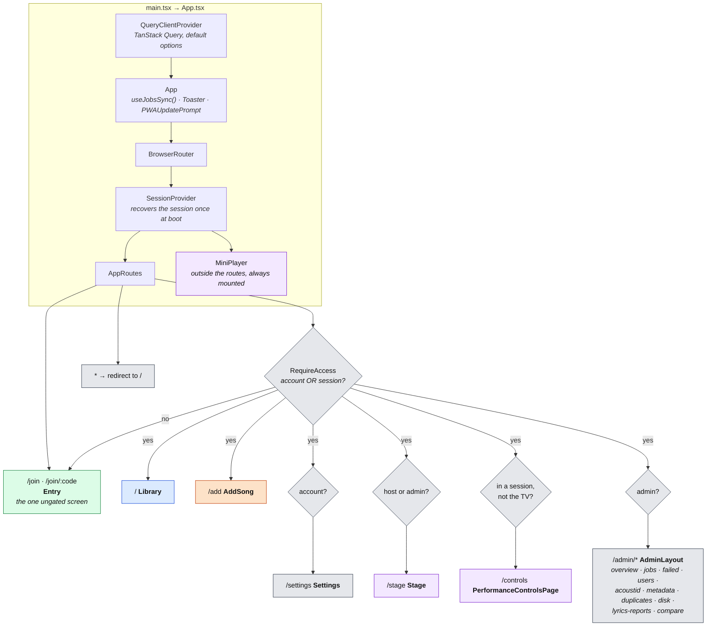
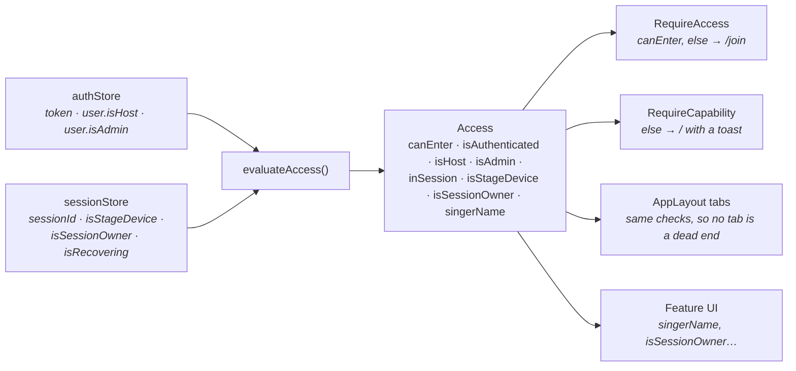
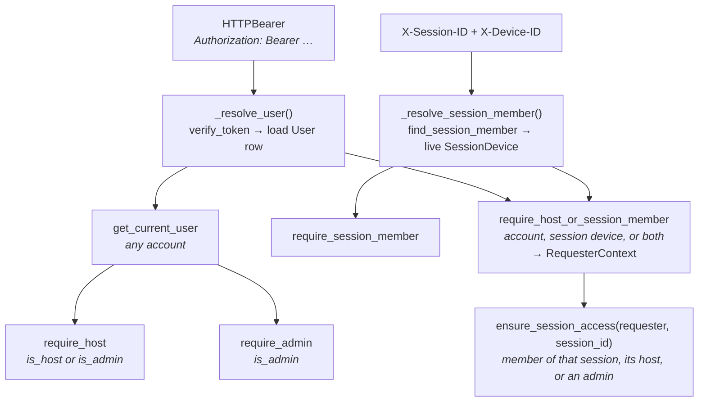
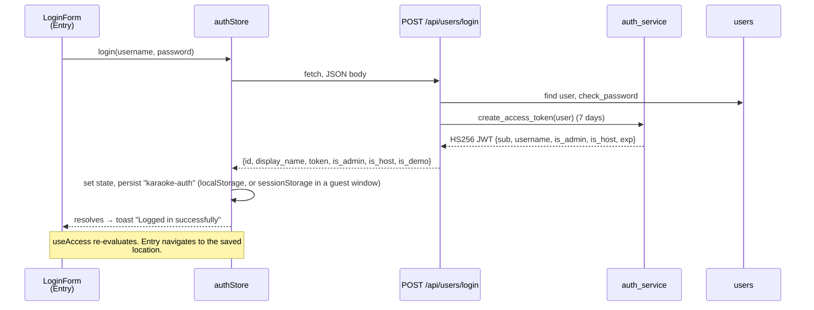
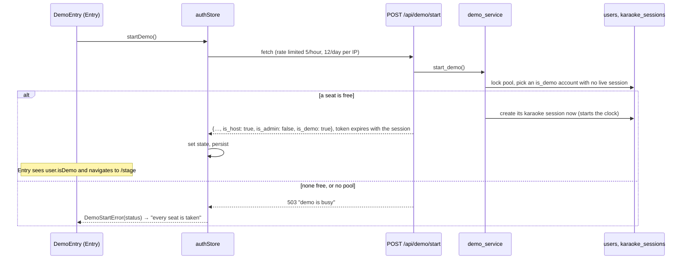
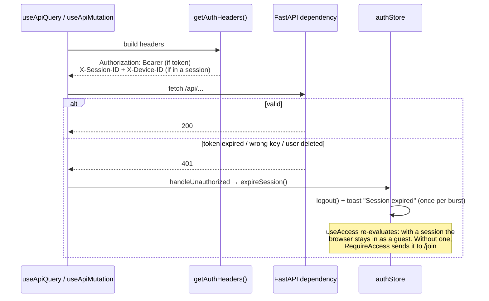
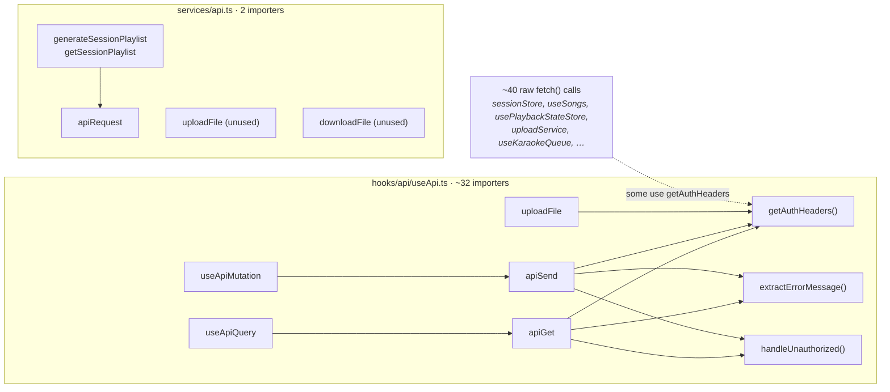
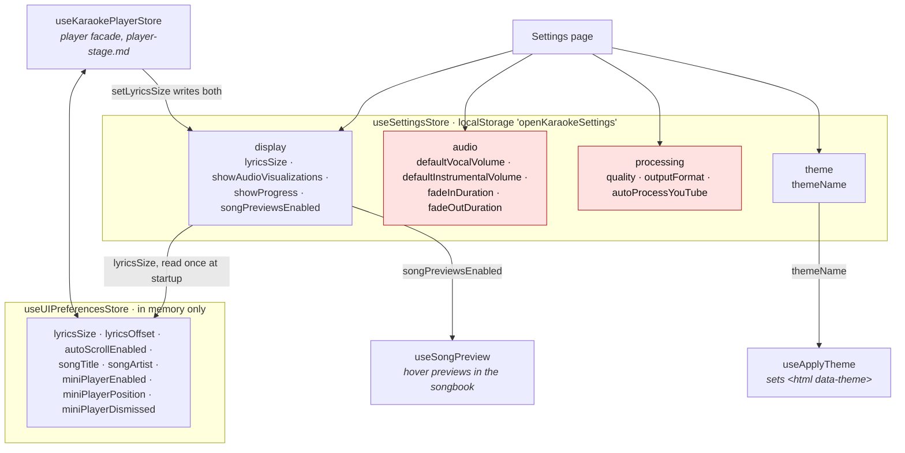

# Platform Foundations

How the app is wired together: the providers and routes every page sits inside, the gate that
decides who gets in, accounts and the JWT, the two API clients, and the settings stores. This is
what's left after the five feature slices, and the map of where each of them plugs in.

## The app shell at a glance

Everything a browser loads, from `main.tsx` down to the pages, and which slice owns each page.

| Colour | Slice | Doc |
|---|---|---|
| Orange | Ingestion & processing | [ingestion-pipeline.md](ingestion-pipeline.md) |
| Blue | Song & library metadata | [song-library.md](song-library.md) |
| Green | Sessions, queue & realtime | [sessions-realtime.md](sessions-realtime.md) |
| Purple | Player, stage & performance | [player-stage.md](player-stage.md) |
| Grey | This doc | — |

Lyrics ([lyrics-system.md](lyrics-system.md)) has no route of its own. It renders inside the
player and inside the song dialog, and owns `/admin/lyrics-reports`.

Three things in that tree run before any page does:

- **`useJobsSync()`** in `App` keeps the processing badges on song cards up to date, on every
  page. That's the ingestion slice's ([How progress reaches the UI](ingestion-pipeline.md#how-progress-actually-reaches-the-ui)).
- **`SessionProvider`** restores a stored session before rendering anything. While it works,
  `sessionStore.isRecovering` is true and both route guards show a "Recovering session..."
  spinner instead of redirecting. That's the sessions slice's.
- **`PWAUpdatePrompt`** shows an undismissable "Update available" dialog when the service worker
  has a new build. The only way out is the Update button.

## Where the code lives

| Concern | Backend | Frontend |
|---|---|---|
| Routes and gating | — | [AppRoutes.tsx](https://github.com/spencerfrost/open-karaoke-studio/blob/master/frontend/src/routes/AppRoutes.tsx), [guards.tsx](https://github.com/spencerfrost/open-karaoke-studio/blob/master/frontend/src/routes/guards.tsx), [useAccess.ts](https://github.com/spencerfrost/open-karaoke-studio/blob/master/frontend/src/hooks/useAccess.ts) |
| Page chrome | — | [AppLayout.tsx](https://github.com/spencerfrost/open-karaoke-studio/blob/master/frontend/src/components/layout/AppLayout.tsx), [NavBar.tsx](https://github.com/spencerfrost/open-karaoke-studio/blob/master/frontend/src/components/layout/NavBar.tsx) |
| Accounts and login | [users.py](https://github.com/spencerfrost/open-karaoke-studio/blob/master/backend/app/api/users.py), [auth_service.py](https://github.com/spencerfrost/open-karaoke-studio/blob/master/backend/app/services/auth_service.py), [models/user.py](https://github.com/spencerfrost/open-karaoke-studio/blob/master/backend/app/db/models/user.py) | [authStore.ts](https://github.com/spencerfrost/open-karaoke-studio/blob/master/frontend/src/stores/authStore.ts), [LoginForm.tsx](https://github.com/spencerfrost/open-karaoke-studio/blob/master/frontend/src/components/auth/LoginForm.tsx) |
| Who may call what | [dependencies.py](https://github.com/spencerfrost/open-karaoke-studio/blob/master/backend/app/api/dependencies.py), [limiter.py](https://github.com/spencerfrost/open-karaoke-studio/blob/master/backend/app/limiter.py) | — |
| Demo pool | [demo.py](https://github.com/spencerfrost/open-karaoke-studio/blob/master/backend/app/api/demo.py), [demo_service.py](https://github.com/spencerfrost/open-karaoke-studio/blob/master/backend/app/services/demo_service.py) | [DemoEntry.tsx](https://github.com/spencerfrost/open-karaoke-studio/blob/master/frontend/src/features/demo/components/DemoEntry.tsx), `authStore.startDemo` |
| Host settings | [host_settings.py](https://github.com/spencerfrost/open-karaoke-studio/blob/master/backend/app/api/host_settings.py), [models/host_settings.py](https://github.com/spencerfrost/open-karaoke-studio/blob/master/backend/app/db/models/host_settings.py) | — (no caller) |
| API clients | — | [useApi.ts](https://github.com/spencerfrost/open-karaoke-studio/blob/master/frontend/src/hooks/api/useApi.ts), [services/api.ts](https://github.com/spencerfrost/open-karaoke-studio/blob/master/frontend/src/services/api.ts) |
| Settings | — | [Settings.tsx](https://github.com/spencerfrost/open-karaoke-studio/blob/master/frontend/src/pages/Settings.tsx), [useSettingsStore.ts](https://github.com/spencerfrost/open-karaoke-studio/blob/master/frontend/src/stores/useSettingsStore.ts), [useUIPreferencesStore.ts](https://github.com/spencerfrost/open-karaoke-studio/blob/master/frontend/src/stores/useUIPreferencesStore.ts) |
| User admin | `GET /api/users`, `set-host`, `register` | [AdminUsersPage.tsx](https://github.com/spencerfrost/open-karaoke-studio/blob/master/frontend/src/features/admin/AdminUsersPage.tsx) |
| CLI | [scripts/manage_users.py](https://github.com/spencerfrost/open-karaoke-studio/blob/master/backend/scripts/manage_users.py) | — |

## Who gets in: two layers of gate

The frontend gate and the backend gate are separate code that's meant to agree. The frontend one
decides what's *shown*. The backend one decides what's *allowed*.

### Frontend: `useAccess` → guards → nav

[`evaluateAccess`](https://github.com/spencerfrost/open-karaoke-studio/blob/master/frontend/src/hooks/useAccess.ts) is a pure function over two stores,
`authStore` (the account) and `sessionStore` (the session this browser is in). It returns one
`Access` object, and three things read it:

The derived fields:

| Field | Rule |
|---|---|
| `isHost` | `user.isHost \|\| user.isAdmin`. An admin can do anything a host can. |
| `inSession` | `sessionId !== null`. The one canonical "am I in a session" check. |
| `canEnter` | `isAuthenticated \|\| inSession`. **Any** account clears it, not just hosts. This mirrors the backend's `require_host_or_session_member`, and a comment in `useAccess.ts` warns not to narrow it. |
| `singerName` | The session's display name, else the account's. |

**`RequireAccess`** wraps every route except `/join`. If `canEnter` is false it redirects to
`/join` and passes the original location in router state. After signing in or joining,
[Entry.tsx](https://github.com/spencerfrost/open-karaoke-studio/blob/master/frontend/src/pages/Entry.tsx) navigates back to that location.

**`RequireCapability`** sits inside it, one per gated route, and checks in this order:

| Requirement | Fails when | Goes to | Toast |
|---|---|---|---|
| `account` | not signed in | `/` | "Sign in to manage your account." |
| `host` | not host or admin | `/` | "Hosting a night needs a host account." |
| `admin` | not admin | `/` | "Admin access required." |
| `session` | no session | `/` | "No session running yet — open the Stage to start one." |
| `device="performer"` | this browser is the TV | `/stage` | — |
| `device="stage"` | this browser isn't the TV | `/controls` | — (no route uses this today) |

A capability failure never sends someone back to `/join`. They already have an account or a
session, just not the right one for this route.

What each kind of visitor can reach (this is the matrix in
[guards.test.tsx](https://github.com/spencerfrost/open-karaoke-studio/blob/master/frontend/src/routes/guards.test.tsx)):

| Visitor | `/` `/add` | `/settings` | `/stage` | `/controls` | `/admin` |
|---|---|---|---|---|---|
| Nobody (no account, no session) | → `/join` | → `/join` | → `/join` | → `/join` | → `/join` |
| Guest phone (session only) | ✓ | → `/` | → `/` | ✓ | → `/` |
| Account, not host | ✓ | ✓ | → `/` | → `/` (✓ if they join a session) | → `/` |
| Host, no session | ✓ | ✓ | ✓ | → `/` | → `/` |
| Host on the TV | ✓ | ✓ | ✓ | → `/stage` | → `/` |
| Admin | ✓ | ✓ | ✓ | only in a session, off the TV | ✓ |

### Page chrome

Four pages wrap themselves in [AppLayout](https://github.com/spencerfrost/open-karaoke-studio/blob/master/frontend/src/components/layout/AppLayout.tsx):
Library, AddSong, Settings and PerformanceControlsPage. It's a full-height column with the
vintage background layers, a scrolling `<main>`, and [NavBar](https://github.com/spencerfrost/open-karaoke-studio/blob/master/frontend/src/components/layout/NavBar.tsx)
pinned to the bottom as a tab bar.

The tabs come from `useAccess` with the same checks the guards use:

| Tab | Shown when |
|---|---|
| Songbook (`/`), Add (`/add`) | always |
| Stage | host or admin. Highlighted when this browser is the TV in a live session. |
| Controls | in a session and not the TV |
| Settings | signed in |
| Admin | admin |

The other pages don't use AppLayout. **Stage** has its own full-screen frame with no tab bar
([player-stage.md](player-stage.md#the-stage-shell)). **AdminLayout** has its own sidebar.
**Entry** is a bare card.

### Backend: the dependency ladder

Every router picks one of these FastAPI dependencies from
[dependencies.py](https://github.com/spencerfrost/open-karaoke-studio/blob/master/backend/app/api/dependencies.py). Each one is built on the one before.

| Dependency | 401 / 403 when | Used by |
|---|---|---|
| `get_current_user` | bad or missing token → 401 | `songs`, `lyrics`, `musicbrainz`, `users` (PATCH) |
| `require_host` | not host or admin → 403 | `sessions`, `session_playlist`, `karaoke_queue`, `songs`, `lyrics`, `youtube`, `youtube_music`, `performance_history`, `host_settings`, `demo` |
| `require_admin` | not admin → 403 | `admin`, `artists`, `jobs`, `songs`, `lyrics`, `users` (list, set-host) |
| `require_session_member` | no live device for those headers → 403 | `sessions` (leave) |
| `require_host_or_session_member` | neither credential is good → 401 (bad token, no device) or 403 | `youtube`, `youtube_music`, `songs`, `karaoke_queue`, `lyrics`, `sessions`, `session_playlist`, `demo` |

Some things to know about it:

- **The DB decides roles, not the token.** The JWT carries `is_admin` and `is_host`, but
  `_resolve_user` reloads the `User` row on every request and the checks read the row. Revoking
  host on the Users page takes effect on the server immediately. The frontend's
  `authStore.user.isHost` is a copy from the login response and isn't refreshed, so that browser
  keeps showing the Stage tab until it logs in again. The server then refuses it with 403.
- **`require_host_or_session_member` keeps both credentials.** A signed-in phone that joined a
  session sends a token and the session headers, and `RequesterContext` holds the account *and*
  the device. A bad token doesn't lock out a caller whose session headers are good: they carry on
  as that session's guest. With nothing to fall back on, the token's 401 stands so the client can
  sign out.
- **An account doesn't open every session.** Anything that acts inside a session (the queue, the
  roster, session info, the recap playlist, lyrics feedback) calls
  [`ensure_session_access`](https://github.com/spencerfrost/open-karaoke-studio/blob/master/backend/app/api/dependencies.py). It admits a member device of
  that session, the account that hosts it, or an admin. Anyone else gets one 403, whether the
  session is someone else's or doesn't exist, so it can't be used to find live codes. Holding an
  account isn't enough because the demo hands accounts out to anyone.
- **Session-owner checks** (`require_session_owner`, `require_queue_access`,
  `require_roster_access`, and `resolve_host_claim` on the socket) live in the sessions slice. See
  [Who may call what](sessions-realtime.md#who-may-call-what) for the per-endpoint table.
- **Rate limits** come from one [slowapi](https://github.com/spencerfrost/open-karaoke-studio/blob/master/backend/app/limiter.py) `Limiter` keyed on the
  client IP: `register` 3/minute, `login` 5/minute, the session join endpoints, `POST /api/demo/start`,
  and the calls that spend a third party's quota (YouTube search and preview, YouTube Music,
  lyrics provider search, lyrics alignment). Behind the bundled nginx the client IP comes from
  `X-Forwarded-For`, trusted from nginx's pinned address only; see
  [Client IPs behind the proxy](../guide.md#client-ips-behind-the-proxy).

## Accounts and the JWT

### Data

[`User`](https://github.com/spencerfrost/open-karaoke-studio/blob/master/backend/app/db/models/user.py) is one table: `username` (unique, at least 3
characters), `password_hash` (Werkzeug), `display_name`, and three flags.

| Flag | Means |
|---|---|
| `is_admin` | Library maintenance, user management. Also passes every `require_host`. |
| `is_host` | Can start a session from `/stage` and run it. |
| `is_demo` | One of the demo pool accounts. Can't be edited, can't change host settings, download quotas apply. |

There is no "performer" flag. An account with neither `is_host` nor `is_admin` clears the
frontend gate and can browse and add songs to the library, but it reaches a session only through
that session's device credential, like a guest. The tiers are laid out in
[Authentication § Permission ladder](../api/authentication.md#permission-ladder).

Accounts are made by an admin, either on the Users page (register, then set-host) or with
`scripts/manage_users.py create [--admin] [--host] [--demo]`. The CLI also lists, deletes and
resets passwords.

### Logging in

[LoginForm](https://github.com/spencerfrost/open-karaoke-studio/blob/master/frontend/src/components/auth/LoginForm.tsx) renders in one place: the "Hosting
tonight? Sign in" accordion on Entry.

Leaving and logging out live in
[AccountMenu](https://github.com/spencerfrost/open-karaoke-studio/blob/master/frontend/src/features/session/components/AccountMenu.tsx), a name chip in the
top-right corner of every page. Both page layouts (`AppLayout` and the admin layout) render it,
so the spot never moves. Only stage mode and the singer's controls, which are full screen with
their own way out, go without it. The menu offers **Leave session** when
the device is in a session and **Log out** when it's signed in. Log out leaves the session first
(`leaveSession`, so the server stops listing the device) and then clears the account. A guest has
no Settings page, so this menu is a guest phone's only way out.

### Starting the demo

The entry page's **Try it live** doesn't use the login form. `authStore.startDemo()` calls
`POST /api/demo/start`, which needs no credentials and returns the same login response.

The demo account is confined to that session: its token expires with it, and
`POST /api/sessions` or `POST /api/sessions/my` (with no live session, or `on_existing: "replace"`)
is a 403. `Stage.tsx` never shows a demo account the create screen. When the session is gone, or
reaches its `expires_at` while the stage is up, it calls `authStore.expireSession()`, which toasts
"Your demo has ended. Press Try it live to start another." and lands the visitor back on `/join`.

`GET /api/demo` (`{enabled}`) decides whether **Try it live** shows at all. `useAccess` exposes
`isDemo`, which the guided tour checks. The pool's own rules (quotas, pool sizing, setup) are in
[Demo Accounts](../demo-accounts.md).

### The secret

`JWT_SECRET_KEY` comes from `.env`. If it's missing, `auth_service` generates a random key for
that process and logs an error, and `main.py` logs it again at startup. Every restart, including
a hot reload, then invalidates every token. The default lifetime is 7 days
(`JWT_ACCESS_TOKEN_EXPIRE_MINUTES=10080`). There are no refresh tokens: when it expires, the
next request 401s.

### Using the token, and what happens on 401

`expireSession` only clears the account. The session this browser joined stays, so a host whose
token lapses mid-night is still a member and still sees the app, just without the Stage tab.

Only three paths call `expireSession`: `apiGet` and `apiSend` in `useApi.ts`, and
`sessionStore.resumeAccountHostSession`. The ~40 raw `fetch` calls elsewhere (see
[Two API clients](#two-api-clients)) surface a 401 as an ordinary error.

## Host settings

[`HostSettings`](https://github.com/spencerfrost/open-karaoke-studio/blob/master/backend/app/db/models/host_settings.py) is one row per host account
(`user_id` unique, cascade-deleted with the user) holding one value: `session_duration_hours`,
default 8.

- `GET /api/host-settings` (host) returns the row, creating it with defaults on first read.
- `PUT /api/host-settings` (host, not demo) sets it, between 0 and 24.
- `POST /api/sessions/my` reads it to set a new session's `expires_at`, falling back to 8 h with
  no row. The demo pool reads it the same way, falling back to 15 minutes.

Nothing in the frontend calls either endpoint. Session length can only be changed with curl or in
the database.

## Two API clients

The frontend has two hand-written fetch wrappers. One does almost all the work.

**[useApi.ts](https://github.com/spencerfrost/open-karaoke-studio/blob/master/frontend/src/hooks/api/useApi.ts)** is the real client:

- URLs are relative to `/api/`. Vite proxies `/api` to the backend in dev.
- `getAuthHeaders()` adds the bearer token and, when this browser is in a session, the
  `X-Session-ID`/`X-Device-ID` pair. Sending both is fine: the backend prefers the JWT.
- `extractErrorMessage()` turns FastAPI's error body into text. `detail` is a string for an
  `HTTPException` and a list of `{msg}` objects for a 422, and it handles both.
- `useApiQuery` and `useApiMutation` are thin wrappers over TanStack Query's `useQuery` and
  `useMutation`. The [`QueryClient`](https://github.com/spencerfrost/open-karaoke-studio/blob/master/frontend/src/queryClient.ts) uses default options.

**[services/api.ts](https://github.com/spencerfrost/open-karaoke-studio/blob/master/frontend/src/services/api.ts)** is the older one. Only the session recap
playlist uses it (`sessionStore` and `useSessionPlaylist`). `apiRequest` adds no auth headers of
its own, so its two playlist calls pass the host's token themselves, and it reads `data.error` for
messages, so a FastAPI `detail` never reaches the user.

## Settings

`/settings` is any signed-in account's page. Top to bottom:

1. **`RotationModeCard`**: the session owner's queue-order switch. Sessions slice.
2. Four cards from `useSettingsStore`: Theme, Audio, Processing, Display, and a Reset button.

The stores behind them:

Red cards are saved but never read. Of the 12 settings on the page, three do anything:

| Setting | Read by |
|---|---|
| Theme | `useApplyTheme`, mounted in `App`, puts it on `<html data-theme>`, where index.css's theme blocks pick it up. An inline script in `index.html` does the same from `localStorage` before the stylesheet paints. The themes are cyberpunk (the default, also set on `<html>` in `index.html`), retro and Catppuccin; the list is [`themes.ts`](https://github.com/spencerfrost/open-karaoke-studio/blob/master/frontend/src/lib/themes.ts). |
| Lyrics Size | Seeds `useUIPreferencesStore.lyricsSize` when the app loads. Changing lyrics size from the player controls writes it back here, so it survives a reload. |
| Preview Songs on Hover | `useSongPreview` |
| All four Audio values, all three Processing values, Show Audio Visualizations, Show Progress Bar | nothing |

[`useUIPreferencesStore`](https://github.com/spencerfrost/open-karaoke-studio/blob/master/frontend/src/stores/useUIPreferencesStore.ts) is the player's
display state, not page settings. It isn't persisted, and the only thing that reads or writes it
is `useKaraokePlayerStore`, which exposes it as part of the player facade
([player-stage.md](player-stage.md#four-stores-behind-one-facade)).

These are per browser. Nothing here is stored on the server or tied to the account. The TV, the
host's phone and a guest's phone each have their own copy.

## Known debt

### Anyone can create an account

`POST /api/users/register` takes no auth, only a 3/minute rate limit. Its one caller in the app
is the admin Users page. A new account has no flags, but any account clears `RequireAccess` and
`require_host_or_session_member`, so anyone who can reach the server can register, browse the
library and start YouTube downloads. The demo quotas don't apply because the account isn't
`is_demo`. It can't reach any session: `ensure_session_access` turns it away. The fix is
`Depends(require_admin)` on `register`.

### Settings that do nothing

Nine of the twelve controls on the Settings page are saved to `localStorage` and never read
(see [Settings](#settings)).

### Endpoints with no caller

- `GET`/`PUT /api/host-settings`: no UI, so the session length can't be changed from the app.
- `PATCH /api/users/{id}`: no UI to change a display name or password. `manage_users.py
  reset-password` is the only way.

### The frontend's copy of the account goes stale

`authStore.user` is written at login and persisted. Role changes made on the Users page don't
reach a browser that's already signed in until it logs in again. The server always uses the
current row, so this shows the wrong tabs but never grants access.

### Two API clients, many raw fetches

`services/api.ts` duplicates `useApi.ts` with weaker error handling and no auth headers of its own. Outside
both, about 40 `fetch` calls build their own headers and error handling, and only one of them
(`resumeAccountHostSession`) handles a 401. A token that expires while the stage is running
shows up as generic errors from those calls, not as "Session expired".

### Smaller things

- `useApi.uploadFile` doesn't call `handleUnauthorized` and reads only `message` from the error
  body, so an `HTTPException`'s `detail` is replaced by "HTTP error! Status: …".
- The comment on `downloadFile` in `services/api.ts` says track downloads need a bearer token.
  `GET /api/songs/{id}/download/{track}` is public, so `<audio>` elements can load it.
- `register` and `login` return 500 with the raw exception text for unexpected errors.
- The `RequireCapability device="stage"` branch exists but no route uses it.

### Dead code

- `auth_service.authenticate_user()`: no callers. `login_user` does the same lookup inline.
- `User.theme` and `User.color` columns: nothing reads or writes them.
- `services/api.ts` `uploadFile` and `downloadFile`: no importers. Uploads use
  `useApi.uploadFile`.
- `useSongs` `downloadVocals` / `downloadInstrumental` / `downloadOriginal` and their private
  `downloadFile`: no callers, and it sends `POST` to a `GET` route, so it would 405.

## Tests

- [guards.test.tsx](https://github.com/spencerfrost/open-karaoke-studio/blob/master/frontend/src/routes/guards.test.tsx): the visitor × route matrix above,
  plus the recovery spinner.
- [guards.entry.test.tsx](https://github.com/spencerfrost/open-karaoke-studio/blob/master/frontend/src/routes/guards.entry.test.tsx): Entry returns you to
  the route you asked for after signing in, and prefills the code from a QR link.
- `evaluateAccess` is pure so the matrix can be tested without mounting stores.
- Backend, in `backend/tests/api/`: `test_users.py` (register, login, update, including
  "demo can't be edited"), `test_host_settings.py`, `test_demo_start.py`, `test_demo_quota.py`,
  `test_dependencies.py` for the dependency ladder, and `test_access_gates.py`, which runs the real
  gates for a stranger, a self-registered account, a demo host and a member of another session.

## Cross-references

- **`Entry`, `SessionProvider`, `sessionStore`, session recovery, device credentials,
  `require_session_owner`, `RotationModeCard`, the recap playlist endpoints** —
  [sessions-realtime.md](sessions-realtime.md).
- **`/stage` and `/controls` and everything on them, `MiniPlayer`, `useKaraokePlayerStore`** —
  [player-stage.md](player-stage.md).
- **`/add`, `useJobsSync`, upload, the YouTube download path the demo quota guards** —
  [ingestion-pipeline.md](ingestion-pipeline.md).
- **`/` (Library), the song dialog's host-only actions, the admin data-quality pages** —
  [song-library.md](song-library.md).
- **`/admin/lyrics-reports`, alignment jobs** — [lyrics-system.md](lyrics-system.md).
- **Demo pool rules, quotas and setup** — [demo-accounts.md](../demo-accounts.md).
- **The admin overview, failed songs and jobs pages** — no domain doc covers these; see
  `features/admin/`.
