# Player, Stage & Performance

What's on the screen while someone sings: the TV's full-screen stage app, the audio engine that
plays three stems in step, the controls on the TV's left rail and on a performer's phone, and the
screen that hands the mic to the next person when a song ends.

::: info
This slice reads session state but doesn't own it. The session, the queue, the rotation and both
WebSockets are in [Sessions, Queue & Realtime](sessions-realtime.md). Read that first if "turn",
"roster" or "session owner" are unfamiliar.
:::

## The slice at a glance

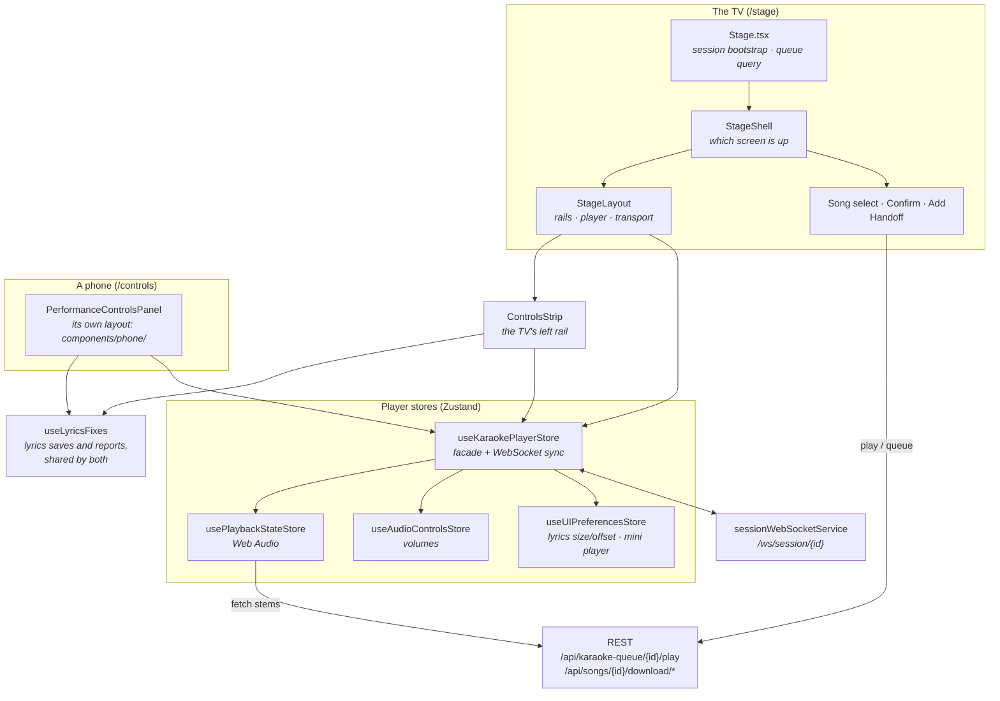

The TV is the only device that makes sound. Every other screen, the phone included, is a remote
control that sends messages over the session WebSocket. The audio lives in the TV's browser tab.

## Vocabulary

| Word | Means |
|---|---|
| **Stage** | The TV. The `/stage` route, full-screen, no nav bar. Only a host can open it. |
| **Shell** | `StageShell`, the component that decides which *screen* the stage shows. Screens are component state, not routes. |
| **Performance screen** | The player: lyrics in the middle, controls rail on the left, queue rail on the right. |
| **Rails** | The two side columns of the performance screen. They collapse to icon strips while a song plays. |
| **Handoff** | The screen between songs: who's up next and what they're singing. |
| **Wheel** | The stage's song select: columns on a turning cylinder, DDR-style. The first column picks a *source* (Artists A–Z or Recently added), and the source decides the columns after it. |
| **Stems** | The separated audio files of a song: instrumental, vocals, and on newer songs backing vocals. |
| **Facade** | `useKaraokePlayerStore`. It mirrors three smaller stores and is the only one components normally touch. |

## Where the code lives

| Area | Files |
|---|---|
| Page | [pages/Stage.tsx](https://github.com/spencerfrost/open-karaoke-studio/blob/master/frontend/src/pages/Stage.tsx), [pages/PerformanceControlsPage.tsx](https://github.com/spencerfrost/open-karaoke-studio/blob/master/frontend/src/pages/PerformanceControlsPage.tsx) |
| Shell and screens | [features/stage/](https://github.com/spencerfrost/open-karaoke-studio/tree/master/frontend/src/features/stage): `StageShell`, `StageShellContext`, `ExitStagePrompt`, `screens/` (Create, Select, Confirm, Add, Handoff), `wheel/`, `components/` (RosterPicker, StageNowPlaying, StageSearch) |
| Performance screen | [features/player/components/stage/](https://github.com/spencerfrost/open-karaoke-studio/tree/master/frontend/src/features/player/components/stage): `StageLayout`, `StageTransport`, `StageQueueRail`, `StageJoinCode`, `StageAmbientBar`, `StageRailIcons`, and the hooks `useStageRails`, `useStageKeyboard`, `useStageRootScale` |
| Player | [features/player/components/KaraokePlayer.tsx](https://github.com/spencerfrost/open-karaoke-studio/blob/master/frontend/src/features/player/components/KaraokePlayer.tsx), [hooks/useKaraokePlayer.ts](https://github.com/spencerfrost/open-karaoke-studio/blob/master/frontend/src/features/player/hooks/useKaraokePlayer.ts), `usePlayerUI` (fullscreen), `useSongSuggestions` |
| Controls | TV rail: [features/performance/controls/](https://github.com/spencerfrost/open-karaoke-studio/tree/master/frontend/src/features/performance/controls) (`ControlsStrip`, `MixCard`, `VocalFader`, `LyricsControlsCard` and its rows, `MoreControlsSheet`). Phone: [PerformanceControlsPanel.tsx](https://github.com/spencerfrost/open-karaoke-studio/blob/master/frontend/src/features/performance/components/PerformanceControlsPanel.tsx) and [components/phone/](https://github.com/spencerfrost/open-karaoke-studio/tree/master/frontend/src/features/performance/components/phone). Shared: `features/performance/hooks/` (`useLyricsFixes`, `useBackingTrackAvailable`, `usePerformanceControlsLogic`) |
| Guided tour | [features/tour/](https://github.com/spencerfrost/open-karaoke-studio/tree/master/frontend/src/features/tour), [stores/tourStore.ts](https://github.com/spencerfrost/open-karaoke-studio/blob/master/frontend/src/stores/tourStore.ts) |
| Stores | [stores/useKaraokePlayerStore.ts](https://github.com/spencerfrost/open-karaoke-studio/blob/master/frontend/src/stores/useKaraokePlayerStore.ts), [usePlaybackStateStore.ts](https://github.com/spencerfrost/open-karaoke-studio/blob/master/frontend/src/stores/usePlaybackStateStore.ts), [useAudioControlsStore.ts](https://github.com/spencerfrost/open-karaoke-studio/blob/master/frontend/src/stores/useAudioControlsStore.ts), [shared/](https://github.com/spencerfrost/open-karaoke-studio/tree/master/frontend/src/stores/shared) |
| Mini player | [components/player/MiniPlayer/](https://github.com/spencerfrost/open-karaoke-studio/tree/master/frontend/src/components/player/MiniPlayer) |
| Backend | [api/performance_history.py](https://github.com/spencerfrost/open-karaoke-studio/blob/master/backend/app/api/performance_history.py). The player's WebSocket messages are handled in `ws/session_specific.py`, which [sessions-realtime.md](sessions-realtime.md) owns. |

`features/player` holds the performance screen and `features/stage` holds everything around it.

## The stage shell

### One page, many screens

`/stage` renders `Stage.tsx`, which does three things and nothing else:

1. **Finds or starts tonight's session.** On mount it tries to recover a session (this browser's
   storage first, then the server). If there's nothing to resume it shows `CreateSessionScreen`.
   That flow is documented in [sessions-realtime.md § Created: only on the Stage](sessions-realtime.md#created-only-on-the-stage).
2. **Holds the queue.** `useQueue(displayCode)` over REST, refetched whenever `queue_updated`
   arrives on the WebSocket.
3. **Renders `StageShell`** with the queue's `current`, `upcoming` and `turn`, plus handlers for
   "play this item" and "remove this item".

`StageShell` owns everything the screen does with that data. Its one design rule, from its header
comment: **the performance screen never unmounts.** Someone browsing for the next song must come
back to the same audio, the same lyrics position and the same open dialogs. So screens aren't
routes. They're a piece of React state, and the player is hidden with `display: none` while
another screen is up.

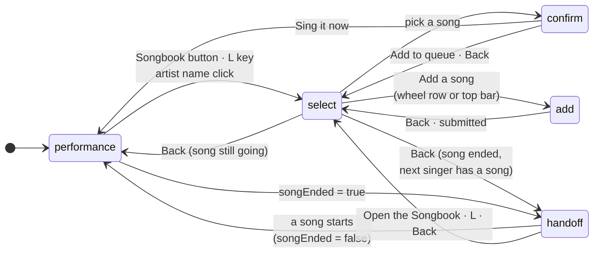

Which screens stay mounted:

| Screen | Mounted | Why |
|---|---|---|
| performance (`StageLayout`) | Always | Audio, lyrics timing and dialogs must survive. |
| select (`SongSelectScreen`) | Once opened, then hidden | The wheel keeps its place across a trip to confirm and back. It remounts fresh once per singer: when the playing song passes 10% (`WHEEL_FRESH_AT`), the next visit to song select starts over, since the next person browsing is probably someone else. Someone already browsing at that moment keeps their place. |
| confirm, add, handoff | Only while showing | Cheap to mount. `AddSongScreen` reads its `query` on mount, so it has to remount to take a new one. |

The handoff screen is the only one the shell opens by itself. It watches `songEnded` from
`usePlaybackStateStore` ([StageShell.tsx](https://github.com/spencerfrost/open-karaoke-studio/blob/master/frontend/src/features/stage/StageShell.tsx)).
When a song finishes on the performance screen, the shell switches to handoff. When the next song
starts, `songEnded` goes false and it switches back. A song that ends while someone is browsing
leaves them where they are.

### Three contexts

The shell publishes its state through three React contexts in
[StageShellContext.tsx](https://github.com/spencerfrost/open-karaoke-studio/blob/master/frontend/src/features/stage/StageShellContext.tsx). They're split on
purpose, because several hundred song cards and wheel rows read them:

| Hook | Carries | Changes |
|---|---|---|
| `useStageShell()` | The actions: `openSelect`, `openConfirm`, `openAdd`, `openHandoff`, `openPerformance`, `back` | Never. Same object for the life of the shell. |
| `useStageScreen()` | Which screen is up | On every screen change |
| `useStageQueue()` | `current`, `upcoming`, `turn` | On every queue broadcast |

`useStageShell()` returns `null` off the stage. That's how a shared component, like a library song
card, knows whether to switch a stage screen or navigate a phone's router.
[`useOpenSongSelect`](https://github.com/spencerfrost/open-karaoke-studio/blob/master/frontend/src/hooks/useOpenSongSelect.ts) and `useSongActions` both
branch on it.

## The performance screen

What renders inside `StageLayout`:

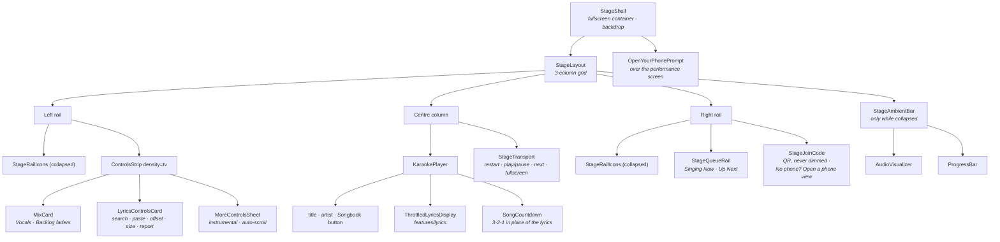

`KaraokePlayer` is small. It shows the title, the lyrics and the error state. Every control
lives in the rails or the transport. Before a new song it shows the countdown ("{Singer}, get
ready", then 3-2-1; see [Starting a song](#starting-a-song)). After a page reload, while the stems
are still downloading, it shows "Getting the song ready…". With no song loaded it shows "No songs
in the queue" and an "Open the Songbook" button.

**"{Name}, open your phone."** [`OpenYourPhonePrompt`](https://github.com/spencerfrost/open-karaoke-studio/blob/master/frontend/src/features/stage/components/OpenYourPhonePrompt.tsx),
mounted by `StageShell` over the performance screen, shows across the top while the current
singer's linked phone is disconnected or not on screen. It reads `presenceStore` by
`current.performerId`. There's nothing to tap: once the phone is back on the page it opens its own
controls (see [The phone](#the-phone)) and the prompt goes. A singer with no linked phone never
gets it. It's kept short, because plenty of singers never want the controls: only during the
intro, up to the first sung line (15 seconds for a song without timed lyrics; `phonePromptEnd`),
and only once per singer per session, never for a singer whose phone has already been on the
controls (`isPromptSong`).

It is kept short, since many singers never want the controls and a phone set down mid-song locks
itself:

- **Intro only.** `phonePromptEnd` puts the cut-off at the first sung line, shifted by the lyrics
  offset the same way the renderer shifts it, or at 15 seconds into a song without timed lyrics.
  The prompt never sits over the words.
- **Once per singer per session.** `presenceStore.promptedFor` records the queue item each singer
  was first shown it during; `isPromptSong` allows that song (a seek back still works) and no
  other. `usedControls` collects every singer whose phone has reported `onControls`, and they are
  never asked. Both reset with the session. Like the rest of the store they live in memory, so a
  stage reload can ask each singer once more.

### Rails that get out of the way

[`useStageRails`](https://github.com/spencerfrost/open-karaoke-studio/blob/master/frontend/src/features/player/components/stage/useStageRails.ts) collapses
both rails to icon strips the moment playback starts, and dims the title. The transport folds away
and `StageAmbientBar` (a waveform and a thin progress line) appears along the bottom edge.

- Rails come back on a click, a key, or **120 px of mouse travel**. A bump to the mic stand doesn't
  count.
- They collapse again after 4 s of no activity.
- For 600 ms after play starts, activity is ignored, so the click that started the song doesn't
  reopen them.
- Nothing unmounts when the rails collapse. Dialogs, drag state and focus all survive.
- The join QR (`StageJoinCode`) shrinks into the bottom of the right rail but stays at full
  brightness, so latecomers can always scan in. Song select puts its QR in the same bottom-right
  spot.
- Under the QR, **No phone? Open a phone view** opens a ~400 px popup at
  `/join/<CODE>?guest-window`, a guest window with its own identity (see
  [sessions-realtime.md](sessions-realtime.md)). It folds away with the label when the rails
  collapse, and only shows with a fine pointer (`pointer-fine:`), so never on the TV.

### Sizing to the TV

[`useStageRootScale`](https://github.com/spencerfrost/open-karaoke-studio/blob/master/frontend/src/features/player/components/stage/useStageRootScale.ts)
sets the page's root `font-size` to `min(1.63vh, 0.92vw)` while the performance screen is up. The
stage is laid out in rem and was designed at 1920×1080, so this scales the whole screen as one
piece. `STAGE_SCALE = 1.1` is the single knob. The song wheel doesn't use this. It lays itself out
on a fixed 1600×900 frame and scales that to fit.

### Keys

Four separate window `keydown` listeners, each live only while its screen is up:

| Screen | Hook | Keys |
|---|---|---|
| Performance | [`useStageKeyboard`](https://github.com/spencerfrost/open-karaoke-studio/blob/master/frontend/src/features/player/components/stage/useStageKeyboard.ts) | Space/Enter play-pause · ↑↓ vocal volume ±10% · ←→ lyrics offset ±100 ms · F fullscreen (on every screen) · L songbook |
| Song select | `useWheelKeys` | ↑↓ move (with its own hold-to-accelerate, up to 36 rows/s) · ←→ turn the wheel · Enter pick · Back · L leave |
| Confirm | inline in `SongConfirmScreen` | ↑↓ singer · ←→ "Sing it now" / "Add to queue" · Enter · Back |
| Handoff | inline in `HandoffScreen` | Enter play their song (or open the songbook) · Back/L songbook |

All of them skip text fields, open dialogs and sliders, and ignore held-key repeats on Enter so
the press that started one song can't start or pause the next. Escape isn't bound on the
performance screen because the browser uses it to leave fullscreen.

## The audio engine

### Four stores behind one facade

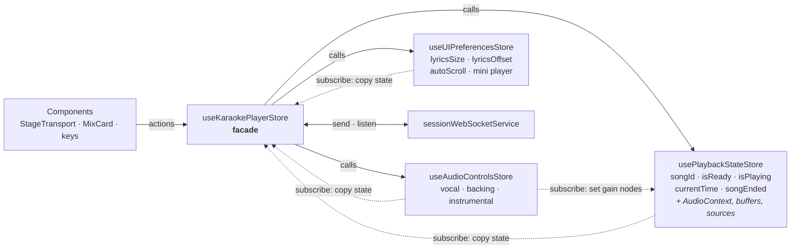

`useKaraokePlayerStore` is a facade over three focused stores. Each child store's state is copied into the facade on every
change, so components can keep reading one store. The facade adds the WebSocket side: every user
action is applied locally *and* sent to the server.

The facade's `currentTime` changes on every animation frame while a song plays, so components
never take the whole store. Each one selects the fields it uses (with `useShallow` when it needs
several), and anything that moves with the song reads the position through
[`useSongPosition(step)`](https://github.com/spencerfrost/open-karaoke-studio/blob/master/frontend/src/features/player/hooks/useSongPosition.ts), which
rounds it down inside the selector. A component then re-renders only when the rounded value
changes: every 0.25 s for `StageTransport`'s timeline and `StageAmbientBar`, every 0.1 s for the
lyrics. `StageNowPlaying` and `StageShell` read `usePlaybackStateStore` directly with narrow
selectors.

Inside the lyrics, each line and each instrumental separator is memoized, so a frame re-renders
only the active line and the separator that is filling. The visualizer stops drawing while the
ambient bar is hidden.

### The audio graph

Built in `setupAudioGraph` in [usePlaybackStateStore.ts](https://github.com/spencerfrost/open-karaoke-studio/blob/master/frontend/src/stores/usePlaybackStateStore.ts).
A fresh graph is built on every play and every seek.

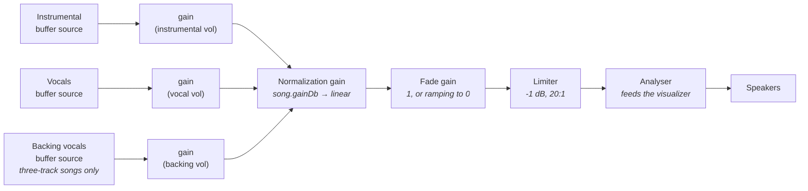

- **One `AudioBufferSourceNode` per stem.** A buffer source can only be started once, so every
  play and seek makes new ones. All of them are started at the same audio-clock instant, 50 ms
  ahead, which keeps the stems sample-locked.
- **Normalization gain** is the per-song `gain_db` the backend measures (toward −16 LUFS). It's
  set once per song and never ramped.
- **Fade gain** is a separate node so fading a song out never touches its loudness value. See
  [Changing songs](#changing-songs).
- **Limiter** catches what the normalization can't predict, such as the lead vocal turned up.
- **Volumes** reach the gain nodes live: `usePlaybackStateStore` subscribes to
  `useAudioControlsStore` and writes `gain.value` on every change.

**Time keeping.** There's no media element to ask for the position. The store remembers
`playbackOffset` (where in the song playback started) and `playbackStartTime` (the AudioContext
clock at that moment, the scheduled start), and computes `currentTime = offset + elapsed`, with
elapsed clamped at 0 so a pause inside the 50 ms lead-in can't step backwards. A
`requestAnimationFrame` loop writes it to the store about 60 times a second for the lyrics. A
separate 300 ms interval sends it to the server.

**End of song.** The instrumental source's `onended` handler sets `songEnded: true` if the store
still says playing
([usePlaybackStateStore.ts](https://github.com/spencerfrost/open-karaoke-studio/blob/master/frontend/src/stores/usePlaybackStateStore.ts)). A
deliberate stop (pause, seek, cleanup) clears the handler before stopping the source, so it only
fires when the song runs out.

### Loading a song

`load()` fetches `/api/songs/{id}/download/instrumental` and `/vocals` in parallel, then tries
`/backing-vocals` and carries on without it if that fails. All three are fetched with
`cache: "reload"` and no auth header (the download routes are public so `<audio>` elements can use
them). It decodes them into `AudioBuffer`s and sets `isReady`. The whole song sits in memory as
decoded PCM.

### Playback states

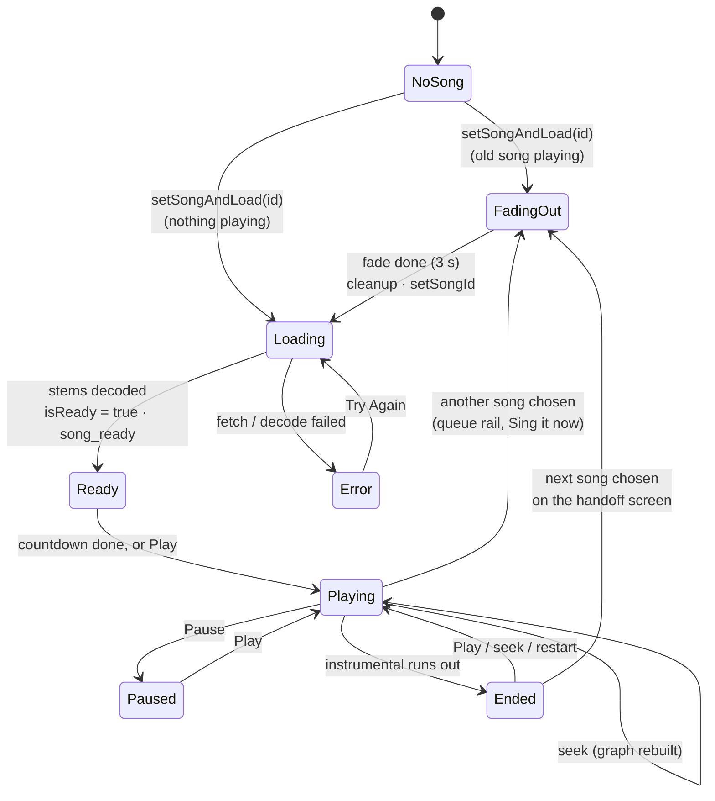

`Ended` is `songEnded: true` in `usePlaybackStateStore`, and that's what moves the shell to the
handoff screen. "Paused" and "Ready" are the same flags (`isReady && !isPlaying`); they differ only
in whether `currentTime` is zero.

### Starting a song

`StageLayout` mounts the player with `autoPlay`. Every way of starting a song ("Sing it now",
**Sing this**, the handoff screen, the queue rail, Next) only changes which song the stage is on.
[useSongStart.ts](https://github.com/spencerfrost/open-karaoke-studio/blob/master/frontend/src/features/player/hooks/useSongStart.ts), called from
`useKaraokePlayer`, is the single path that turns that into playback. It drives
[useSongCountdownStore](https://github.com/spencerfrost/open-karaoke-studio/blob/master/frontend/src/stores/useSongCountdownStore.ts), and
[SongCountdown](https://github.com/spencerfrost/open-karaoke-studio/blob/master/frontend/src/features/player/components/SongCountdown.tsx) draws it.

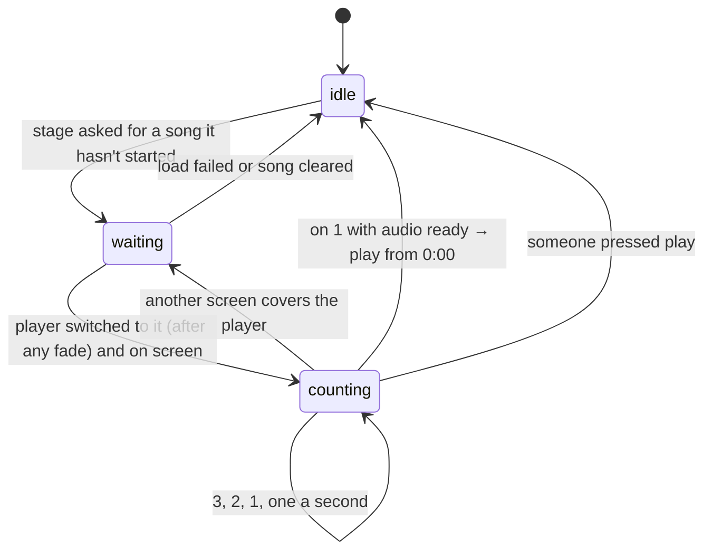

- **Over silence.** A playing song finishes its 3-second song-change fade first, with "Get ready"
  showing, so the count never runs over music. The new song plays from 0:00.
- **Holds on 1.** The audio loads under the count. If it isn't ready on 1, the store's `holding`
  flag keeps the 1 on screen until it is. No spinner, no false start.
- **Waits for the player.** `visible` is false while song select or the handoff screen covers the
  player (`keyboardEnabled`), so the count waits, and starts again from 3 if the player is covered
  mid-count.
- **Not on a restart.** Restarting keeps the song's id, so it never counts. The song already loaded
  when the page mounts doesn't count (a reload is resuming the night), nor does one that loads
  before the page has had a click or key (`navigator.userActivation`), because the browser would
  keep the AudioContext silent anyway.
- **Client-only.** Nothing about the count is sent to the server. Phones see the song as not
  playing until it starts, which is true.
- Play pressed mid-count, on the stage or a phone, just starts the song and ends the count.

### Changing songs

The full path from "Enter on the handoff screen" to sound:

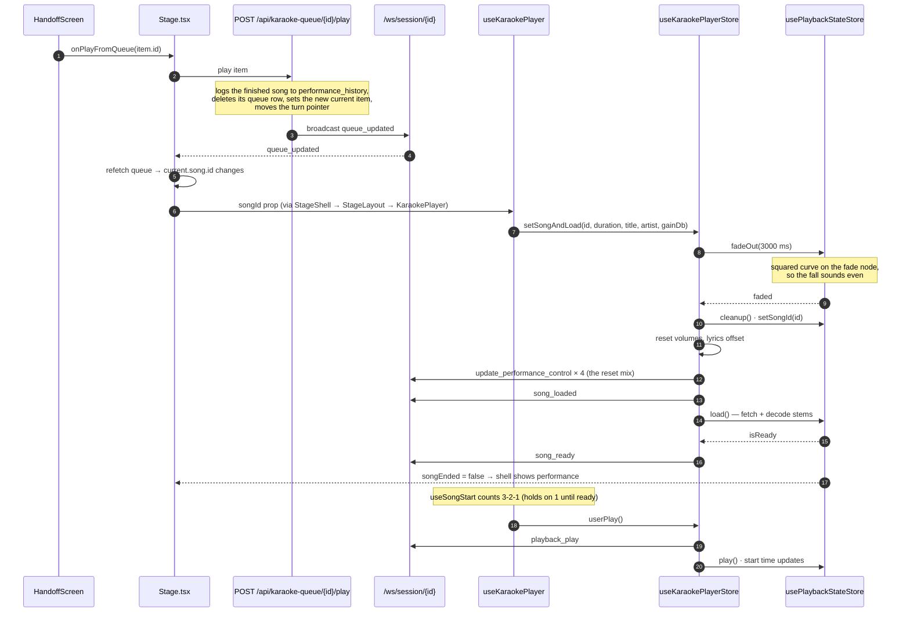

Things worth knowing about this path:

- **Songs never cut each other off.** Whatever is playing fades out over
  `SONG_CHANGE_FADE_MS = 3000` first. Pausing is still instant, and so is leaving the session.
- **A later song overtakes an earlier one.** If a second song is picked mid-fade, the first call
  sees `switchingTo` has changed and returns. A repeat call for the same song (the player's load
  effect re-running) is ignored.
- **Every new song starts from defaults**: vocals at 0, backing and instrumental at 1,
  lyrics offset 0. The TV then sends that mix to the server (`pushMixToSession`), so phones
  and anyone joining later see the reset. The server's own starting mix matches (vocals at 0).
- **"Sing it now"** on the confirm screen goes through `useSongActions.handlePlayAs`: add to the
  queue, then `POST /play`, then `shell.openPerformance()`. From there it's the same path.
  **Sing this** in the processing list ([useSingThis.ts](https://github.com/spencerfrost/open-karaoke-studio/blob/master/frontend/src/features/stage/hooks/useSingThis.ts))
  calls the same `handlePlayAs`, under the singer the rotation says is up.
- **The transport's ⏭ and the queue rail's ▶** call the same `onPlayFromQueue`.

## Syncing with other screens

The TV is the session owner's device, so the server accepts its player messages. What it sends:

| When | Message | Server does |
|---|---|---|
| A song is set | `song_loaded {songId, duration}` | Updates and persists the session's playback state, relays to the room |
| Stems decoded | `song_ready {songId, duration}` | Same, with `is_ready` |
| Play / pause pressed | `playback_play` / `playback_pause` | Same |
| Every 300 ms while playing, and on pause/seek | `update_player_state {isPlaying, currentTime, duration}` | Persists, relays `performance_state` |
| A fader or lyrics size/offset changes, a song loads, or the TV reconnects as owner | `update_performance_control {control, value}` | Updates the in-memory dict, relays `control_updated`. Not persisted. |

The gate on each of these is in [sessions-realtime.md § Message catalogue](sessions-realtime.md#message-catalogue).
In short: the player messages are session-owner only, and `update_performance_control` is open to
any connection but limited to the mix/display controls.

**What the TV listens to.** `useKaraokePlayerStore.connect()` registers handlers for
`performance_state`, `control_updated`, `playback_play` and `playback_pause`, and applies them
through `updateFromWebSocket`. Two guards stop the TV fighting its own echoes:

- **For 1 s after a local change**, the local value wins: any incoming value for that control is
  ignored, not only the echo. The TV re-broadcasts its state every few hundred ms, and a broadcast
  sent just before the server saw the change still carries the old value
  ([websocketSync.ts](https://github.com/spencerfrost/open-karaoke-studio/blob/master/frontend/src/stores/shared/websocketSync.ts)). For `current_time`
  only a value within 0.5 s of the local one is ignored.
- **During a song change**, every incoming update is ignored until 500 ms after the new song is
  ready.

### The phone

`/controls` is the performer's phone, held in one hand while the other holds the mic.
[`PerformanceControlsPanel`](https://github.com/spencerfrost/open-karaoke-studio/blob/master/frontend/src/features/performance/components/PerformanceControlsPanel.tsx)
lays the controls out by priority, separately from the TV's rail:

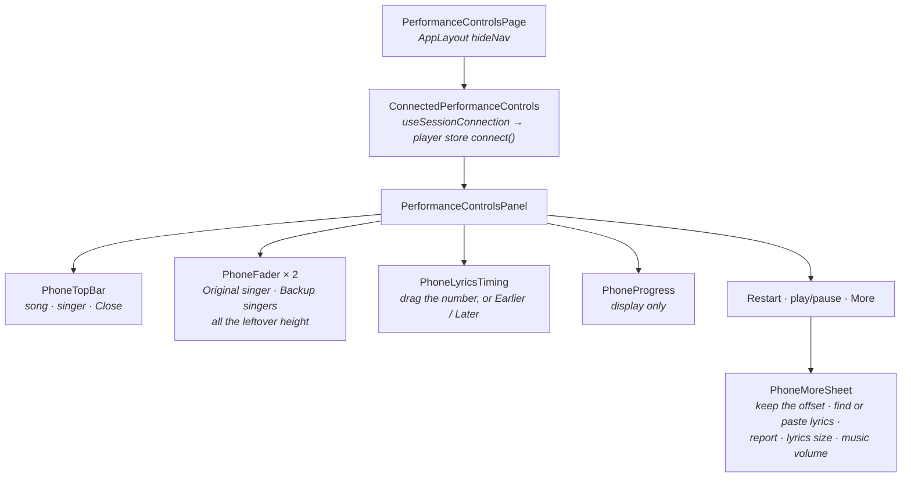

- **Two faders take the leftover height.** Each has its mute beside the level. On a two-track
  song the Backup singers fader is replaced by a line saying the song has no backup-singer track.
  That comes from the song itself (`backingVocalPath`, through
  [useBackingTrackAvailable](https://github.com/spencerfrost/open-karaoke-studio/blob/master/frontend/src/features/performance/hooks/useBackingTrackAvailable.ts)),
  not from loaded audio, since the phone loads none.
- **Lyrics timing** says in words what the offset does. A positive offset shows the lyrics
  earlier.
- **Progress is display only**, so a stray touch can't jump the song for the whole room.
- **Nothing appears or disappears during a song**, so the layout never shifts under a thumb. On a
  phone too short for everything, the page scrolls.
- Lyrics saves and reports go through [useLyricsFixes](https://github.com/spencerfrost/open-karaoke-studio/blob/master/frontend/src/features/performance/hooks/useLyricsFixes.ts),
  the same hook the TV's rail uses.

The phone mirrors the TV. `useSessionConnection` registers the player store's WebSocket listeners,
so `performance_state` and `control_updated` move the phone's faders, offset and progress. The
store keeps the song on stage as `sessionSongId`, from `session_connected` (a phone opened
mid-song) and from `song_loaded`/`song_ready`. `selectCurrentSongId` returns the song this device
plays, else that one, and the lyrics tools act on it.

Moving a fader sets the value in the phone's own stores (where it changes no sound) and sends
`update_performance_control`. The TV receives `control_updated` and changes the real gain.

There is no fullscreen button on the phone. `requestFullscreen()` needs a click in the tab that
goes fullscreen, so the TV owns that locally.

**Opening by itself.** [usePhonePresence](https://github.com/spencerfrost/open-karaoke-studio/blob/master/frontend/src/features/session/hooks/usePhonePresence.ts),
mounted app-wide through `PhonePresence`, does two things on every page:

1. Reports presence over the session socket: whether the page is on screen (Page Visibility API)
   and whether it's `/controls`. The stage's "open your phone" prompt reads the result.
2. Watches the queue's `current` item. When `current.performerId` is this phone's seat (from
   `presence_acknowledged`), it navigates to `/controls`, once per queue item
   (`presenceStore.autoOpenedItemId`), so it never drags someone back after they've left.

It's `current`, not `turn`, that decides: the moment a song starts, the turn moves on to whoever
is next. Coming back to the page re-requests the queue, so a song that started while the phone was
locked is noticed straight away. The protocol is in
[websocket-protocol.md § Presence](../websocket-protocol.md#presence).

## The other stage screens

### Song select: the wheel

[`SongWheel`](https://github.com/spencerfrost/open-karaoke-studio/blob/master/frontend/src/features/stage/wheel/SongWheel.tsx) is built to be driven with arrow keys
across about 600 artists. Its columns sit on a cylinder. ←→ turns the cylinder, ↑↓ moves within
the column at the front.

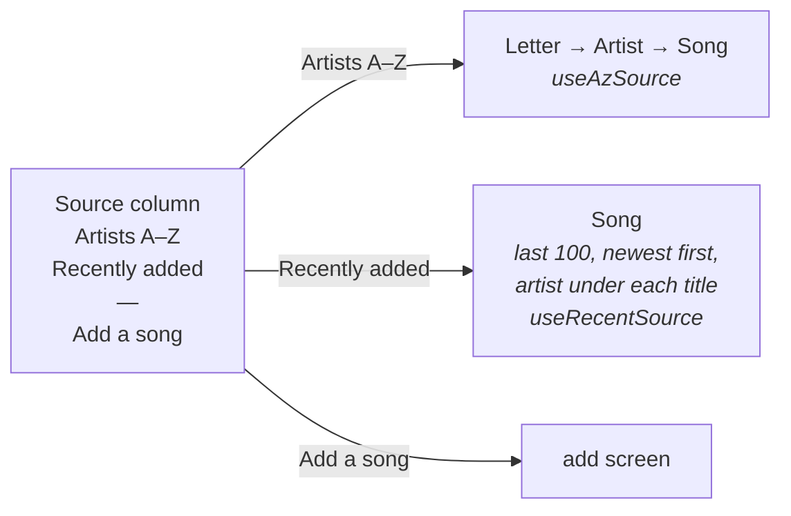

- **The first column picks a source.** Moving in it swaps the columns after it at once, and each
  source keeps its own cursors. Under the sources is an **Add a song** row, so the arrow keys reach
  it; there's also an **Add a song** button in the top bar beside Search. The column's kinds, widths
  and row heights are laid out per source in [wheelModel.ts](https://github.com/spencerfrost/open-karaoke-studio/blob/master/frontend/src/features/stage/wheel/wheelModel.ts).
- **The letter column has no cursor of its own.** It's derived from the artist cursor every time,
  so sitting on Fleetwood Mac and turning left always lands on F. `wheelModel.ts` is pure and
  tested.
- **The first column and the letters grow in place** when active instead of turning the ring to
  the middle. Each column carries the ring's turn in its own transform, so clicks reach the
  left-hand columns while the song column is in front.
- **Only rows near the screen exist**, about 17 per column. That's what makes the wheel cheap to
  mount.
- **Nothing is fetched until the cursor rests for 150 ms**: an artist's songs, the artist photo,
  the song artwork. Holding ↓ passes 30 rows a second.
- **Resting 1.5 s on a song plays a preview** at a quarter volume, through the same preview store
  as a library card's hover ([useWheelPreview.ts](https://github.com/spencerfrost/open-karaoke-studio/blob/master/frontend/src/features/stage/wheel/useWheelPreview.ts)).
- **`SongInfoCard`** on the right shows what the library actually knows about the song (lyrics
  type, year, vocal range…) and leaves out anything missing rather than showing a dash.
- **Search** is a quiet button in the top bar. Songs come up as library cards; artists are buttons
  that hand back to the wheel, landed on that artist.
- **The join QR** sits bottom-right, where the performance screen has it.
- **"Exit stage"** is deliberately small and out of reach of the arrow keys, so nobody ends the
  night by pressing Back once too often.

`StageNowPlaying`, the footer on select, confirm and add, shows the playing song with time left
and is itself the way back.

**The processing list.** [`StageProcessingList`](https://github.com/spencerfrost/open-karaoke-studio/blob/master/frontend/src/features/stage/components/StageProcessingList.tsx)
gets a column of its own on the left of song select while anything is processing, and the wheel
(scaled to fit) shrinks to make room rather than being covered. On a computer the wheel is limited
by height, so it doesn't shrink; on the TV's ~960×540 it does, until the queue empties. The column
collapses when the list is empty or search is open. It shows every song in the job queue, everyone's, so a guest can see why theirs is
still waiting: the step it's on with a progress bar, or how many are ahead. This session's songs
are marked **Yours** (matched by `owner_tag`) and stay when finished, turning into **Sing this**
beside a **Not now** that dismisses the row; other sessions' songs drop off when done. A finished
row also leaves once its song is in the queue by any route (the shell watches the queue, since the
list is only mounted on song select), or after 15 minutes untouched, checked on a one-minute timer
because the jobs feed can go quiet for hours. A song counts as finished once all its jobs, lyrics
alignment included, have left the feed. Three rows, then "and N more". The data side is
[ingestion-pipeline.md](ingestion-pipeline.md).

### Confirm: who's singing?

[`SongConfirmScreen`](https://github.com/spencerfrost/open-karaoke-studio/blob/master/frontend/src/features/stage/screens/SongConfirmScreen.tsx) asks for a
name before anything is queued from the TV, so a walk-up's song isn't filed under the host's
name. The name grid is `RosterPicker` (the session roster, plus "Someone else…" for free
text). It starts on whoever's turn it is, not on seat one
([useDefaultSinger.ts](https://github.com/spencerfrost/open-karaoke-studio/blob/master/frontend/src/features/stage/hooks/useDefaultSinger.ts)). Then "Sing it
now" (only for processed songs) or "Add to queue".

### Handoff: between songs

[`HandoffScreen`](https://github.com/spencerfrost/open-karaoke-studio/blob/master/frontend/src/features/stage/screens/HandoffScreen.tsx) renders the server's `queue.turn` and never decides
the turn itself. Three slots, always in the same place:

1. **Who's up.** `turn.performerName` at headline size, or "Who's singing?".
2. **What they're singing.** This is the only slot that changes:
   - they have a song → its artwork and title; click or Enter plays it;
   - nobody has joined → a big QR code and the join code;
   - otherwise → "check your phone, or pick one here", up to four same-artist suggestions
     (`useSongSuggestions`), and "Open the Songbook". A suggestion is filed under the turn's
     performer.
3. **How to change either.** "Skip my turn", "Add performer" (inserts them at the turn), "Remove
   from rotation" (with a 10 s undo toast). Below: on deck, the rotation ribbon, and "Just played".

Under "Just played", [`LyricsFeedbackRow`](https://github.com/spencerfrost/open-karaoke-studio/blob/master/frontend/src/features/stage/components/LyricsFeedbackRow.tsx)
asks how the lyrics were for the song that just finished. The answers feed the admin lyrics
feedback page ([lyrics-system.md](lyrics-system.md)). The screen is laid out to fit the TV's
960×540.

No timer runs here. The screen waits for a person. A 409 from a turn action means another device
got there first; it's logged and the next broadcast settles it.

`findTurnItem` ([turnItem.ts](https://github.com/spencerfrost/open-karaoke-studio/blob/master/frontend/src/features/stage/turnItem.ts)) answers "does the
next singer have a song?" in one place, because the shell asks it too (to decide where Back goes
after a song ends).

### Add, create, exit

- **`AddSongScreen`** renders the phone's `AddSongFlow` (search, artist, album) for the top of the
  shell's add stack; `back()` walks the stack before returning to song select. It hands back to
  song select as soon as a song is added. Download and separation take minutes, and the song shows up in
  the wheel when it lands, and in the processing list on song select meanwhile. The pipeline itself is [ingestion-pipeline.md](ingestion-pipeline.md).
- **`CreateSessionScreen`** renders before the shell exists. It's covered in
  [sessions-realtime.md](sessions-realtime.md#created-only-on-the-stage).
- **`ExitStagePrompt`** offers "Keep it running" (leave fullscreen, go to `/`, session and audio
  untouched) and, for the owner, "End the session" (then the recap modal). "Keep it running"
  deliberately does not call `leaveSession()`.

## The guided tour

A demo account's stage ([platform-foundations.md § Starting the demo](platform-foundations.md#starting-the-demo))
mounts [`GuidedTour`](https://github.com/spencerfrost/open-karaoke-studio/blob/master/frontend/src/features/tour/components/GuidedTour.tsx) inside
`StageShell`. It walks a visitor through one song from their phone to the TV.

```mermaid
stateDiagram-v2
    direction LR
    sound --> scan: "Sound is on" (the click that lets audio play)
    scan --> add: a phone joins
    add --> wheel: a job from this session appears
    wheel --> ready: that song comes out playable
    ready --> countdown: the count starts
    countdown --> controls: the song plays
    controls --> mix: the singer's phone opens its controls
    mix --> end: the mix moves
    end --> done
```

- **No Next buttons.** Every step after the first waits on something the app does, read from
  the stores by [useTourSignals](https://github.com/spencerfrost/open-karaoke-studio/blob/master/frontend/src/features/tour/useTourSignals.ts). The rules
  are pure functions in [tourSteps.ts](https://github.com/spencerfrost/open-karaoke-studio/blob/master/frontend/src/features/tour/tourSteps.ts).
- **Only forward.** A shortcut (picking a song off the wheel instead of waiting) jumps the tour
  ahead to match. Nothing sends it back.
- **Elements it points at** carry `data-tour` attributes (the join code, the wheel, the phone's
  faders), found by `useTourTargets`.
- **When the visitor's own song can't be had** (download quota, busy, failed), `FallbackSong`
  offers one from the library through the same **Sing this** path, so the tour carries on from
  the countdown.
- **Progress** is in [tourStore](https://github.com/spencerfrost/open-karaoke-studio/blob/master/frontend/src/stores/tourStore.ts), persisted and keyed by
  the session code plus its creation time, since codes get reused. Reloading the stage resumes the
  step. **Skip tour** is always visible.
- A phone joining a demo session lands on `/add` rather than the songbook.

The end card's "how this works" links point at `VITE_DOCS_URL` ([Demo Accounts](../demo-accounts.md)).

## The mini player

After "Keep it running", the song is still playing in the TV's browser: the stores live outside
React, and `useKaraokePlayer` deliberately never cleans up on unmount.
[`MiniPlayer`](https://github.com/spencerfrost/open-karaoke-studio/blob/master/frontend/src/components/player/MiniPlayer/MiniPlayer.tsx), mounted once in
`App.tsx`, shows a floating card with play/pause, an expand button (back to `/stage`) and close.

It shows only when a song is loaded, ready and playing, the route isn't `/stage` or `/controls`, and
it hasn't been dismissed for this song. On a phone it never appears, because a phone never loads a
song.

## Performance history

[`GET /api/performance-history`](https://github.com/spencerfrost/open-karaoke-studio/blob/master/backend/app/api/performance_history.py) is a host-only,
paginated list of every song performed, newest first, across all sessions. The library's
`RecentlySang` section reads it through `usePerformanceHistory`.

Nothing in this slice writes to it. A row is written in `POST /api/karaoke-queue/{id}/play`, when
the *previous* current song is replaced. So:

- A song is logged when the next one starts, not when it finishes.
- The last song of the night is never logged. Ending the session doesn't log it.
- `POST /skip` doesn't log either (noted in [sessions-realtime.md](sessions-realtime.md#smaller-things)).

The table also stores `performer_id` and `user_id`, which the endpoint doesn't return.

## Known debt

Found by reading the code for this doc. None of the bugs below were reproduced on a device.

### The phone's transport is always disabled

The phone's Restart and play/pause are gated on `isReady`, which only becomes true by loading
stems locally, and the phone never does. Even if they were enabled, a guest's `playback_play` and
`update_player_state` would be refused (`permission_denied`), since those are owner-only. The
stage starts songs by itself, so the panel keeps these small.

### Smaller things

- **`connect()` stacks listeners.** Each call registers nine handlers and overwrites
  `window.__playerWebSocketCleanup` without running the old cleanups. Both `useKaraokePlayer` (the
  TV) and `useSessionConnection` (the phone) call it, and every remount of `KaraokePlayer` (leaving
  `/stage` and coming back) adds another set, so a remote `playback_play` calls `play()` once per
  set.
- **`reload()` drops the loudness correction.** "Try Again" calls `setSongAndLoad` without
  `gainDb`, so the retried song plays un-normalized.
- **Lyrics size is three-way.** `setLyricsSize` writes the UI store, the persisted settings store
  and the WebSocket. Every other control is two-way.
- **`isPlaying` from the WebSocket is written straight onto the facade**, not into
  `usePlaybackStateStore`. The next change in the playback store overwrites it.

### Dead code

- `KaraokePlayer`'s `onPlay`/`onPause`/`onError` props: nothing passes them.
- `useKaraokePlayer`'s `preload` option and `preloadSong`: a TODO that only logs.
- `usePerformanceControlsLogic`'s `toggleInstrumentalVolume`, `getLyricsSizeNumericValue`,
  `handleLyricsSizeChange`: not used by any control.
- `useMiniPlayer`'s `handleDrag` and `setMiniPlayerEnabled`: the mini player can't be dragged or
  turned off from anywhere.
- `connectionStatus` from `useKaraokePlayer` never reports `"connecting"` (a TODO).

## Tests

| Test | Covers |
|---|---|
| [useKaraokePlayerStore.test.ts](https://github.com/spencerfrost/open-karaoke-studio/blob/master/frontend/src/stores/useKaraokePlayerStore.test.ts) | Defaults, clamping, WebSocket sends, `setSongId`, mini player, `songEnded`, and the song-change fade: own gain node, limiter placement, overtaking, pause mid-fade |
| [usePlaybackStateStore.test.ts](https://github.com/spencerfrost/open-karaoke-studio/blob/master/frontend/src/stores/usePlaybackStateStore.test.ts) | Stems start at one instant and offset, seek restarts them, position survives pause/play, a pause isn't an end, the instrumental running out ends the song |
| [wheelModel.test.ts](https://github.com/spencerfrost/open-karaoke-studio/blob/master/frontend/src/features/stage/wheel/wheelModel.test.ts) | Letter grouping, letter stepping, hold rates, scroll routing, the info card's derived facts |
| [turnItem.test.ts](https://github.com/spencerfrost/open-karaoke-studio/blob/master/frontend/src/features/stage/turnItem.test.ts) | `findTurnItem` |
| [useDefaultSinger.test.ts](https://github.com/spencerfrost/open-karaoke-studio/blob/master/frontend/src/features/stage/hooks/useDefaultSinger.test.ts) | Picker starts on the turn's performer, falls back to seat one |
| [useSongStart.test.ts](https://github.com/spencerfrost/open-karaoke-studio/blob/master/frontend/src/features/player/hooks/useSongStart.test.ts), [useSongCountdownStore.test.ts](https://github.com/spencerfrost/open-karaoke-studio/blob/master/frontend/src/stores/useSongCountdownStore.test.ts) | Which starts count, hold on 1, waiting while covered, play mid-count |
| [presenceStore.test.ts](https://github.com/spencerfrost/open-karaoke-studio/blob/master/frontend/src/stores/presenceStore.test.ts) | When a phone opens its controls, when the stage prompts |
| [websocketSync.test.ts](https://github.com/spencerfrost/open-karaoke-studio/blob/master/frontend/src/stores/shared/websocketSync.test.ts) | A local change wins over stale broadcasts for the debounce window |
| [tourSteps.test.ts](https://github.com/spencerfrost/open-karaoke-studio/blob/master/frontend/src/features/tour/tourSteps.test.ts) | The whole guided tour, driven through its signals |
| `backend/tests/api/test_performance_history.py` | The history endpoint |

Not covered: `StageShell`'s screen transitions, the handoff screen, `usePlaybackStateStore`'s
time keeping and end detection, `updateFromWebSocket`, the phone page.

## Cross-references

- **The session, roster, rotation, `turn`, both WebSockets and who counts as session owner** —
  [sessions-realtime.md](sessions-realtime.md).
- **The lyrics display, the lyrics search/paste dialogs, lyrics reports and the offset's LRC save** —
  [lyrics-system.md](lyrics-system.md).
- **The stems' URLs, `gain_db` measurement and three-track separation** —
  [ingestion-pipeline.md](ingestion-pipeline.md).
- **Song cards, `useSongActions`, artwork, the preview store and the artists API the wheel reads** —
  [song-library.md](song-library.md).
- **The `/stage` and `/controls` route guards, `authStore`, `AppLayout`, the demo account the
  tour runs under** — [platform-foundations.md](platform-foundations.md).
