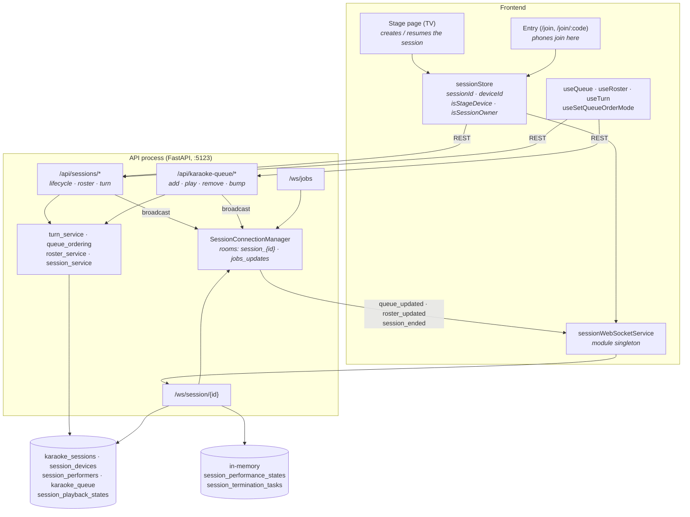
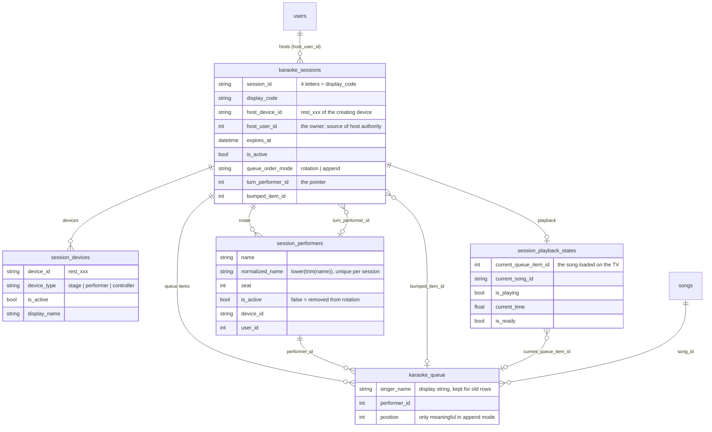
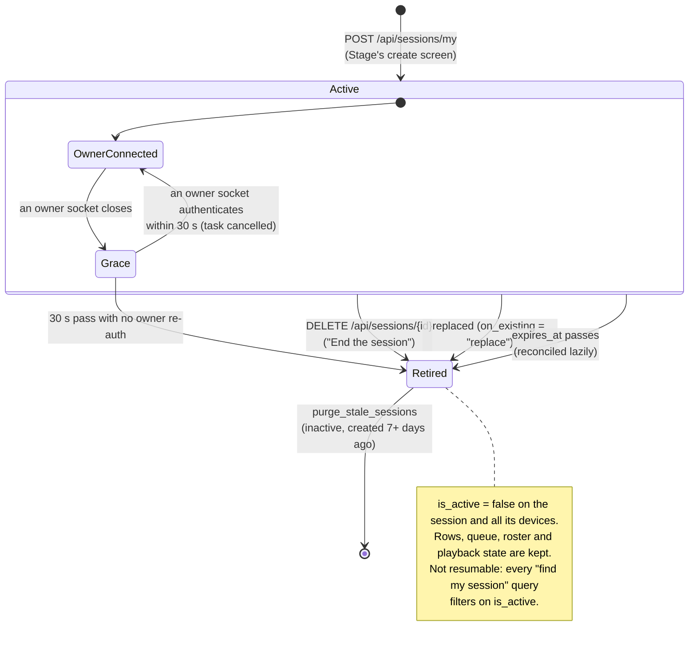
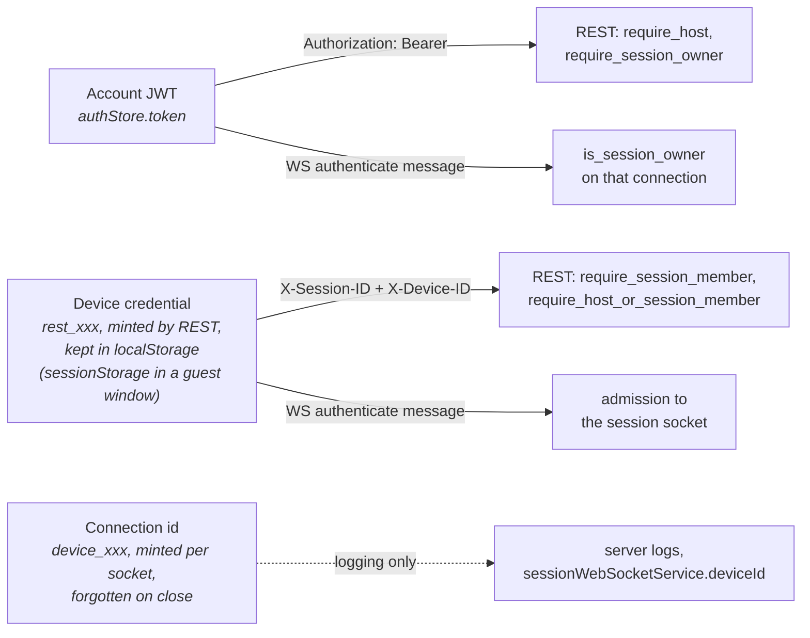
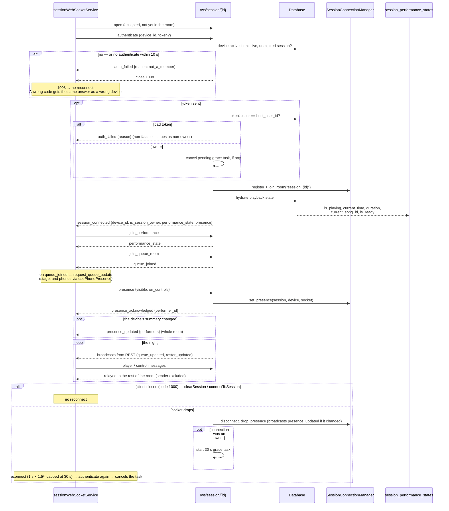
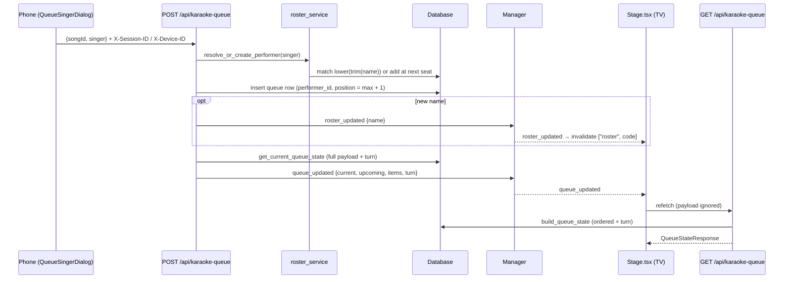
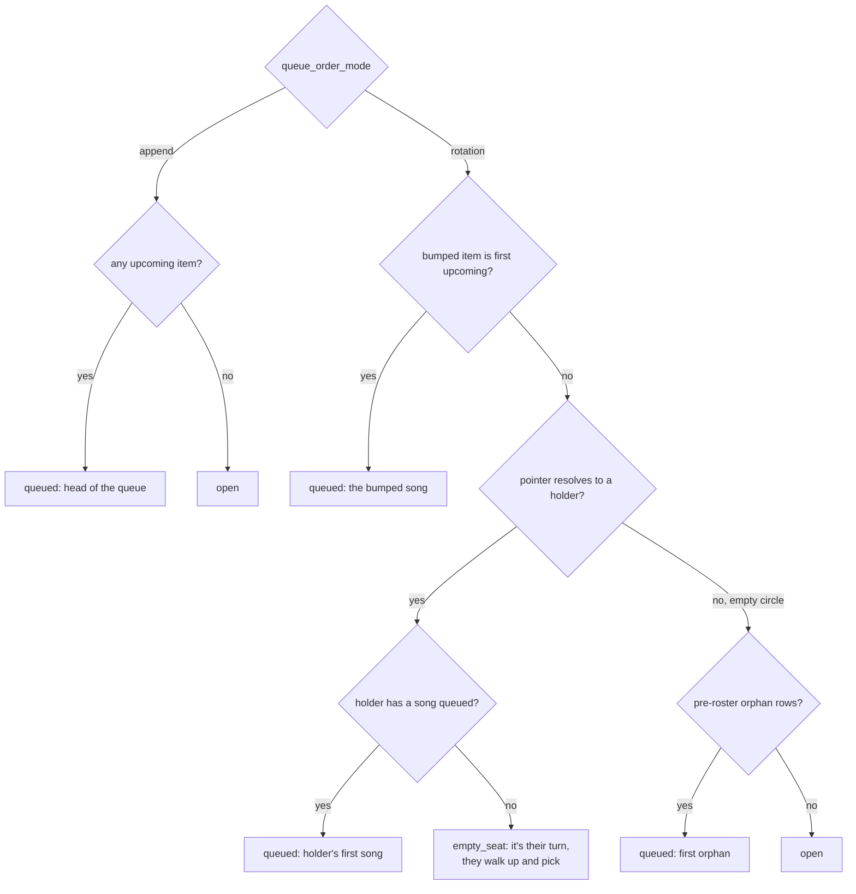
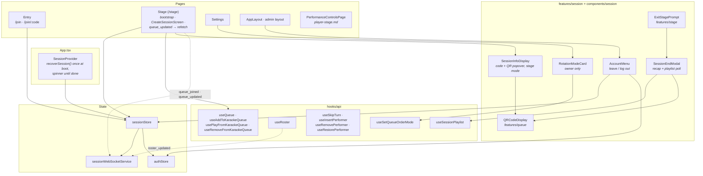
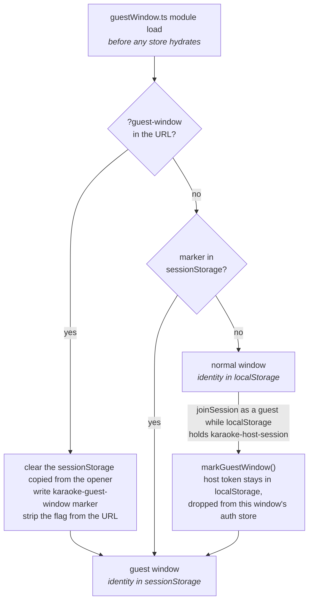

# Sessions, Queue & Realtime

How a night of karaoke is held together: the session the TV starts, the phones that join it with
a 4-letter code, the queue and the rotation that decide who sings next, and the two WebSockets
that keep every screen in step.

## The slice at a glance

The shape to keep in mind: **every change goes through REST, and the WebSocket only tells
everyone that something changed.** Queue edits, roster edits, turn moves and session ending are
all REST calls. Each one finishes by broadcasting to the session's room. The socket carries
player state and performance controls itself (that half is in [player-stage.md](player-stage.md)), but for the queue it is a
doorbell.

## Vocabulary

| Word | What it is in the code |
|---|---|
| **Session** | A `karaoke_sessions` row. Its `session_id` **is** its 4-letter `display_code` (`create_new_session` sets both to the same value). One per night, owned by a host account (`host_user_id`). |
| **Device** | A `session_devices` row. Minted by REST when a browser joins, with an id like `rest_3f9a…`. The device id plus the session id is how an anonymous phone proves it belongs to the session. |
| **Connection** | One open `/ws/session/{id}` socket, with an id like `device_x7Q…` that lasts only as long as the socket. It is unrelated to the device id above (see [Three identities](#three-identities)). |
| **Performer** | A `session_performers` row: a *name* on the night's roster, matched case- and whitespace-insensitively. It can exist with no device at all, for example a walk-up who never touches a phone. |
| **Seat** | A performer's fixed place in the rotation (`seat`). Handed out in join order. Only "Add performer" renumbers seats. |
| **Circle** | The active performers in seat order: one lap. |
| **Turn / pointer** | Whose turn it is. Stored, not derived, in `karaoke_sessions.turn_performer_id`. |
| **Bump** | A one-off "this song is next" (`bumped_item_id`), cleared when that song starts. |
| **Queue order mode** | `rotation` (the default: fair round-robin over the circle) or `append` (insert order, which the host can drag to reorder). |

## The data model

Models: [session.py](https://github.com/spencerfrost/open-karaoke-studio/blob/master/backend/app/db/models/session.py) (`KaraokeSession`,
`SessionDevice`, `SessionPlaybackState`), [performer.py](https://github.com/spencerfrost/open-karaoke-studio/blob/master/backend/app/db/models/performer.py),
[queue.py](https://github.com/spencerfrost/open-karaoke-studio/blob/master/backend/app/db/models/queue.py).

Things the diagram doesn't show:

- **The song playing now is still a queue row.** `/play` points
  `session_playback_states.current_queue_item_id` at the item, and the row stays in
  `karaoke_queue` until the *next* `/play`. At that point it is written to
  `performance_history` and deleted. Both queue payloads split the current item back out as
  `current`.
- **`position` is append mode's order and nothing else.** Rotation mode ignores it and
  computes play order on every read (see [The rotation](#the-rotation)).
- **`karaoke_sessions` ↔ `session_performers` is a foreign-key cycle** (the roster points at the
  session, the pointer points at a roster row). That's why both FKs use `use_alter`.
- **Retired sessions keep their rows**, so they keep their 4-letter code out of circulation.
  `purge_stale_sessions` hard-deletes inactive sessions created more than 7 days ago, which
  cascades to devices, queue and playback state. It runs opportunistically at the start of every
  `POST /api/sessions/my`. There's no scheduled job.

## Session lifecycle

### Created: only on the Stage

A session starts in exactly one place: the host opens `/stage` and submits
`CreateSessionScreen`. The Stage page ([Stage.tsx](https://github.com/spencerfrost/open-karaoke-studio/blob/master/frontend/src/pages/Stage.tsx)) first tries
to find a night to resume:

1. `recoverSession()` reads this window's identity storage (`karaoke-host-session`, then
   `karaoke-performer-session`; see [Guest windows](#guest-windows)) and checks it with `GET /{id}/validate` + `GET /{id}/info`.
2. If that finds nothing, `resumeAccountHostSession()` asks the server with `GET /api/sessions/my`.
   This catches a live session this browser has no record of, such as a different device or
   cleared storage.
3. Only if both come back empty does the create screen render.

The create screen calls `joinAsHost(setup)`, which is `POST /api/sessions/my` with
`device_type: "stage"`, the host's setup (`queue_order_mode`, `performer_names`, a one-off
`duration_hours`, `include_host_in_roster`) and `on_existing: "reject"`. "Reject" matters: if a
live session turns up that recovery missed, the server answers 409 with its code. The client
raises `ExistingSessionError` and the screen asks the host to **resume** or **replace**, so the
setup they just typed isn't silently thrown away.

On creation, [`get_or_create_my_session`](https://github.com/spencerfrost/open-karaoke-studio/blob/master/backend/app/api/sessions.py):

- first runs `deactivate_expired_sessions` and `purge_stale_sessions`,
- picks a code no row holds, active *or retired*
  ([`generate_display_code`](https://github.com/spencerfrost/open-karaoke-studio/blob/master/backend/app/db/models/session.py)), using the full A–Z
  alphabet,
- sets `host_user_id` to the caller. This is what makes them the owner.
- adds the stage's `SessionDevice`,
- seats the host on the roster unless they opted out, then the pre-listed names in order. These
  become anonymous roster rows that dedupe by name.

Session length is `duration_hours` if given, else the host's `HostSettings.session_duration_hours`,
else 8 hours.

The same endpoint is also the **resume** path: with `on_existing: "resume"` (the default) it returns
the newest live session. If the caller sends its known `device_id`, it reuses that device row
instead of inserting a new one, so remounting the stage doesn't add devices. Resume
never touches the roster, so a host who opted out of singing stays opted out.

### Joined: phones

[Entry.tsx](https://github.com/spencerfrost/open-karaoke-studio/blob/master/frontend/src/pages/Entry.tsx) is the app's one ungated screen (`/join`,
`/join/:code`). The stage's QR code points at `/join/ABCD`. If this browser remembers a display
name (`localStorage.karaokeDisplayName`), it auto-joins once. Otherwise it asks for the name.

`joinSession(code, "performer", name)` calls
[`POST /api/sessions/join-by-code`](https://github.com/spencerfrost/open-karaoke-studio/blob/master/backend/app/api/sessions.py) (rate-limited to
10/min). That mints a `rest_xxx` device, creates or reactivates the roster entry for the name, and
returns the session, including its `owner_tag` (see [The two WebSockets](#the-two-websockets)).
The phone stores `{sessionId, deviceId, displayName}` under `karaoke-performer-session`, and from
then on sends `X-Session-ID` + `X-Device-ID` on every
request ([`getAuthHeaders`](https://github.com/spencerfrost/open-karaoke-studio/blob/master/frontend/src/hooks/api/useApi.ts)). That header pair is the
phone's whole credential.

### Retired: four ways

| Trigger | Code | What happens |
|---|---|---|
| Host ends the night | `DELETE /api/sessions/{id}` → [`_retire_session`](https://github.com/spencerfrost/open-karaoke-studio/blob/master/backend/app/api/sessions.py) | Owner-only. Deactivates rows, broadcasts `session_ended`, closes every socket in the room, cancels any pending grace task. The client then fires `POST /{id}/playlist` for the recap. |
| Host replaces it | `POST /my` with `on_existing: "replace"` | Same `_retire_session`, then a new session is created. |
| Owner's socket gone 30 s | [`terminate_session_after_grace`](https://github.com/spencerfrost/open-karaoke-studio/blob/master/backend/app/ws/session_specific.py) | `deactivate_session` + `force_close_session_connections`. See [the grace period](#the-host-disconnect-grace-period). |
| Expiry passes | `deactivate_expired_sessions` | Lazy: runs only at the start of `POST /my`. Meanwhile join, validate, info, the WebSocket and the member credential check each test `is_expired()` themselves (410, 403 or a closed socket), so guests never see an expired-but-flagged row. Account holders hitting the queue endpoints skip that check. |

**Leaving is not ending.** [`POST /{id}/leave`](https://github.com/spencerfrost/open-karaoke-studio/blob/master/backend/app/api/sessions.py)
deactivates the caller's own device row and nothing else. The stage's **Exit stage → Keep it
running** ([ExitStagePrompt.tsx](https://github.com/spencerfrost/open-karaoke-studio/blob/master/frontend/src/features/stage/ExitStagePrompt.tsx))
deliberately doesn't even do that: it navigates to `/` inside the same SPA, so the socket
singleton stays open and the session never notices.

### The host-disconnect grace period

Sessions survive the TV's socket dropping. The rule is in the `except WebSocketDisconnect`
branch of the session endpoint:

- If the connection that closed had authenticated as the session owner, start an `asyncio.Task`
  that sleeps `HOST_DISCONNECT_GRACE_SECONDS = 30`, stored in
  `session_termination_tasks[session_id]`.
- If any connection authenticates as the owner before the 30 seconds run out, the task is
  cancelled. The client re-sends `authenticate` on every socket open, and its reconnect backoff
  starts at 1 s, so a page refresh or a Wi-Fi blip is covered.
- If the 30 seconds expire, the session is **deactivated, not deleted**: rows, queue, roster and
  playback state all stay. Every socket in the room gets `session_ended` and is closed.

"Survives" means up to 30 seconds. Past that, the night is retired. The data is kept for the
recap and the history, but the session can't be resumed: `GET`/`POST /my`, `validate`, `info`
and the WebSocket all filter on `is_active`. See also the
[multi-owner-device bug](#bug-any-one-owner-device-dropping-ends-the-night) below.

## Roles: `isStageDevice` vs `isSessionOwner`

Two fields in [sessionStore.ts](https://github.com/spencerfrost/open-karaoke-studio/blob/master/frontend/src/stores/sessionStore.ts) answer two independent
questions, and they are decided in different places on purpose:

| | `isStageDevice` | `isSessionOwner` |
|---|---|---|
| Question | Is *this browser* the TV? | Does *this account* own the session? |
| Decided by | The client, by how it entered: `joinAsHost` / `recoverHostSession` set it true, and joining by code sets it to the response's `is_host` (always false for a new device) | The server, in answer to the WebSocket `authenticate` message: it compares the JWT's user with `host_user_id` ([`resolve_host_claim`](https://github.com/spencerfrost/open-karaoke-studio/blob/master/backend/app/ws/session_specific.py)) |
| Updated | When the session is set up | On every socket (re)open, by a module-level `session_connected` listener at the bottom of `sessionStore.ts` |
| Gates | Routing: `RequireCapability device="performer"` bounces the TV off `/controls`. The session popover with the QR code (`SessionInfoDisplay`) renders only on the stage. | UI: "End the session" in the exit prompt, `RotationModeCard` in Settings, song-card host actions. Server: host-only WS messages. |

They really are independent. The host's own phone, signed in and joined by code, is an owner but
not the stage. The reverse doesn't happen in practice: the stage reaches its session through
`/my`, which only returns the caller's own, so the stage is always an owner.

### Three identities

There are three unrelated ids, and they're easy to confuse:

A device id proves *membership*, never host authority. Anyone with the code can get one from
`join-by-code` (rate limited), so it says "this browser joined the session" and nothing more.
Host authority comes only from the account JWT.

### Who may call what

From [dependencies.py](https://github.com/spencerfrost/open-karaoke-studio/blob/master/backend/app/api/dependencies.py) and the two routers.
"In the session" means a member device of that session (the `X-Session-ID`/`X-Device-ID` headers),
the account that hosts it, or an admin: the rule in
[`ensure_session_access`](platform-foundations.md#backend-the-dependency-ladder). Any other
account, and any other session's device, gets one 403 whether the session exists or not.

| Action | Endpoint | Who |
|---|---|---|
| Read queue, add a song | `GET`/`POST /api/karaoke-queue` (`require_queue_access`) | In the session |
| Load a song (`/play`), remove, bump, reorder, skip current | `/api/karaoke-queue/...` (`require_session_owner`) | Session owner (or admin) |
| Read roster, add a name | `GET`/`POST /{id}/performers` (`require_roster_access`) | In the session |
| Skip turn, add performer at turn, remove from rotation, undo | `/{id}/turn/*`, `/{id}/performers/{pid}/remove`, `/restore` | In the session. Deliberately not host-only: guests run the handoff screen at the TV between songs |
| Switch queue order mode | `PATCH /{id}/queue-order-mode` | Owner (or admin) |
| End session | `DELETE /{id}` | Owner |
| Leave (this device) | `POST /{id}/leave` | Member |
| Read session info | `GET /{id}/info` | In the session. `is_host` comes from the account, `is_self` from `X-Device-ID` |
| Join, validate | `join-by-code`, `/validate` | Anyone |
| Create a session | `POST /api/sessions`, `POST /my` | Host account |
| Generate the recap playlist | `POST /{id}/playlist` | The session's host or an admin (it writes to the server's YouTube Music account). Anyone else gets the same 404 as a missing session |
| Read the recap playlist | `GET /{id}/playlist` | In the session |

On the session WebSocket, `update_player_state`, `playback_play`, `playback_pause`,
`reset_player_state`, `song_loaded` and `song_ready` are owner-only and answer `permission_denied`
otherwise. Everything else is open to any connection in the room.

## The two WebSockets

There are exactly two endpoints, both registered in [main.py](https://github.com/spencerfrost/open-karaoke-studio/blob/master/backend/app/main.py) and
sharing one `SessionConnectionManager` (also exposed as `app.state.session_manager` so REST
handlers can broadcast):

| | `/ws/jobs` | `/ws/session/{session_id}` |
|---|---|---|
| Handler | [ws/jobs.py](https://github.com/spencerfrost/open-karaoke-studio/blob/master/backend/app/ws/jobs.py) | [ws/session_specific.py](https://github.com/spencerfrost/open-karaoke-studio/blob/master/backend/app/ws/session_specific.py) |
| Room | `jobs_updates`, global | `session_{session_id}`, one per session |
| Who connects | Every browser holding an account or a session; `jobsWebSocketService` reconnects when either changes | Every browser in a session, via `sessionWebSocketService.connectToSession` |
| Auth | First message must be `authenticate` with an account JWT or a member's `session_id` + `device_id` | First message must be `authenticate` with a member device id, plus a JWT for the host |
| Carries | The in-flight song jobs, polled by the client every 3 s while jobs are active. No join codes or user ids: each job has an opaque `owner_tag` | Player state, performance controls, queue/roster doorbells, presence, `session_ended` |

`/ws/jobs`'s message flow, and why it is polling and not push, are covered in
[ingestion-pipeline.md § How progress actually reaches the UI](ingestion-pipeline.md#how-progress-actually-reaches-the-ui).
Briefly: Celery workers run in another process and have no way into this manager. That doc is the
authority on it; nothing here contradicts it.

**Ownership without the code.** Because every session's members share `/ws/jobs`, a job can't say which session
it belongs to by `session_id`: that's the join code. `Job.to_dict()` sends
`owner_tag = HMAC-SHA256(SECRET_KEY, "job-owner:" + session_id)[:16]` instead
([owner_tag.py](https://github.com/spencerfrost/open-karaoke-studio/blob/master/backend/app/utils/owner_tag.py)), and every `SessionResponse` carries the
same tag, so a device compares the two. The jobs list also leaves out jobs with no `song_id`: a
playlist-export job's id is `playlist-{session_id}`.

### Connection lifecycle on `/ws/session/{id}`

### Message catalogue

Client → server ([`websocket_unified_session_endpoint`](https://github.com/spencerfrost/open-karaoke-studio/blob/master/backend/app/ws/session_specific.py)):

| Message | Gate | Effect |
|---|---|---|
| `authenticate {device_id, token?}` | must be first | Admits the connection if `device_id` is an active member of this live session, otherwise `auth_failed {reason: "not_a_member"}` and close 1008. A token sets `is_session_owner`; a bad one gets a non-fatal `auth_failed {reason}`. Answered by `session_connected`. Not handled after the first message. |
| `join_performance` | — | Replies `performance_state` with the session's in-memory state. |
| `update_performance_control {control, value}` | control whitelist | Sets one of the mix/display controls (`PERFORMANCE_CONTROLS`: the three volumes, `lyrics_size`, `lyrics_offset`) and relays `control_updated` to the others. Any other key gets `permission_denied`. |
| `update_player_state {isPlaying, currentTime, duration}` | owner | Updates and persists, relays `performance_state`. |
| `playback_play` / `playback_pause` / `reset_player_state` / `song_loaded` / `song_ready` | owner | Updates and persists, relays the same type with `state`. |
| `join_queue_room` | — | Replies `queue_joined`. The socket is already in the room. This is just a handshake the Stage uses as its cue to ask for the queue. |
| `request_queue_update` | — | Replies `queue_updated` with `current`/`upcoming`/`items`, without `turn` (see [debt](#two-queue-serializers-and-one-of-them-is-thrown-away)). Every item carries `performerId`. |
| `presence {visible, on_controls}` | — | Records whether this socket's page is on screen and on `/controls`, against the device it authenticated as. Replies `presence_acknowledged {performer_id}` (this device's roster seat, or `null`), and broadcasts `presence_updated` if the device's summary changed. Non-boolean fields get `permission_denied {reason: "Malformed presence report"}`. |

Server → client, beyond the replies above:

| Message | Sent by | Listened to by |
|---|---|---|
| `queue_updated {current, upcoming, items, turn}` | `broadcast_queue_update`, after every queue, turn or roster mutation | `Stage.tsx`, which refetches the queue over REST |
| `roster_updated {name}` | `broadcast_roster_update`, on a new name, remove, restore | `useRoster`, which invalidates `["roster", code]` |
| `session_ended {reason}` | `force_close_session_connections` | `sessionStore` (one listener, re-registered by every session-establishing action): `clearSession()` then a hard navigation to `/`. `endSession()` unregisters it first so the host's own recap modal survives. |
| `presence_updated {performers: [{performerId, connected, visible, onControls}]}` | `broadcast_presence_update`, on a presence change and when a socket closes | `presenceStore`, read by the stage's `OpenYourPhonePrompt` |
| `permission_denied {action, reason}` | host-only messages from a non-owner, a malformed `presence` | logged as an error by the service |

### Session isolation

The invariant from `CLAUDE.md` holds: nothing session-scoped lives in a global dictionary that
isn't keyed by `session_id`.

- `session_performance_states`, `session_cleanup_locks` and `session_termination_tasks` are
  module-level dicts in `session_specific.py`, each keyed by `session_id`.
- Presence lives on the manager as `presence[session_id][device_id][connection_id]`, and is
  cleared when the session ends. Its broadcasts name roster seats (`performerId`), never device
  ids, because a device id is the credential behind `X-Device-ID`. Only seats with a linked
  phone appear ([ws/presence.py](https://github.com/spencerfrost/open-karaoke-studio/blob/master/backend/app/ws/presence.py)).
- Broadcasts go to `session_{session_id}`, so they reach only that room. Every REST broadcaster
  takes the session id it already authorized.
- Queue rows, roster rows and playback state carry a `session_id` FK, and every query filters on
  it. `test_websocket_queue_update_is_session_specific` and `test_karaoke_queue_scoping.py`
  guard this.

Two caveats. None of this survives an API restart: performance controls (volumes, lyrics size
and offset) reset to defaults, while the persisted playback fields come back on the next
connection. And it's single-process only: run two API workers and broadcasts reach only the
sockets held by the worker that handled the REST call.

## How the queue reaches every screen

The TV is the only screen that keeps a live queue. Phones fetch it only while the singer dialog
is open (`useQueue(…, { enabled: isOpen })`), and no phone listens for `queue_updated`.

Adding a song is the one queue action phones take. **Loading** a song is an owner action:
`POST /{item_id}/play` is what the Stage calls when the handoff screen or the queue rail starts
someone. It:

1. writes the *previous* current item to `performance_history` and deletes it,
2. points `current_queue_item_id` at this item and resets playback to paused at 0,
3. calls [`turn_service.record_play`](https://github.com/spencerfrost/open-karaoke-studio/blob/master/backend/app/services/turn_service.py), the only
   automatic move of the pointer (see below),
4. broadcasts.

## The rotation

Rotation is the default mode, and the part of this domain with the most real logic in it.
[queue_ordering.py](https://github.com/spencerfrost/open-karaoke-studio/blob/master/backend/app/services/queue_ordering.py) is the read side (the circle,
who holds the turn, play order). [turn_service.py](https://github.com/spencerfrost/open-karaoke-studio/blob/master/backend/app/services/turn_service.py)
owns every write that moves the pointer. Both modules' docstrings are good and worth reading
directly.

### The model

- Everyone on the roster has a **seat**. The circle is the active performers in seat order.
- `turn_performer_id` is the **pointer**. A null or dangling pointer resolves to the lowest seat,
  or the next seat after a removed person's ([`holder_in`](https://github.com/spencerfrost/open-karaoke-studio/blob/master/backend/app/services/queue_ordering.py)).
- **Play order is projected, never stored.**
  [`project_upcoming`](https://github.com/spencerfrost/open-karaoke-studio/blob/master/backend/app/services/queue_ordering.py) walks the circle from the
  holder, lap by lap, taking each person's k-th song on the k-th pass. A bump goes first; the walk
  starts after the holder if it was the holder's song, at the holder otherwise. Songs of removed performers are hidden,
  not deleted. Rows with no performer (from before the roster) go last.
- **"The queue is empty" isn't a state.** [`compute_turn`](https://github.com/spencerfrost/open-karaoke-studio/blob/master/backend/app/services/turn_service.py)
  always names whose turn it is. It answers one of three `kind`s:

The turn rides along with every queue payload as
`{kind, performerId, performerName, itemId, circle}`. It carries `itemId`, not the item, because
the item is already `upcoming[0]`.

### What moves the pointer

| Event | Endpoint | Pointer | Notes |
|---|---|---|---|
| Holder's song starts (bumped or not) | `/play` → `record_play` | Advances to the next seat | |
| Someone else's song starts | `/play` → `record_play` | To the seat after the singer | The turn follows whoever sings. Whoever sat between the holder and them waits a lap. |
| Someone else's song starts, their first of the night | `/play` → `record_play` | Stays on the holder | They're reseated just ahead of the holder, the way Add performer seats people. A walk-up joins at the end of the circle, so following them would skip everyone in between. "First" means no `performance_history` row for them in this session. |
| Someone else's bumped song starts | `/play` → `record_play` | Stays | An extra song. `bumped_item_id` cleared (for any bumped song) |
| **Skip my turn** | `/turn/skip` | Advances | Their songs don't move, so each is a lap later. Skipping a bump cancels the bump, and the turn goes back to the holder unless the bump was the holder's own. |
| **Add performer** | `/turn/insert` | Onto the new person | Every seat ≥ the holder's moves up one, inactive rows included, so an undo still lands in place. Rejects a name already in the circle. |
| **Remove from rotation** | `/performers/{id}/remove` | Moves on, if it was theirs | `is_active = false`, songs hidden, seat kept, their bump dropped. Returns `holder_id` for the undo. |
| **Undo** | `/performers/{id}/restore` | Back onto them only if `holder_id` still matches | Otherwise they just rejoin their seat. |
| Rejoin any other way (queue a song under their name, phone join, typed) | `roster_service.mark_active` | — | Goes to the **end** of the circle with a fresh seat. |
| **Bump** | `/{item_id}/bump` | Untouched | Sets `bumped_item_id`. Owner-only, rotation only, refuses the item that's playing. |

**Concurrency is first write wins.** The handoff actions send `expected_performer_id`, the turn
the screen was showing when someone tapped. `_check_expected` 409s if the server's turn differs,
and the client turns that into `TurnMovedOnError`. That way a phone and the TV acting at the same
moment settle on one outcome. There's no locking beyond this.

**Append mode** turns most of this off: there's no circle, `record_play` is a no-op, bump 400s,
and `PUT /reorder` (drag order, which rotation refuses) is the way to edit. The handoff screen and
the projection are rotation-only. 35 tests in
[test_turn.py](https://github.com/spencerfrost/open-karaoke-studio/blob/master/backend/tests/api/test_turn.py) and 14 in `test_roster.py` pin these
rules down.

## Frontend

- **[sessionStore.ts](https://github.com/spencerfrost/open-karaoke-studio/blob/master/frontend/src/stores/sessionStore.ts)** is the session's brain on the
  client. It owns every REST lifecycle call (`joinAsHost`, `joinSession`, the three recover
  flows, `leaveSession`, `endSession`), opens the socket, and writes the two identity records
  recovery reads. It's wrapped in Zustand `persist` with `partialize: () => ({})`, so
  persistence is effectively off: the manual keys are the real persistence. `sessionInfo`
  carries the session's `owner_tag` for the processing lists.
- **[presenceStore.ts](https://github.com/spencerfrost/open-karaoke-studio/blob/master/frontend/src/stores/presenceStore.ts)** holds, in memory only, the
  session's presence by performer and this device's own seat (`myPerformerId`).
  [usePhonePresence](https://github.com/spencerfrost/open-karaoke-studio/blob/master/frontend/src/features/session/hooks/usePhonePresence.ts), mounted
  app-wide, reports presence on every visibility or route change, and opens `/controls` once per
  queue item when `current.performerId` is this device's seat. See
  [player-stage.md § The phone](player-stage.md#the-phone).
- **[sessionWebSocketService.ts](https://github.com/spencerfrost/open-karaoke-studio/blob/master/frontend/src/services/sessionWebSocketService.ts)** is a
  singleton event emitter over one socket. It authenticates on every open, sends
  `join_performance` + `join_queue_room`, reconnects forever unless closed with 1000, and
  exposes typed `on()` subscriptions that return cleanup functions.
- **[SessionContext.tsx](https://github.com/spencerfrost/open-karaoke-studio/blob/master/frontend/src/contexts/SessionContext.tsx)** runs recovery once at
  boot and holds rendering until it's done. It never creates a session: sessions start only on the
  Stage.
- **Route gating** (`RequireAccess`, `RequireCapability`, `useAccess`) belongs to
  [platform-foundations.md](platform-foundations.md). The
  part that touches this slice is that `canEnter` is "an account **or** a session", so a phone
  with only a device credential gets the whole app except `/settings`, `/stage` and `/admin`.
- **Queue and turn UI lives in `features/stage`** (the handoff screen, the queue rail, the
  confirm-singer screen). That's in [player-stage.md](player-stage.md). `features/queue` is down to
  `QRCodeDisplay`.

### Guest windows

Every window on an origin shares `localStorage`. That's right for the host (the stage, library
and settings tabs should be one signed-in person), but a guest joined from the same browser would
overwrite the host's records. So the auth and session stores persist through
`guestWindow.identityStorage` ([guestWindow.ts](https://github.com/spencerfrost/open-karaoke-studio/blob/master/frontend/src/lib/guestWindow.ts)), which
is `sessionStorage` in a guest window and `localStorage` otherwise.

The stage's **No phone? Open a phone view** opens one by name (`karaoke-phone-view`), a ~400 px
popup at `/join/<CODE>?guest-window`. Pressing it again brings back the same window rather than
signing a new guest in. A browser that refuses `sessionStorage` keeps a guest window's identity in
memory, so it's lost on reload but never falls back to the shared area.

## Session recap playlist

When the host ends the night, `endSession()` fires `POST /api/sessions/{id}/playlist` and
`SessionEndModal` polls `GET` every 3 s
([session_playlist.py](https://github.com/spencerfrost/open-karaoke-studio/blob/master/backend/app/api/session_playlist.py),
[useSessionPlaylist.ts](https://github.com/spencerfrost/open-karaoke-studio/blob/master/frontend/src/features/session/hooks/useSessionPlaylist.ts)). The
backend runs a FastAPI `BackgroundTask`, not Celery. It collects the `video_id` of every
`performance_history` row for the session in order, creates a YouTube Music playlist named
"Karaoke Night — {date}", and keeps its state in a `Job` row with id `playlist-{session_id}`
(status JSON in `status_message`). It's idempotent per session: a second POST returns the existing
job.

## Known debt

The bugs below were found by reading the code. None has been reproduced in the app.

### Bug: any one owner device dropping ends the night

The grace task is started whenever *a* connection that authenticated as the owner closes. It's
cancelled only when an owner connection *authenticates*. Nothing checks whether another owner
connection is still open.

So with the TV on stage and the host's own phone signed in and in the session, both connections
are owners. When the phone locks, its socket closes, the 30-second timer starts, and nothing
cancels it: the TV is already connected and never re-authenticates. Thirty seconds later the
session is deactivated and every screen, the TV included, gets `session_ended` and is bounced to
`/`. The reverse (the TV dropping while the phone stays) does the same.

The data survives (the session is deactivated, not deleted), but the night is over. A fix would check the room
for another owner connection before starting the timer, and again when it fires. That needs the
manager to remember which connections are owners, which it doesn't today. No test covers the
grace period at all (`test_ws_host_authority.py` covers authentication only).

### Two queue serializers, and one of them is thrown away

`build_queue_state` ([karaoke_queue.py](https://github.com/spencerfrost/open-karaoke-studio/blob/master/backend/app/api/karaoke_queue.py), REST) and
`get_current_queue_state` ([ws/queue.py](https://github.com/spencerfrost/open-karaoke-studio/blob/master/backend/app/ws/queue.py), WebSocket) each
hand-build the same item and song dicts, cover-art fallback included. Ordering was unified into
`queue_ordering`, and the turn into `serialize_turn`, both because these two had already drifted.
The item serializer is still duplicated, and `/play`'s response has a third copy of the cover-art
rule.

The WebSocket copy is also mostly wasted. The only `queue_updated` listener, `Stage.tsx`, ignores
the payload and refetches over REST. So every mutation computes the full queue and turn once for
the broadcast, then once more per TV for the refetch. And `request_queue_update`'s reply omits
`turn`. That's harmless today only because the reply also triggers a refetch.

### A doorbell that doesn't ring

`PATCH /queue-order-mode` doesn't broadcast. Switching between rotation and append in Settings
changes play order and the turn, but the TV keeps showing the old order until some other mutation
rings.

### Smaller things

- **`update_performance_control` is open to every member.** It can only set the mix/display
  controls, but any joined phone can change them, not just the singer's.
- **`connectedDevices` is never populated.** The store initializes it to `[]` and nothing writes
  it. `SessionInfoDisplay`'s "N participants" therefore always says 0, and its device list never
  renders. The data is in `sessionInfo.connected_devices`, from the last REST response.
- **The recap playlist is keyed by the 4-letter code, which gets reused.** Once
  `purge_stale_sessions` frees a code, a later session with the same code finds the old
  `playlist-ABCD` job. Both endpoints ignore a job older than the session row, so the old playlist
  isn't handed over, and `POST` replaces it. A failed generation still can't be retried, since
  the failed job is this session's own.
- **`/skip` (skip the song playing now) doesn't record `performance_history`** and doesn't touch
  the turn, unlike moving on with `/play`. It has no frontend caller today, so this is latent.
- **`join-by-id` uses the caller's IP as the device id** and returns no `device_id`. That makes it
  a device that can never authenticate as a member. The client only takes this path when the code
  isn't 4 characters, which since `session_id == display_code` never happens.
- **Expiry is reconciled lazily** (only on `POST /my`). Guests can't reach an expired session, but
  an account can still add to its queue, and "active" counts in the DB overstate.
- **Connection-manager leaks.** For every unified-endpoint socket, `connect()` records
  `device_sessions["ws_<id>"]` and `disconnect()` never removes it. Empty room lists are never
  pruned. Both are a few bytes per connection, held until restart.
- **`remove_from_queue` is owner-only,** so a guest can't take back a song they queued by mistake.
  This may be deliberate. Nothing documents it either way.

### Dead code

| What | Where | Note |
|---|---|---|
| The manager's own session registry: `sessions`, `create_session`, `find_session_by_*`, `join_session`/`leave_session`, `get_session_for_device`, its `generate_*` | [connection_manager.py](https://github.com/spencerfrost/open-karaoke-studio/blob/master/backend/app/ws/connection_manager.py) | Nothing calls `create_session`, so `manager.sessions` is always empty and `join_session`/`leave_session` are silent no-ops. Its `generate_display_code` has a different alphabet from the real one in `KaraokeSession`. |
| `broadcast_queue_item_added` / `_removed` / `_reordered` | [ws/queue.py](https://github.com/spencerfrost/open-karaoke-studio/blob/master/backend/app/ws/queue.py) | Broadcast to a `karaoke_queue` room nobody joins. No callers. |
| `POST /api/sessions` (plain create) and the store's `createSession` | `sessions.py`, `sessionStore.ts` | No frontend caller. Sessions are created only through `/my`. |
| `PUT /reorder`, `POST /{id}/bump`, `POST /skip`, `useAddPerformer` | queue API, `useRoster.ts` | Implemented and tested, with no UI calling them yet. Bump is described in the plans as a host gesture. |
| `WebsocketStatus`, `EndSessionButton`, `useSessionContext` | `features/session`, `hooks/` | Exported, never imported |

## Tests

| File | Covers |
|---|---|
| [test_turn.py](https://github.com/spencerfrost/open-karaoke-studio/blob/master/backend/tests/api/test_turn.py) | 35 tests: the rotation projection, pointer moves, out-of-turn songs, bump, skip, insert, remove/restore, 409s |
| `test_roster.py` | Name matching, seats, rejoin-to-the-end |
| `test_sessions.py` | `/my` create/resume/reject/replace, end vs. leave, deactivate-not-delete, purge |
| `test_karaoke_queue.py`, `test_karaoke_queue_scoping.py` | Queue CRUD and that a member can't reach another session's queue |
| `integration/test_karaoke_queue_websockets.py` | Broadcasts stay in their session, playback state survives a reconnect, performance controls can't write playback state |
| `integration/test_ws_host_authority.py` | Unprivileged start, owner vs. non-owner tokens, host-only messages |
| `unit/test_ws/test_connection_manager.py` | Rooms and broadcast, including the dead registry, and presence per socket |
| `integration/test_ws_presence.py` | Presence reports, acknowledgements, broadcasts by seat, malformed reports, disconnects |
| `unit/test_utils/test_owner_tag.py` | The owner tag |
| [guestWindow.test.ts](https://github.com/spencerfrost/open-karaoke-studio/blob/master/frontend/src/lib/guestWindow.test.ts), [sessionStore.guestWindow.test.ts](https://github.com/spencerfrost/open-karaoke-studio/blob/master/frontend/src/stores/sessionStore.guestWindow.test.ts) | Opening as a guest window, converting at join time |

Not covered: the grace period.

## Cross-references

- **What `/ws/jobs` carries (including `owner_tag` and `step`), and why job progress is polled** —
  [ingestion-pipeline.md](ingestion-pipeline.md#how-progress-actually-reaches-the-ui).
- **The songs a queue row points at, cover-art resolution, the song card's "Add to queue" and
  `QueueSingerDialog`** — [song-library.md](song-library.md).
- **The `syncedLyrics`/`plainLyrics` every queue payload carries** — [lyrics-system.md](lyrics-system.md).
- **The handoff screen, queue rail, confirm screen, `CreateSessionScreen`, `ExitStagePrompt`, the
  player store's half of this socket (performance state, `song_loaded`/`song_ready`), and the
  performance controls page** — [player-stage.md](player-stage.md).
- **`authStore`, the JWT, `require_host`, route guards, `HostSettings` (default session length)** —
  [platform-foundations.md](platform-foundations.md).
