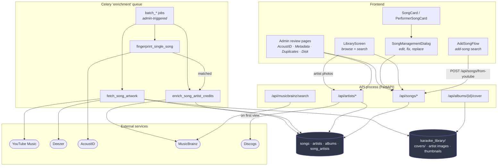
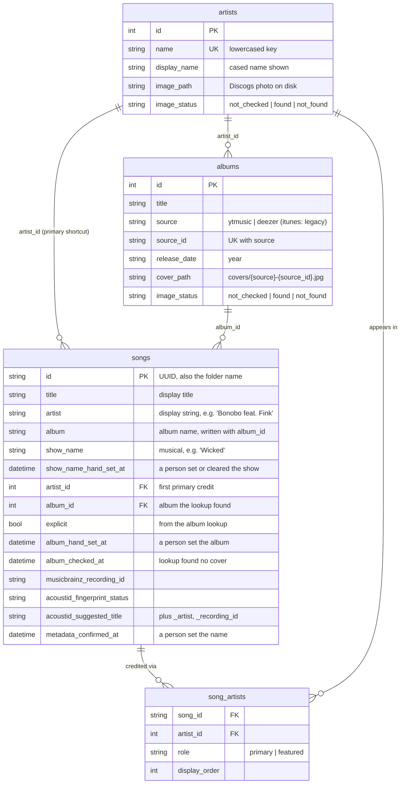
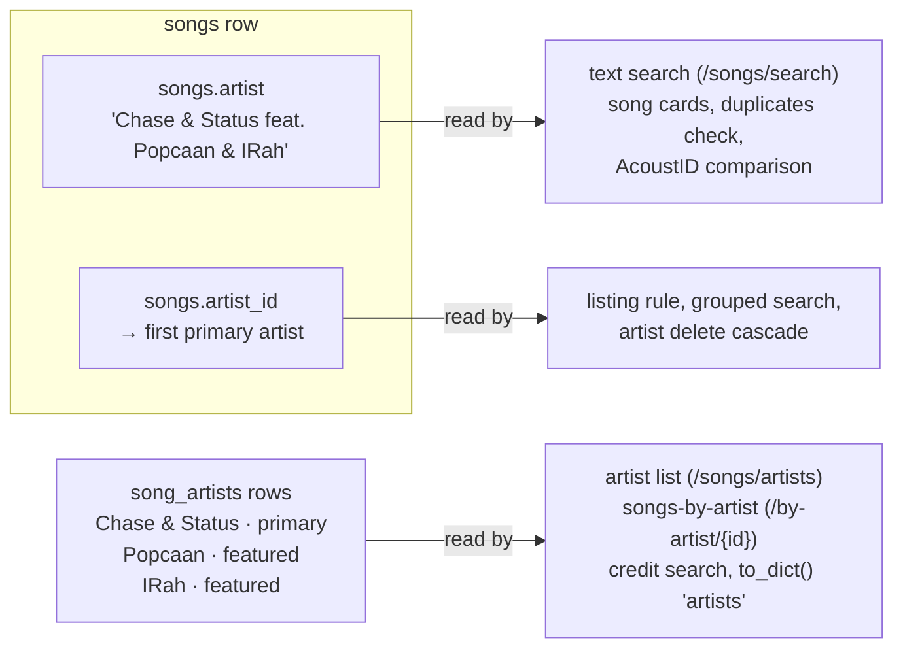
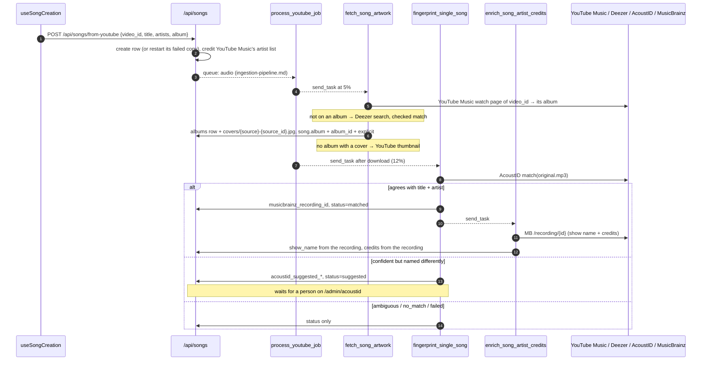
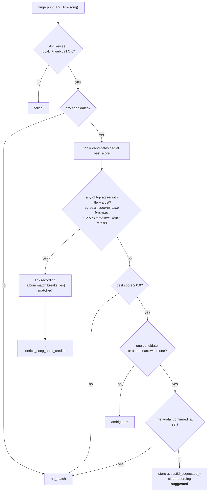
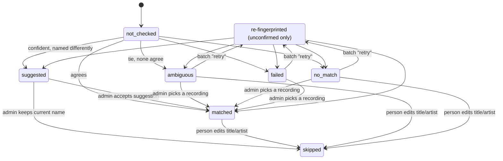
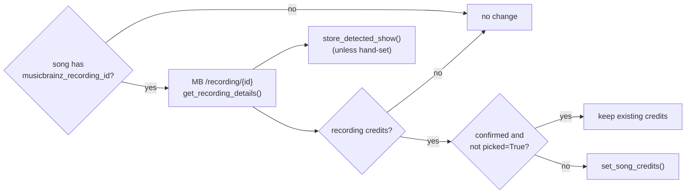
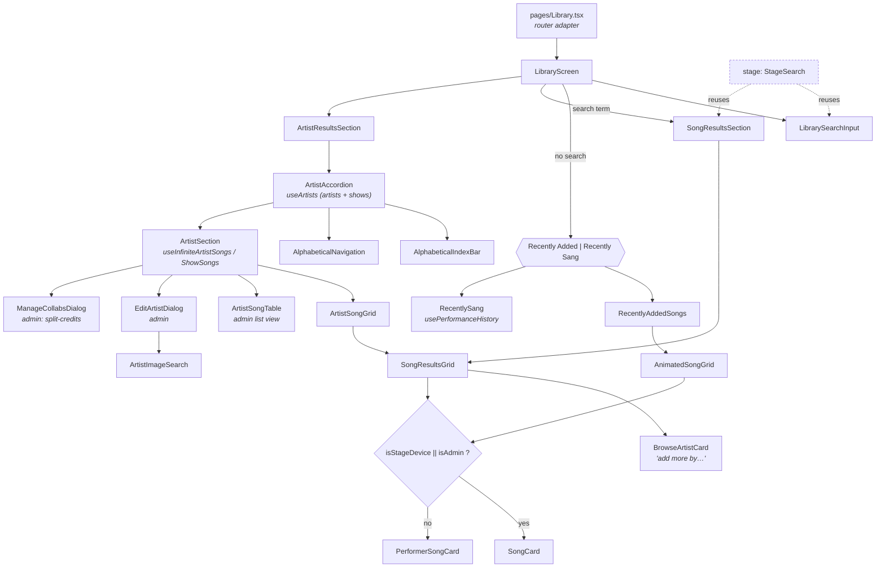
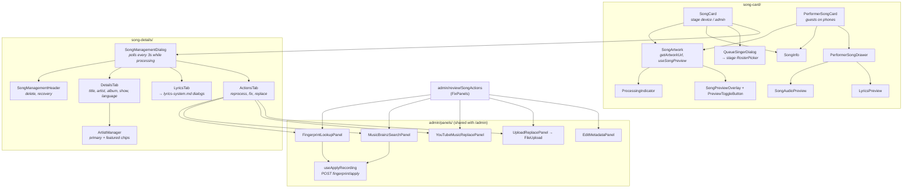
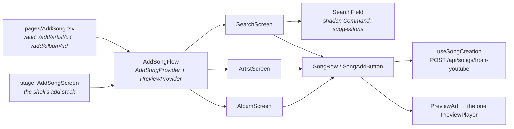

# Song & Library Metadata

What a song *is*: its name and artist, who's credited on it, which album and cover it shows,
how it gets identified by its audio, and how people browse and search the result.

## The slice at a glance

Two facts to hold onto before reading the rest:

1. **A song's name has several writers and no single owner.** The add-song form, the edit
   dialog, the AcoustID review, the "split credits" dialog and the credits enrichment task all
   write some part of "who is this by". [Who writes what](#who-writes-what) lays it out. Most of
   the confusing behaviour in this domain comes from two of those writers disagreeing.
2. **Each enrichment source answers one question.** YouTube Music (or Deezer) picks the album and cover, AcoustID
   picks the MusicBrainz recording, MusicBrainz supplies artist credits and the show name, and
   Discogs supplies artist photos. None of them is allowed to rename a song on its own any more
   (see [AcoustID](#acoustid-link-don-t-rename)).

## The data model

Model files: [song.py](https://github.com/spencerfrost/open-karaoke-studio/blob/master/backend/app/db/models/song.py),
[artist.py](https://github.com/spencerfrost/open-karaoke-studio/blob/master/backend/app/db/models/artist.py),
[album.py](https://github.com/spencerfrost/open-karaoke-studio/blob/master/backend/app/db/models/album.py),
[song_artist.py](https://github.com/spencerfrost/open-karaoke-studio/blob/master/backend/app/db/models/song_artist.py). The lyrics columns
(`plain_lyrics`, `synced_lyrics`, `word_synced_lyrics`, `lyrics_hand_picked_at`) and the audio
analysis columns (`vocal_range_*`, `loudness_lufs`, `gain_db`, `singing_map`) live on `songs` too, but they
belong to [lyrics-system.md](lyrics-system.md) and [ingestion-pipeline.md](ingestion-pipeline.md).

### One artist, three representations

The "artist" of a song is stored three ways, and each read path uses a different one:

- **`songs.artist`** is the display string. It's what the add-song form sent, or what a person
  typed. Search, the cards and the duplicate finder all read it. Automatic credit updates never
  rewrite it; it changes only when a person edits it or edits the credits (then it's rebuilt
  from the list, "A & B feat. C").
- **`song_artists`** is the structured version: one row per credited artist, with a role and
  `credited_as`, the name as that recording prints it ("Dixie Chicks" on a song by The Chicks).
  Browsing by artist joins through it. The stage wheel shows featured artists from it
  (`songByline`), so correct credits show there without touching the text.
- **`songs.artist_id`** is the first primary artist, set whenever the credits are written.

An artist row has `name` (the lowercased key), `display_name` (the cased name shown), and two
ids when known: `musicbrainz_artist_id`, the artist's identity, and `youtube_music_artist_id`,
their YouTube Music channel. `artist_aliases` holds the other names an artist goes by, keyed by
`normalize_artist_name()` (accents, case, "&"/"and", a leading "The" and punctuation folded): their
MusicBrainz aliases, every name a credit printed, and the names of artists merged into them.

## Who writes what

| Writer | Trigger | `title` / `artist` | `song_artists` + `artist_id` | `album_id` | recording / status | `metadata_confirmed_at` |
|---|---|---|---|---|---|---|
| `POST /api/songs/from-youtube` | add-song flow | from the search result; every credited artist as "Primary feat. A, B" | YouTube Music's list: first primary, rest featured, with channel ids | — | — | — |
| `PATCH /api/songs/{id}` | Details tab, admin "Edit details" | what the person typed; rebuilt from `artists` when that's sent | `artists` as given, else parsed if `artist` changed | kept on a new name (`album_hand_set_at` set); cleared with the name | clears the recording; status → `skipped` if title/artist was typed | set if title/artist changed or `artists` sent |
| `fetch_song_artwork` | pipeline at 5%; `batch_fetch_albums` | — | — | YouTube Music exact video, else a checked Deezer match; skips hand-set albums | — | — |
| `fingerprint_single_song` | pipeline; admin "Fingerprint"; batch | never | — | — | links on agreement, else suggests | — |
| `enrich_song_artist_credits` | after a `matched` fingerprint; after a person picks a recording | never | the recording's MB credits; none → kept | — | — | skipped if set, unless `picked=True` |
| `fingerprint/apply`, `suggestion/accept` | admin picks a recording | the picked names | credits task with `picked=True` | — | sets it, `matched` | set |
| `skip-fingerprint` | admin "Keep current name" | kept | — | — | `skipped` | set |
| `POST /api/artists/{id}/split-credits` | Manage collabs dialog | rebuilt from the new credits | the given credits in the artist's place (all featured where it was featured) | — | — | set |
| `POST /api/artists/{id}/merge-into/{target}` | Edit artist → Merge into… | — | moved to the target | — | — | — |
| `batch_rebuild_artist_credits` | admin Jobs page, Artist credits | never | MB credits for every song with a recording, even confirmed; older songs without one re-parsed | — | — | — |

Every writer of `song_artists` goes through one function, `set_song_credits`; see
[Artist credits](#artist-credits).

## How a new song gets its metadata

The task names, queues and dispatch points are in
[Ingestion pipeline § Workers and queues](ingestion-pipeline.md#workers-and-queues). The
initial title, artist and album are whatever the frontend's search result said: YouTube Music
gives structured track/artist/album, while a plain YouTube video gives a parsed video title. No
server-side step cleans those up. The admin Metadata page's "Raw YouTube Title" check
(`_check_song_metadata` in [songs.py](https://github.com/spencerfrost/open-karaoke-studio/blob/master/backend/app/api/songs.py)) exists to catch the
leftovers.

## AcoustID: link, don't rename

[acoustid_service.py](https://github.com/spencerfrost/open-karaoke-studio/blob/master/backend/app/services/acoustid_service.py) fingerprints the audio
(`original.mp3`, falling back to `instrumental.mp3` then `vocals.mp3`) and asks AcoustID which
MusicBrainz recordings it matches. Its only job now is to **link a recording**. It never writes
`title` or `artist`.

A song a person has confirmed is treated specially in `_unresolved()`: anything short of
`failed` is recorded as `matched` (if it keeps a recording) or `skipped`, so it never drops back
into the review queue. An unconfirmed song loses any recording an earlier run had linked.

### Fingerprint status lifecycle

"Admin picks a recording" means applying a candidate from a fresh fingerprint lookup or a
MusicBrainz search on the AcoustID page.

The batch job ([batch_tasks.py](https://github.com/spencerfrost/open-karaoke-studio/blob/master/backend/app/jobs/batch_tasks.py),
`batch_fingerprint_songs`) has two modes, defined in
[batch_jobs.py](https://github.com/spencerfrost/open-karaoke-studio/blob/master/backend/app/services/batch_jobs.py): `missing` (`not_checked` songs) and
`retry` (unconfirmed songs that are `ambiguous`, `no_match` or `failed`). There's deliberately no
`all` mode. Re-running every song is what re-trampled the hand-fixed names before the rework.

## Artist credits

Credits arrive as a list from whatever knows the artists; the parser only runs when nothing
does. `set_song_credits(session, song, credits)` in
[song_artist_service.py](https://github.com/spencerfrost/open-karaoke-studio/blob/master/backend/app/services/song_artist_service.py) is the one function
that writes `song_artists` and `songs.artist_id`.

| Event | Credits written | Song confirmed? |
|---|---|---|
| Song added from YouTube Music | YouTube Music's artist list: first is primary, the rest featured | no |
| Song uploaded, or added with no artist list | parsed from the artist text and title | no |
| Fingerprinting links a recording | the recording's MusicBrainz credits, unless the song is confirmed | no change |
| A person picks or accepts a recording | the recording's MusicBrainz credits | yes |
| A person edits the credit list | the list as given | yes |
| A person edits only the artist text | parsed from the new text | yes |
| split-credits | the given list, in the split artist's place | yes |

`metadata_confirmed_at` is the only lock: automatic runs leave a confirmed song's credits alone.
`enrich_song_artist_credits` in [metadata_tasks.py](https://github.com/spencerfrost/open-karaoke-studio/blob/master/backend/app/jobs/metadata_tasks.py)
writes the recording's credits, or leaves the song as it is when the recording has none. There's
no MusicBrainz search: a song with no recording keeps the list it came with or the parser's
result.

### Resolving a credited name to an artist

`ArtistRepository.resolve(name, mbid, ytm_id, credited_as=…)` tries, in order: the MusicBrainz
artist id, the YouTube Music channel id, an alias, the stored name; `credited_as` is tried by
alias and name too. Nothing found creates the artist. A match by name picks up whichever ids the
credit carries, and a properly cased name replaces a lowercase `display_name` (never one a person
set). Unicode hyphens (U+2010, U+2011) become plain ones first, so MusicBrainz's "Jay‐Z" is the
"Jay-Z" a person types.

### The parser (the fallback)

[artist_parsing.py](https://github.com/spencerfrost/open-karaoke-studio/blob/master/backend/app/services/artist_parsing.py):

- **Featured part.** After "feat."/"ft."/"featuring", split on ",", "&", "and" and "with": band
  names almost never sit in the featured slot. "& The …", "and His …" and similar stay joined.
- **Primary part.** Left whole ("Chase & Status"), unless every half of an "&" or "and" split is
  an artist already (`split_known_primaries`): "Amber Mark & John The Blind" splits once both
  are in the library. "X & The Y" never splits.
- **Title.** "(feat. X)" / "[ft. X & Y]" in the title adds featured credits. The title is left
  as it is.

### MusicBrainz credits

`_parse_artist_credits` in [musicbrainz_service.py](https://github.com/spencerfrost/open-karaoke-studio/blob/master/backend/app/services/musicbrainz_service.py)
reads roles from the joinphrases: every artist after a "feat."/"ft." joinphrase is featured, so
"Amber Mark & John The Blind" comes back as two primaries and "Bob Marley & The Wailers" as one
entity. Each credit keeps the artist's MB id, their current name, and the name as credited.
MusicBrainz credits beat YouTube Music's: they list each artist as an entity with a role.

### The artist list

`GET /api/songs/artists` lists an artist when they have at least one primary credit, **or** are
featured on songs by two or more different primary artists. A one-off guest (Bou, IRah) isn't
listed; their songs file under the primary artist, and search still finds them (`listed: false`
in a search). Each artist carries `ownCount` and `featuredCount`. An artist's page, and the stage
wheel's song column, show their own songs first, then the ones they appear on.

### Merging and the rebuild job

`ArtistRepository.merge_into(source, target)` moves every credit to the target (a song crediting
both keeps one, primary over featured), repoints `songs.artist_id` and `albums.artist_id`, keeps
the source's names as aliases, takes its ids and photo when the target has none, and deletes it.
Admins run it from Edit artist → Merge into….

The **Artist credits** job on the admin Jobs page (`batch_rebuild_artist_credits`, logic in
[artist_credits_rebuild.py](https://github.com/spencerfrost/open-karaoke-studio/blob/master/backend/app/services/artist_credits_rebuild.py)) re-credits the
whole library in one pass:

1. Looks up every linked recording and every artist with an MB id on MusicBrainz, at 1 request a
   second, retrying 503s. Responses are cached in `karaoke_library/cache/musicbrainz/`, so a
   re-run, and an apply after a preview, asks nothing again.
2. Credits every song with a recording from its MB credits, **including confirmed songs**: their
   credits came from parsing the text, not from a list a person picked. A song without one is
   re-parsed if its credits have no `credited_as` (written before credits came as lists).
3. Records MB aliases, merges rows MB names as one artist and rows whose names match once
   normalized, names artists with MusicBrainz's current name (a lowercase row without one takes
   the spelling its credits print), and deletes artists nothing refers to.

`preview` does all of it in one transaction and rolls back; `apply` commits. Both save a report
on the run (`GET /api/admin/jobs/runs/{id}/report`): changed songs before → after, merges,
renames, deleted artists, songs without a recording whose primary artist has "&" or "and", songs
whose credits still don't name the artist in their text, and library counts before and after.
Take a `pg_dump` before applying.

## Album and cover

One lookup in [album_service.py](https://github.com/spencerfrost/open-karaoke-studio/blob/master/backend/app/services/album_service.py) finds the album
name, its cover and the explicit flag, and writes `songs.album`, `songs.album_id` and
`songs.explicit` in one transaction, so the name and the cover beside it come from the same
release:

1. **YouTube Music, exact video.** `get_watch_playlist(video_id)` returns the album YouTube Music
   files that video under, which is the release whose audio we downloaded. Its art is fetched at
   1200px square. A search for `artist title` supplies the explicit flag (only search results
   carry it). Music videos and plain uploads have no album and fall through.
2. **Deezer.** A plain `artist title` search (Deezer's `artist:"…"` filter returns nothing),
   taking the first result whose artist and title match: names normalized, "feat." credits
   dropped, version markers (live, acoustic, remix, demo…) agreeing, and karaoke, tribute,
   "in the style of", instrumental and 8-bit albums rejected. Art is `cover_xl` (1000px).
3. **Nothing.** The song keeps its YouTube thumbnail and `album_checked_at` is set.

Albums are keyed by `(source, source_id)`, so songs on the same release share one row and one
cover file, `karaoke_library/covers/{source}-{source_id}.jpg`, served by `GET /api/albums/{id}/cover`.
The file is named after the release, not the row, because dev and prod share one library folder
but number their albums separately: a release's cover is the same picture in both.

A person editing the album name sets `album_hand_set_at`; automatic lookups then skip the song
and its cover stays linked. Clearing the name clears the link and the marker.

The frontend's `getArtworkUrl` in [useSongs.ts](https://github.com/spencerfrost/open-karaoke-studio/blob/master/frontend/src/hooks/api/useSongs.ts) picks
album cover → `/api/songs/{id}/thumbnail` (the YouTube thumbnail saved on disk) → the YouTube CDN
URL built from `videoId`.

One admin batch job maintains this: `song_albums` (`batch_fetch_albums`, "Album covers"). Missing
mode takes songs not hand-set or checked whose album is absent or has no cover; "all" looks every
song that isn't hand-set up again. Each run ends by deleting albums no song links to. Their cover
files stay, since the other database sharing the folder may still show that release.

## Artist images

`GET /api/artists/{id}/image` is lazy. The first time any client asks for an artist's photo,
[artist_image_service.py](https://github.com/spencerfrost/open-karaoke-studio/blob/master/backend/app/services/artist_image_service.py) searches Discogs
(`DISCOGS_TOKEN`), takes the first artist result's primary image, saves it to disk and records
`image_status`. Later requests are served from disk with an hour of `Cache-Control`. `not_found`
is sticky: it's never asked again unless an admin sets an image by hand (`EditArtistDialog` →
`ArtistImageSearch` → `POST /api/artists/{id}/image`). The `artist_images` batch job pre-fetches
`not_checked` artists. A shared async lock and rate-limit budget keep the Discogs calls under
their limit.

## Show names (musicals)

`show_name` files "Defying Gravity" under *Wicked*: search matches it, `GET /api/songs/shows`
lists shows, `/by-show/{name}` lists their songs, and
[useArtists.ts](https://github.com/spencerfrost/open-karaoke-studio/blob/master/frontend/src/hooks/api/useArtists.ts) folds shows into the A–Z artist list
with negative synthetic ids (`isShow: true`). Only musicals count (Broadway or film), not songs
that were just played in a film.

**The show follows the recording.** Every path that looks up a song's MusicBrainz recording writes
the show through one function, `store_detected_show` in
[show_name_service.py](https://github.com/spencerfrost/open-karaoke-studio/blob/master/backend/app/services/show_name_service.py):
`enrich_song_artist_credits` (after a `matched` fingerprint or a picked recording) and the artist
credits rebuild, whose report has a Shows tab. Losing the recording (AcoustID now suggests a
different one, or a person types a new title or artist) clears the show with it.

`_extract_show_name` in [musicbrainz_service.py](https://github.com/spencerfrost/open-karaoke-studio/blob/master/backend/app/services/musicbrainz_service.py)
decides. A recording is from a show when one of its releases is in a release group that is:

- an **Album** with the **Soundtrack** secondary type (MusicBrainz files Broadway cast albums as
  soundtracks too),
- **not** a Compilation,
- **not** credited to Various Artists,
- first out the **same year** the recording first came out. A licensed pop song came out years
  earlier on the artist's own album, so a later movie soundtrack doesn't count.

Of the albums that qualify, the one out on the recording's first release date wins, then the
earliest.

**A person's show wins.** Setting or clearing the show in the Details tab sets
`show_name_hand_set_at`, and every automatic writer leaves the song alone after that. Film
musicals credited to Various Artists (Across the Universe) are missed by the rule and have to be
set by hand.

## Read paths: browse and search

| Endpoint | Matches on | Notes |
|---|---|---|
| `GET /api/songs?sort_by=…` | — | Recently Added. `songbook_only` hides failed songs (`in_songbook()`) |
| `GET /api/songs/search?q=` | `ILIKE` on `title`, `artist` (string), `album`, `show_name`, and credited artists by name, alias or `credited_as` | "relevance" is just title → artist → newest. `group_by_artist=true` groups by each song's primary artist row |
| `GET /api/songs/artists` | the listing rule; with `search`, every artist by name or alias | `ownCount` / `featuredCount`. Sorted in Python by `filing_name()` |
| `GET /api/songs/shows` | `show_name` | Same filing rules |
| `GET /api/songs/by-artist/{id}` | `song_artists.artist_id` | Own songs first, then featured; each song has `role` |
| `GET /api/songs/by-show/{name}` | exact `show_name` | |

Filing rules live in one place, [utils/filing.py](https://github.com/spencerfrost/open-karaoke-studio/blob/master/backend/app/utils/filing.py): leading
"The/A/An" ignored, accents folded, anything not A–Z goes under "#". The phone's A–Z bar and the
stage wheel both read `firstLetter` from the API, so they always agree.

So searching "Dixie Chicks" finds The Chicks' songs through an alias, and "IRah" finds the
Chase & Status song they guest on through its credit, whatever the artist text says.

## Frontend

### Library browsing

`LibraryScreen` takes everything as props so the stage can render it inside its own shell
([player-stage.md](player-stage.md)). `pages/Library.tsx` only reads `?expandArtist=` from the URL.

### The song card and everything behind it

Shared hooks: `useSongActions` (play, queue, delete; also used by the stage's
`SongConfirmScreen`), `useSongDialogs` (which dialog is open), `useSongPreview` (hover/tap audio
previews, also used by the stage wheel) and `useSongRecovery` (restart a song whose files are
missing; also used by the admin Disk check).

The Details tab builds the artist string from `ArtistManager` as "Primary feat. A, B" and PATCHes
it, so a hand edit goes back through the regex parser. Any featured guest with a comma in their
name gets split.

### The add-song search

Code: [features/songs/components/add-song/](https://github.com/spencerfrost/open-karaoke-studio/tree/master/frontend/src/features/songs/components/add-song).

- **Screens.** Search, an artist, an album. On a phone they're routes, so back and links work;
  on the stage they're a stack in the shell (`pushAdd`, `replaceAdd`, and `back()` walks it).
  [useAddFlowNavigation](https://github.com/spencerfrost/open-karaoke-studio/blob/master/frontend/src/hooks/useAddFlowNavigation.ts) moves between them
  without knowing which.
- **Search.** Typing shows YouTube Music's suggestions; results load when one is picked or the
  search is submitted. The server sorts them into the best match, its other versions (folded into
  one row) and other songs. "Can't find it?" swaps in plain YouTube results.
- **A picked suggestion** carries `openTopArtist`. When the search's `topArtistId` is set (YouTube
  Music's unfiltered top result is an artist), the results replace themselves without the flag
  and the artist opens on top, so back shows the results. A name match isn't used here: "creep"
  and "yesterday" are artists too.
- **Artist screen.** Albums first, in a sideways row, oldest first; then popular songs; then
  singles; then remixes, which the server takes out of YouTube Music's albums and singles. The
  server sends every release up front; the singles and remixes grids show 8 before "See all".
- **One row component** for every list. Its button reads the song's `library` field plus this
  page's own submissions: Add, Adding, In the songbook, Getting it ready… (with
  `SongProcessingTracker` under the row), Try again, Not available. In the songbook comes with
  Sing it, which fetches the library copy and queues it through `useQueueSong`, the same rules as
  the songbook's queue button.
- **Adding** is one request. The server restarts a failed copy instead of adding a duplicate, so
  the page has nothing to decide; `useSongCreation` only ignores a second tap while the first is in
  flight. Everything after the request is [ingestion-pipeline.md](ingestion-pipeline.md)'s.
- **Preview.** One `<audio>` for the whole flow, so starting a preview pauses the last, and it
  keeps playing between screens. A bar at the bottom shows it.
- **"Browse artist" from the library** opens the search with `findArtist`: it goes straight to the
  artist only when one's name matches the query exactly (case and accents ignored).

### Data-fetching hooks and stores

| File | What it does |
|---|---|
| [hooks/api/useSongs.ts](https://github.com/spencerfrost/open-karaoke-studio/blob/master/frontend/src/hooks/api/useSongs.ts) | `useSongs(params)` routes to `/songs/search` when `q` is set, otherwise `/songs`. Also `useSong`, `useUpdateSong`, `useDeleteSong`, `useReprocessSong`, `getArtworkUrl`. Half the file is dead (below) |
| [hooks/api/useArtists.ts](https://github.com/spencerfrost/open-karaoke-studio/blob/master/frontend/src/hooks/api/useArtists.ts) | Fetches `/songs/artists` and `/songs/shows` in parallel and merges them into one sorted list |
| [hooks/api/useArtistSongs.ts](https://github.com/spencerfrost/open-karaoke-studio/blob/master/frontend/src/hooks/api/useArtistSongs.ts) | Infinite queries for `/by-artist` and `/by-show` |
| [stores/useSongPreviewStore.ts](https://github.com/spencerfrost/open-karaoke-studio/blob/master/frontend/src/stores/useSongPreviewStore.ts) | Which song is previewing, so only one plays at a time |
| [stores/useSongsStore.ts](https://github.com/spencerfrost/open-karaoke-studio/blob/master/frontend/src/stores/useSongsStore.ts) | **Unused.** Nothing imports it; songs live in TanStack Query |

## Admin data-quality pages

The data-quality tools are routes under `/admin`, laid out by
[AdminLayout.tsx](https://github.com/spencerfrost/open-karaoke-studio/blob/master/frontend/src/features/admin/AdminLayout.tsx). The ones in this domain all
use the same list-and-detail shell,
[review/ReviewLayout.tsx](https://github.com/spencerfrost/open-karaoke-studio/blob/master/frontend/src/features/admin/review/ReviewLayout.tsx), with the
selection in the URL (`?song=<id>`):

| Page | Backend | What a person does there |
|---|---|---|
| **AcoustID** ([AdminAcoustIdPage.tsx](https://github.com/spencerfrost/open-karaoke-studio/blob/master/frontend/src/features/admin/AdminAcoustIdPage.tsx)) | `GET /songs/by-fingerprint-status`, `fingerprint/lookup`, `fingerprint/apply`, `fingerprint/suggestion/accept`, `skip-fingerprint` | Work through `suggested` / `ambiguous` / `no_match` / `failed`: accept the suggestion, keep the name, pick a recording from a fresh fingerprint lookup or a MusicBrainz search |
| **Metadata** ([AdminMetadataPage.tsx](https://github.com/spencerfrost/open-karaoke-studio/blob/master/frontend/src/features/admin/AdminMetadataPage.tsx)) | `GET /songs/metadata-audit` | Fix songs flagged by `_check_song_metadata` (raw YouTube titles, missing album/duration/lyrics…). Each issue type maps to the fix panels that can solve it |
| **Duplicates** ([AdminDuplicatesPage.tsx](https://github.com/spencerfrost/open-karaoke-studio/blob/master/frontend/src/features/admin/AdminDuplicatesPage.tsx)) | `GET /songs/duplicates` | Clusters with the same case-insensitive `title` + `artist` string; listen and delete |
| **Disk check** ([AdminDiskCheckPage.tsx](https://github.com/spencerfrost/open-karaoke-studio/blob/master/frontend/src/features/admin/AdminDiskCheckPage.tsx)) | `GET /songs/library-audit`, orphan/ghost bulk deletes | Folders with no row, rows with no folder, songs missing stems |

The lyrics reports and lyrics feedback pages belong to [lyrics-system.md](lyrics-system.md).
Failed songs, background jobs and the overview are the admin dashboard's own pages, in
`features/admin/`.

## Known debt and data quality

- **AcoustID mislabels in prod may remain.** Songs fingerprinted before AcoustID stopped renaming
  can carry a wrong title/artist (e.g. Norah Jones "Don't Know Why" stored as "Petite Fleur /
  Sidney Bechet"). Whether every one was repaired on prod hasn't been checked against the prod DB.
  Tools and backups are in [backend/scripts/archive/](https://github.com/spencerfrost/open-karaoke-studio/tree/master/backend/scripts/archive)
  (`repair_acoustid_mislabels.py`, `review_mislabels.py`, `data/`).
- **The rebuild's renames can look odd.** Naming artists with MusicBrainz's current name turns
  "Miley Cyrus" into "MILEY", "IRah" into "IRAH" and "Fun." into "Fun". Read the preview report's
  renames before applying.
- **split-credits picks the first credit as primary.** `songs.artist_id` goes to the first credit
  in the new list even when that credit is featured.
- **Deleting an artist likely fails on Postgres.** `songs.artist_id`, `albums.artist_id` and
  `song_artists.artist_id` reference `artists.id` with no `ondelete`, and
  `ArtistRepository.delete_with_cascade` leaves albums and shared songs pointing at the deleted
  artist. The tests run on SQLite without foreign keys enforced, so they don't catch it.
- **Deleting an artist deletes their songs.** `DELETE /api/artists/{id}` removes every song where
  they're the only credit, plus songs whose `artist_id` points at them with no other credit. This
  is intended ("remove this artist"), but there's no undo.
- **`PATCH /api/songs/{id}` is open to any session member** (`require_host_or_session_member`), on
  purpose: singers fix lyrics from their phone. The edit dialog itself is reachable only from
  `SongCard`, which only the stage and admins get.

### Dead code

| What | Where | Notes |
|---|---|---|
| `useUpdateSongMetadata`, `useUpdateYoutubeMetadata`, `useRichSongMetadata`, `useReprocessAllSongs`, `useSongStatus`, `uploadSong`, `getAudioUrl`, `downloadVocals/Instrumental/Original`, `fetchAudioBuffer` | [useSongs.ts](https://github.com/spencerfrost/open-karaoke-studio/blob/master/frontend/src/hooks/api/useSongs.ts) | No callers. Several hit endpoints that don't exist: `/api/status/{id}`, `/api/songs/upload`, `/api/songs/reprocess-all`, `?include_metadata=true` |
| `useSongsStore` | [stores/useSongsStore.ts](https://github.com/spencerfrost/open-karaoke-studio/blob/master/frontend/src/stores/useSongsStore.ts) | No importers |
| `MetadataEditForm`, `upload/LyricsTab` | `features/songs/components/` | No importers (the live lyrics tab is `song-details/tabs/LyricsTab.tsx`) |

## Cross-references

- **Download, separation, and the dispatch points for every enrichment task** — [ingestion-pipeline.md](ingestion-pipeline.md). The replace-from-YouTube / replace-upload
  flows (`validate-*-replacement` runs an AcoustID comparison first) restart that pipeline.
- **Lyrics columns, `LyricsTab`, `LyricsFetchDialog`, `PasteLyricsDialog`, the lyrics reports
  page** — [lyrics-system.md](lyrics-system.md).
- **`QueueSingerDialog`, `RosterPicker`, `useSongActions`' queue calls** — [sessions-realtime.md](sessions-realtime.md).
- **The stage's reuse of `LibraryScreen`, `StageSearch`, `AddSongScreen` and the song wheel** —
  [player-stage.md](player-stage.md).
- **`useAccess` (`isStageDevice`, `isAdmin`), `require_admin` / `require_host`, demo quotas on
  `POST /api/songs`** — [platform-foundations.md](platform-foundations.md).
- **Admin batch-job runner (`batch_runs`, `/api/admin/jobs`)** — [Admin API](../api/admin.md).
