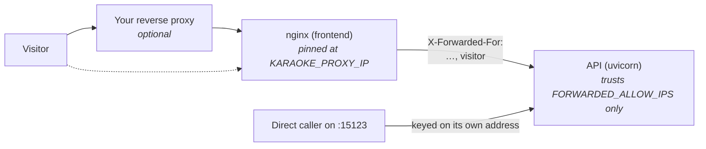

# Self-Hosting

Docker Compose runs the whole stack: the web app (nginx), the API, a Celery worker, Postgres and
Redis.

## What you need

- **Docker** with Compose v2.
- **A GPU is optional.** Without one, separation runs on the CPU: about 10–20 minutes per song.
  An NVIDIA GPU with the
  [NVIDIA Container Toolkit](https://docs.nvidia.com/datacenter/cloud-native/container-toolkit/install-guide.html)
  brings that down to a few minutes (see [Using an NVIDIA GPU](#using-an-nvidia-gpu)).
- **RAM:** the worker is capped at 12 GB (`CELERY_MEMORY_LIMIT`).
- **Disk:** about 20 MB per song (the original audio plus its separated stems), and a few GB for
  the images and model weights.
- **A screen for the stage:** any browser on a TV, laptop or projector. Guests use their own
  phones, with no app to install.

## Install

```bash
git clone https://github.com/spencerfrost/open-karaoke-studio.git
cd open-karaoke-studio
cp .env.example .env
```

Set these in `.env`:

| Variable | What to put |
|----------|-------------|
| `SECRET_KEY`, `JWT_SECRET_KEY` | Two different long random strings (`openssl rand -hex 32`) |
| `ADMIN_USERNAME`, `ADMIN_PASSWORD` | The first admin account (password at least 8 characters) |
| `CORS_ORIGINS` | The address you'll open the app at, e.g. `http://192.168.1.50:5192` |
| `POSTGRES_PASSWORD` | Optional. A password for the database instead of the default. Set it before the first start: Postgres keeps the password it was created with |

```bash
docker compose up -d
```

The first build downloads PyTorch and takes a while. On first start the API runs the database
migrations and creates the admin. Open `http://<server-ip>:5192` and sign in under
**Hosting tonight? Sign in**. Add more hosts on `/admin/users`.

The first song after a fresh install is slow: the worker downloads the separation models and
compiles them once. Both are cached in the `torch_cache` volume, so later songs are faster.

## Using an NVIDIA GPU

`docker-compose.gpu.yml` gives the worker one GPU. Install the NVIDIA Container Toolkit, then add
this line to `.env` so every `docker compose` command uses both files:

```bash
COMPOSE_FILE=docker-compose.yml:docker-compose.gpu.yml
```

Run `docker compose up -d` again to recreate the worker with the GPU, then check that it sees it:

```bash
docker compose exec celery python -c "import torch; print(torch.cuda.is_available())"
```

## Using it

1. Search for a song and add it. It downloads and separates in the background, with progress
   shown in the app.
2. Start a session and put the stage on the big screen.
3. Guests scan the QR code on the stage to join from their phones. They can queue songs and set
   their own vocal level.

The [features](/features) page lists everything a guest, host and admin can do.

## Ports

| Port | Service |
|------|---------|
| `5192` | Web app, which also proxies `/api` and `/ws` to the API |
| `15123` | API, published directly |
| `15432` | Postgres, on `127.0.0.1` only, for debugging and backups from the host |

Only `5192` needs to be reachable from guests' phones.

## Behind a reverse proxy

If you put your own reverse proxy in front of the app, add its address to `FORWARDED_ALLOW_IPS`
and its public URL to `CORS_ORIGINS`.

### Client IPs


Per-IP rate limits (login, session join, the [live demo](/demo-accounts)) need each visitor's real
address. In Docker, requests reach the API through the frontend's nginx, so the API has to read it
from `X-Forwarded-For`, and must only believe that header from nginx.



- `docker-compose.yml` gives `karaoke-network` a fixed subnet (`KARAOKE_SUBNET`, default
  `172.30.250.0/24`) and pins the frontend container to `KARAOKE_PROXY_IP` (default
  `172.30.250.10`). `FORWARDED_ALLOW_IPS` defaults to that one address. If the subnet clashes
  with another Docker network, set both in `.env`; the address must sit inside the subnet.
- nginx sends `$proxy_add_x_forwarded_for`: whatever the client sent, with the address nginx saw
  appended last. uvicorn reads the header right to left and trusts only nginx, so it takes that
  last entry and ignores anything a client wrote in front of it. This needs `uvicorn>=0.40.0`,
  which `backend/requirements.txt` requires.
- **Behind your own reverse proxy**, add its address to `FORWARDED_ALLOW_IPS` (comma-separated IPs
  or CIDRs), so uvicorn passes through it to the visitor's address. Never add a range that direct
  callers can come from.
- The API port `15123` is still published to the host. A caller that connects to it directly is
  keyed on its own address, since it isn't a trusted proxy.
- Changing the subnet needs `docker compose down` and then `up`: Docker doesn't change an existing
  network's subnet in place.

## Optional extras

All of these are described in `.env.example`:

- `DISCOGS_TOKEN`: artist images.
- `ACOUSTID_API_KEY`: audio fingerprinting, which helps match songs to the right metadata.
- YouTube cookies (`./secrets/yt-cookies.txt`): needed only for age-restricted videos. Use a
  throwaway Google account.
- `KARAOKE_SUBNET`, `KARAOKE_PROXY_IP`: the private Docker network, if the default clashes with
  another one (see [Client IPs](#client-ips)).
- `CELERY_CPU_LIMIT`, `CELERY_MEMORY_LIMIT`: the worker's CPU and memory ceiling.
- `VITE_DEMO_RECORDING_URL`, `VITE_DOCS_URL`: links for the entry page's **Watch the demo** button
  and the guided tour. Both are frontend build args, so rebuild the frontend image after changing
  them. See [Demo Accounts](/demo-accounts) for the live demo.

## Data and backups

Songs and stems are stored in `./karaoke_library`. The database is in the `postgres_data`
volume. Back up both. The library is useless without the database that indexes it.

## Updating

```bash
git pull
docker compose up -d --build
```

Migrations run automatically when the API container starts.
