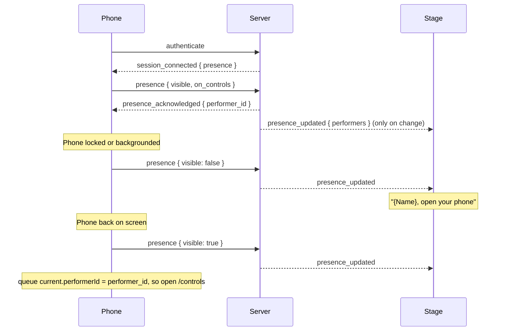

# WebSocket Protocol Documentation

This document describes the real-time communication layer for Open Karaoke Studio, using native FastAPI WebSocket endpoints.

## Overview

The application uses **exactly two WebSocket endpoints** for all real-time communication:

| Endpoint | Purpose | File (Backend) | File (Frontend) |
|----------|---------|----------------|-----------------|
| `/ws/jobs` | Global job status updates | `backend/app/ws/jobs.py` | `frontend/src/services/jobsWebSocketService.ts` |
| `/ws/session/{session_id}` | Session-scoped karaoke operations | `backend/app/ws/session_specific.py` | `frontend/src/services/sessionWebSocketService.ts` |

---

## Connection Flow

### Jobs WebSocket (`/ws/jobs`)

1. Client opens WebSocket connection
2. Client's first message is `{"type": "authenticate", "token": "…", "session_id": "…", "device_id": "…"}`.
   It needs either an account `token` or a session member's `session_id` + `device_id` (the
   `X-Session-ID` / `X-Device-ID` pair REST uses); a signed-in phone in a session sends both. Within
   10 seconds, or the socket is refused: `{"type": "auth_failed", "reason": "not_authenticated"}`,
   then close `1008`. Until it passes, the socket is in no room and receives nothing.
3. Server sends `{"type": "connected", "status": "connected"}`
4. Client sends `{"type": "subscribe_to_jobs"}`
5. Server responds with current jobs list: `{"type": "jobs_list", "jobs": [...]}`
6. Server broadcasts updates for: `job_created`, `job_updated`, `job_completed`, `job_failed`, `job_cancelled`

Every session's members share this feed, so it carries nothing that identifies a session: no
join codes and no user ids. A job says which session added it with an opaque `owner_tag`, and the
snapshot lists only jobs tied to a song (see [JobData](#jobdata-interface)).

The frontend client opens the socket once the browser holds an account or a session, and
reconnects whenever those change. After a `1008` it waits for new credentials instead of retrying.

### Session WebSocket (`/ws/session/{session_id}`)

1. Client opens the WebSocket (no query parameters)
2. Client's first message is `{"type": "authenticate", "device_id": "rest_…", "token": "…"}`.
   `device_id` is the member credential from `join-by-code` or session creation (the same value
   REST calls send as `X-Device-ID`); `token` is the account JWT and is only sent by browsers that
   hold one.
3. If the device isn't an active member of this live session — or no `authenticate` arrives within
   10 s — the server sends `{"type": "auth_failed", "reason": "not_a_member"}` and closes with
   1008. A wrong code and a wrong device get the same answer.
4. Otherwise the server sends `{"type": "session_connected", ...}` with `is_session_owner` (true
   only for the session owner's JWT), the current performance state and the session's
   [presence](#presence). A bad token is reported first as a non-fatal `auth_failed {reason}`.
5. Client sends initial messages to join rooms:
   - `{"type": "join_performance"}`
   - `{"type": "join_queue_room"}`
6. Client reports its presence: `{"type": "presence", "visible": true, "on_controls": false}`, and
   again on every visibility or route change. Each report is answered with
   `presence_acknowledged`.
7. Both host and performer receive real-time updates for their session

---

## Message Catalog

### `/ws/jobs` - Job Broadcasting

#### Server → Client Messages

| Type | Description | Payload |
|------|-------------|---------|
| `auth_failed` | The opening `authenticate` was refused; a `1008` close follows | `{ reason: "not_authenticated" }` |
| `connected` | Connection established | `{ status: "connected" }` |
| `subscribed` | Subscription confirmed | `{ status: "subscribed to job updates" }` |
| `jobs_list` | Initial/current jobs snapshot | `{ jobs: JobData[] }` |
| `job_created` | New job added to queue | `{ job: JobData }` |
| `job_updated` | Job progress update | `{ job: JobData }` |
| `job_completed` | Job finished successfully | `{ job: JobData }` |
| `job_failed` | Job encountered error | `{ job: JobData }` |
| `job_cancelled` | Job was cancelled | `{ job: JobData }` |
| `error` | Server error | `{ message: string }` |

#### Client → Server Messages

| Type | Description | Payload |
|------|-------------|---------|
| `authenticate` | Must be the first message | `{ token?: string, session_id?: string, device_id?: string }` |
| `subscribe_to_jobs` | Subscribe to updates | none |
| `unsubscribe_from_jobs` | Unsubscribe | none |
| `request_jobs_list` | Request current jobs | none |

#### JobData Interface

```typescript
interface JobData {
  id: string;
  filename: string;
  status: string;            // "pending", "downloading", "processing", "finalizing", "completed", "failed", "cancelled"
  step: "download" | "separate" | "align" | null;  // Pipeline step; while pending, the step it waits for
  progress: number;          // 0-100 percentage
  status_message?: string;   // Detail line, e.g. "Separating: Model 1/2"
  task_id?: string;          // Celery task ID
  song_id?: string;
  title?: string;
  artist?: string;
  created_at?: string;       // ISO timestamp
  started_at?: string;       // ISO timestamp
  completed_at?: string;     // ISO timestamp
  error?: string;            // Error message if failed
  engine_type?: string;      // Separation engine, or "lyrics_alignment"
  owner_tag: string | null;  // Opaque tag of the session that added it
}
```

- **`step`** is separate from `status`: `status` says whether the job is waiting, running or done,
  and `step` says which part of the pipeline it's on. Lyrics alignment runs as its own job, so its
  step is always `align`.
- **`owner_tag`** is an HMAC-SHA256 of the session ID keyed with `SECRET_KEY`, truncated to 16 hex
  characters (`backend/app/utils/owner_tag.py`). A device in the session gets the same value as
  `owner_tag` on its [session response](api/sessions.md) and compares the two. It can't be turned
  back into the join code. Jobs started outside a session have `null`.

---

### `/ws/session/{session_id}` - Session Operations

#### Server → Client Messages

##### Connection Events

| Type | Description | Payload |
|------|-------------|---------|
| `session_connected` | This connection was admitted (`device_id` is the per-socket id, not the member credential) | `{ session_id, device_id, is_session_owner, performance_state, presence: PerformerPresence[] }` |
| `auth_failed` | Opening `authenticate` rejected (`not_a_member`, then close 1008) or its token was bad (non-fatal) | `{ reason: string }` |
| `session_error` | Session error occurred | `{ error: string }` |
| `session_ended` | Session terminated | `{ reason: string }` |

##### Performance Control Events

| Type | Description | Payload |
|------|-------------|---------|
| `performance_state` | Current playback state | `{ state: PerformanceState }` |
| `control_updated` | Single control changed | `{ control: string, value: ControlValue }` |

##### Playback Events

| Type | Description | Payload |
|------|-------------|---------|
| `playback_play` | Song started playing | none |
| `playback_pause` | Song paused | none |
| `song_loaded` | Song loaded, ready to play | `{ state: PerformanceState }` |
| `song_ready` | Song fully ready | `{ state: PerformanceState }` |

##### Queue Events

| Type | Description | Payload |
|------|-------------|---------|
| `queue_joined` | Joined queue room | `{ room: string }` |
| `queue_updated` | Queue state changed | `{ current?, upcoming?, items?, trigger? }` |
| `pending_queue_updated` | Pending items changed | `{ pending: QueueItem[] }` |

##### Presence Events

| Type | Description | Payload |
|------|-------------|---------|
| `presence_acknowledged` | Reply to this device's own `presence` report: the roster seat it's linked to (`null` for the stage or a device that never gave a name) | `{ performer_id: number \| null }` |
| `presence_updated` | Broadcast to the session when any linked phone's presence changes, and when one disconnects | `{ performers: PerformerPresence[] }` |

##### UI Events (Broadcast to Session)

| Type | Description | Payload |
|------|-------------|---------|
| `toggle_fullscreen` | Fullscreen toggle requested | none |

#### Client → Server Messages

##### Connection & State

| Type | Description | Sender | Payload |
|------|-------------|--------|---------|
| `authenticate` | Must be the first message; see Connection Flow | All | `{ device_id: string, token?: string }` |
| `join_performance` | Subscribe to performance state | All | none |
| `join_queue_room` | Subscribe to queue updates | All | none |
| `request_queue_update` | Request current queue | All | none |
| `presence` | Whether this page is on screen and whether it's `/controls`; sent after `authenticate` and on every visibility or route change. A malformed one gets `permission_denied` with `reason: "Malformed presence report"` | All | `{ visible: boolean, on_controls: boolean }` |

##### Performance Controls

| Type | Description | Sender | Payload |
|------|-------------|--------|---------|
| `update_performance_control` | Change a mix/display control (`vocal_volume`, `backing_vocal_volume`, `instrumental_volume`, `lyrics_size`, `lyrics_offset`); any other `control` gets `permission_denied` | All | `{ control: string, value: ControlValue }` |

##### Playback Controls (Host Only)

| Type | Description | Sender | Payload |
|------|-------------|--------|---------|
| `update_player_state` | Update playback position | Host | `{ isPlaying?, currentTime?, duration? }` |
| `playback_play` | Start playback | Host | none |
| `playback_pause` | Pause playback | Host | none |
| `reset_player_state` | Reset playback | Host | none |
| `song_loaded` | Song loaded | Host | `{ songId, duration, currentTime?, isPlaying? }` |
| `song_ready` | Song ready to play | Host | `{ songId, duration, currentTime?, isPlaying?, isReady? }` |

##### Queue Management

| Type | Description | Sender | Payload |
|------|-------------|--------|---------|
| `toggle_fullscreen` | Request fullscreen toggle | Performer | none |

#### TypeScript Interfaces

```typescript
interface PerformanceState {
  vocal_volume: number;           // 0-1
  instrumental_volume: number;    // 0-1
  backing_vocal_volume: number;   // 0-1
  lyrics_size: "small" | "medium" | "large";
  lyrics_offset: number;          // seconds
  current_time: number;           // seconds
  duration: number;               // seconds
  is_playing: boolean;
  current_song_id?: string | null;
  is_ready?: boolean;
}

type ControlValue = number | string | boolean;

interface QueueItem {
  id: string;
  songId: string;
  singer: string;
  performerId?: number | null;  // Roster seat the song belongs to
  position: number;
  addedAt?: string;  // ISO timestamp
  song: {
    id: string;
    title: string;
    artist: string;
    album?: string;
    duration?: number;
    syncedLyrics?: string;
    plainLyrics?: string;
  };
}

interface PerformerPresence {
  performerId: number;  // Roster seat; only seats with a linked phone appear
  connected: boolean;   // At least one socket open
  visible: boolean;     // Some socket's page is on screen
  onControls: boolean;  // Some on-screen socket is on /controls
}
```

---

## Presence

Presence tells the stage whether the current singer's phone is open, so it can ask them to take it
out, and tells each phone which roster seat it is, so it can open `/controls` when its own song
starts.



- **Held in memory** in the connection manager, keyed session → device → socket
  (`SessionConnectionManager.presence`). A device with several sockets counts as visible if any of
  them is. A socket can only report for the device it authenticated as, and its entry is dropped
  when it closes, or when the session ends.
- **Broadcast by performer, never by device.** Session device ids are the credential behind
  `X-Device-ID`, so `presence_updated` names roster seats (`performerId`). Seats without a linked
  phone (a walk-up the host typed in) are left out.
- **Only on change.** A report that doesn't change the device's summary is acknowledged but not
  broadcast.

---

## Permission Matrix

| Action | Host | Performer |
|--------|------|-----------|
| `update_performance_control` | ✅ | ✅ |
| `update_player_state` | ✅ | ❌ |
| `playback_play` | ✅ | ❌ |
| `playback_pause` | ✅ | ❌ |
| `song_loaded` | ✅ | ❌ |
| `song_ready` | ✅ | ❌ |
| `reset_player_state` | ✅ | ❌ |
| `join_performance` | ✅ | ✅ |
| `join_queue_room` | ✅ | ✅ |
| `request_queue_update` | ✅ | ✅ |
| `presence` | ✅ | ✅ |
| `toggle_fullscreen` | ✅ | ✅ |

---

## Room Structure

### Jobs Room
- **Room ID**: `jobs_updates`
- **Scope**: Global (all connected clients)
- **Purpose**: Broadcast job status changes to all sessions

### Session Room
- **Room ID**: `session_{session_id}`
- **Scope**: Per-session
- **Purpose**: Isolate session state from other sessions

---

## Error Handling

### Connection Errors

| Code | Meaning |
|------|---------|
| 1000 | Normal closure (client-initiated disconnect) |
| 1008 | Not a member of this live session (bad code, bad or inactive device, or no `authenticate`). The client does not reconnect. |

### Client Behavior

- **Reconnect on disconnect**: Clients should attempt to reconnect with exponential backoff (max 30s)
- **Session recovery**: On reconnect, clients re-send `join_performance` and `join_queue_room`
- **Grace period**: When the host's last open device disconnects, a 30-second grace period starts before session termination

---

## Implementation Notes

### Backend

- **Logging**: Use Python `logging` module (not `print()`)
- **State isolation**: All session state keyed by `session_id` in `session_performance_states` dict
- **Persistence**: Player state persisted to `SessionPlaybackState` table on each update

### Frontend

- **Logging**: Use `createLogger("websocket:...")` from `@/lib/logger`
- **Cleanup**: WebSocket cleanup stored in module-private array, not global `window` object
- **Type safety**: Full TypeScript interfaces for all message types

---

## Debugging Tips

1. **Check connection state**: Use `isConnectionActive()` method
2. **Log message flow**: Enable debug logging for `websocket:session` or `websocket:jobs` namespaces
3. **Monitor room membership**: Use `manager.rooms` to see connected clients per room
4. **Session state**: Inspect `session_performance_states[session_id]` for current state
